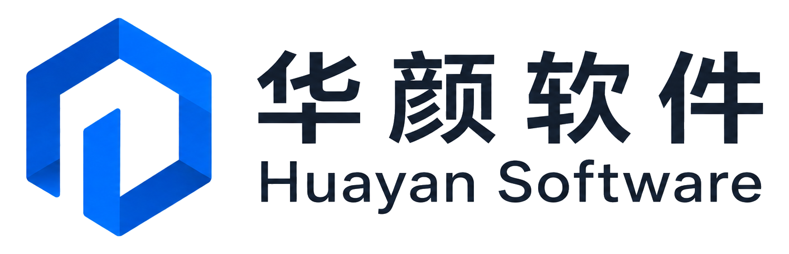

<p align="center">
  
</p>

<h1 align="center">HyRemote</h1>

<p align="center"><strong>Qt 远程访问框架</strong><br>为现有 Qt Widgets 和 Qt Quick 应用接入远程查看及可选远程输入，无需将应用改造成独立远程桌面程序。</p>

<p align="center"><strong>简体中文</strong> ｜ <a href="README.en.md">English</a></p>

<p align="center">
  <a href="LICENSE"></a>
  
  
  
  
</p>

> **平台验证范围：** Windows x86_64 是当前必须完成真实构建、运行和发行资格验证的平台。Linux 桌面、ARM64/嵌入式 Linux、Wayland/EGLFS 仍为用户目标环境验证待完成；Qt 代码可移植或能够交叉编译，不代表该环境已经受支持，也不阻塞 Windows 版本。实际支持范围以[兼容性矩阵](docs/compatibility.md)和对应发行说明为准。

## 从这里开始

按以下顺序即可完成首次接入，无需先阅读内部架构文档。

1. **获取并安装 HyRemote**：下载正式发行源码，或在本地执行 `build.cmd install`；参见[安装指南](docs/guide/install.md)。
2. **接入 Qt 项目**：按照[项目接入完整指南](docs/guide/integrate-your-project.md)，从获取、配置、构建、部署到运行逐步完成。
3. **连接查看器**：按照[查看器连接指南](docs/guide/viewer-connection.md)，了解 LAN 连接、默认行为、重连和停止。

两个真实开源集成示例（Widgets/C++ 与 Qt Quick/QML）位于 [`examples/real-world/`](examples/real-world/)。

## 四种并列接入方式

HyRemote 提供一个共享 Runtime 和四种并列接入方式。应用根据自身结构选择接入方式；Widgets 与 Qt Quick 是 Runtime 的目标界面类型，不是不同产品。

| 接入方式 | 应用侧改动 | 适用场景 |
| --- | --- | --- |
| **C++ API** | 链接 `HyRemote::RemoteAccess` | 需要显式管理 Runtime 生命周期和策略的应用 |
| **Generic Plugin** | 应用不链接 HyRemote target | 希望零代码接入，同时保留应用原生 Qt 平台插件的应用 |
| **QML API** | `import HyRemote` | 使用 Qt Quick、偏好声明式配置的应用 |
| **QPA** | 使用 `-platform hyremote` 启动 | 需要零代码平台入口且满足精确 Qt private ABI 条件的场景 |

四种方式没有主次关系，均遵循同一流程：[获取 → 接入 → 部署 → 运行 → 连接](docs/guide/integrate-your-project.md)。所有前端最终汇入同一套 Runtime/Core，不会因接入方式不同而产生第二套 Session、采集、传输或输入实现。

## 快速接入

### C++ API

```cmake
find_package(Qt6 6.8 REQUIRED COMPONENTS Widgets)
find_package(HyRemote CONFIG REQUIRED)

target_link_libraries(MyApp PRIVATE
    Qt6::Widgets
    HyRemote::RemoteAccess
)
```

```cpp
#include <HyRemote/RemoteAccess.h>

HyRemote::RemoteAccess remote(&window);
remote.start();
```

构造对象不会自动启动 listener。默认监听地址为 `0.0.0.0:5921`（主机所有 IPv4 接口），远程输入默认关闭。

部署应用及 HyRemote Runtime：

```cmake
install(TARGETS MyApp RUNTIME DESTINATION bin)
hyremote_deploy(TARGET MyApp)
```

同一个公开入口可用于已支持的 `QWidget` 和 `QQuickWindow` 目标。

### Generic Plugin

Generic Plugin 保留应用原有 Qt 平台插件（例如 `qwindows`、`qxcb`），应用本身不链接 HyRemote 构建目标：

```cmake
target_link_libraries(MyExistingApp PRIVATE Qt6::Widgets)

find_package(HyRemote CONFIG REQUIRED)
install(TARGETS MyExistingApp RUNTIME DESTINATION bin)
hyremote_deploy(TARGET MyExistingApp GENERIC)
```

显式启用：

```text
MyExistingApp -plugin hyremote
```

Generic Plugin 不是 QPA 替代品；本地窗口、显示、输入和 GPU 集成仍由应用原生 Qt 平台负责。参见 [Generic 接入指南](docs/getting-started/generic.md)。

### QML API

```qml
import HyRemote

RemoteAccess {
    target: mainWindow
    enabled: true
}
```

通过部署辅助函数安装 QML 组件：

```cmake
hyremote_deploy(TARGET MyQmlApp QML)
```

QML 类型是同一共享 Runtime 的轻量声明式前端。参见 [QML 接入指南](docs/getting-started/qml.md)。

### QPA

```cmake
find_package(HyRemote CONFIG REQUIRED)
install(TARGETS ExistingQtApp RUNTIME DESTINATION bin)
hyremote_deploy(TARGET ExistingQtApp QPA)
```

```text
ExistingQtApp -platform hyremote
```

QPA 使用 Factory Trampoline，并委托给经过资格验证的原生 Qt 平台实现，不以 offscreen/qvnc 类后端替代本地平台。QPA 依赖 Qt private ABI，必须按精确 Qt 补丁版本和平台组合验证；当前参考版本为 Qt 6.8.3。参见 [QPA 接入指南](docs/getting-started/qpa-proxy.md)。

## 产品架构与源码布局

```text
C++ API ─────┐
QML API ─────┤
Generic ─────┼──> Shared Runtime ──> Core ──> RFB transport ──> Viewer
QPA ─────────┘          │
                        └── Widgets / Qt Quick target adapters
```

源码所有权与产品结构一致：

```text
src/
├── core/
├── runtime/
└── integrations/
    ├── cpp/
    ├── qml/
    ├── generic/
    └── qpa/
```

`HyRemote::RemoteAccess` / `HyRemoteRemoteAccess` 是共享 Runtime 的常规交付构件。Core 保持内部实现；QML、Generic 和 QPA 是建立在该 Runtime 之上的接入组件。

## 构建与安装

仓库统一使用 `build.cmd` 和 `build.yml`。`build.cmd` 是唯一构建入口：

- `build.cmd build`：按配置执行配置和编译；
- `build.cmd install`：将用户/SDK 消费者所需内容安装到 `build/install/`；
- `build.cmd test`：构建并执行测试；
- `build.cmd clean`：清理构建目录；
- `build.cmd rebuild`：清理后重新构建。

`build/` 是开发中间产物；`build/install/` 才是用户和 SDK 消费者使用的安装树。四种接入方式独立选择，启用其中一种不会自动启用其它方式。

```text
PowerShell: .\build.cmd build
POSIX:      sh ./build.cmd build
PowerShell: .\build.cmd test
POSIX:      sh ./build.cmd test
PowerShell: .\build.cmd install
POSIX:      sh ./build.cmd install
```

`--integrations`、`--qt-prefix` 和 `--toolchain` 是本次命令的临时覆盖项。持久平台配置写入 `build.yml`；构建另一目标时可复制配置文件并通过 `--config` 显式选择。

Qt 6.8.3 是当前参考版本。交叉构建必须使用为目标架构构建的 Qt 6.8.3，不能误用主机 Qt。ARM64/嵌入式 Linux 在取得目标板运行证据前仅属于构建验证路径。

SDK 消费者应使用 `find_package(HyRemote CONFIG REQUIRED)` 和 `hyremote_deploy()`，不要手工复制内部库或插件。

## 安全边界

当前安全行为必须如实理解：

- 默认监听 `0.0.0.0:5921`，覆盖主机所有 IPv4 接口；
- 远程输入默认关闭；
- 默认 `Insecure` 未认证、未加密，只适用于可信局域网，不适合直接暴露到公网；
- `Authenticated` 只有在构建包含对应传输安全能力且配置有效安全描述文件时才可用；当前提供 VNC 认证，但仍不加密传输；
- `AuthenticatedEncrypted` 尚未实现，选择后会失败关闭，不会降级到较弱配置。

不要将当前产品直接暴露到公网。查看和控制是两个独立策略；只读不等于认证，也不等于加密。详细说明见[安全边界](docs/security.md)。

## 版本与兼容范围

当前最新正式发行版本为 [`V0.3.5.1`](docs/releases/v0.3.5.1.md)，发行形式为源码发行；该发行说明不承诺提供二进制附件。开发分支上的变更不等于已发布产品，只有经过受保护发行流程并形成正式标签的版本才可作为发布事实。

当前支持单元和未验证平台请以[兼容性矩阵](docs/compatibility.md)为准。简要边界：Windows x86_64 / Qt 6.8.3 是当前主要资格环境，四种接入方式均有对应证据；Qt 5.15.2 仅保留 C++/Widgets Limited 路径。Linux、ARM64、嵌入式 Linux、Wayland 和 EGLFS 不因 Qt 可移植性而自动成为 Supported。

## 文档

- [安装指南](docs/guide/install.md)
- [Qt 项目完整接入指南](docs/guide/integrate-your-project.md)
- [部署指南](docs/guide/deployment.md)
- [查看器连接指南](docs/guide/viewer-connection.md)
- [故障排查](docs/guide/troubleshooting.md)
- [C++ API 接入](docs/getting-started/cpp.md)
- [Generic Plugin 接入](docs/getting-started/generic.md)
- [QML API 接入](docs/getting-started/qml.md)
- [QPA 接入](docs/getting-started/qpa-proxy.md)
- [兼容性矩阵](docs/compatibility.md)
- [已知限制](docs/known-limitations.md)
- [安全边界](docs/security.md)
- [文档目录](docs/README.md)
- [仓库目录与模块职责（维护者参考）](docs/internal/repository-layout.md)

## 许可证

HyRemote 使用 **Apache License 2.0**。详见 [`LICENSE`](LICENSE) 和 [`NOTICE.md`](NOTICE.md)。
