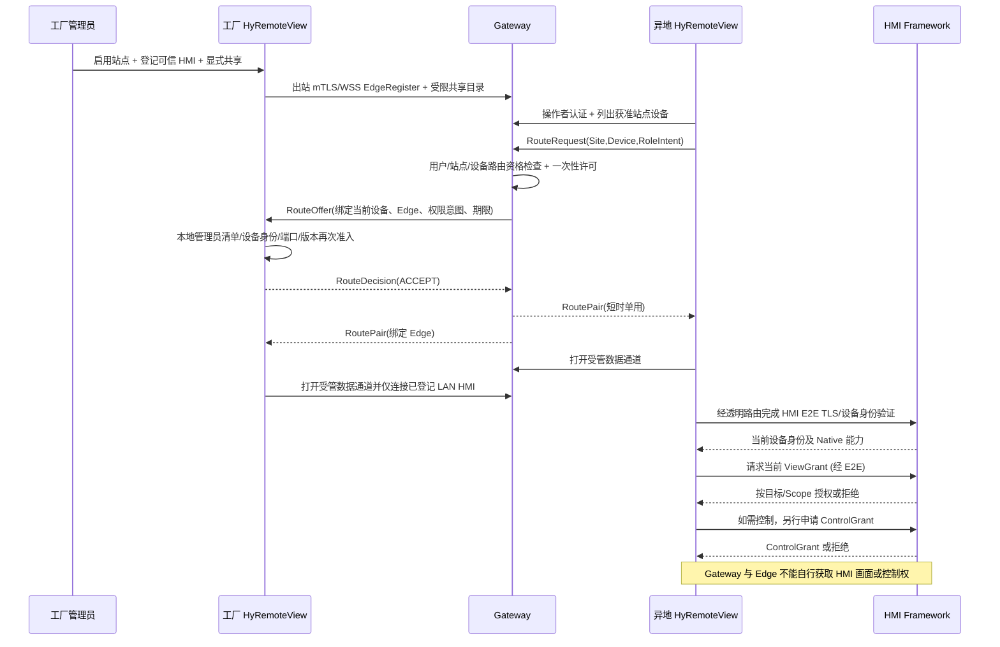

# V15/V8 模块详细设计 02｜受管连接协议、身份与会话状态机（设计候选）

> #830；必须与《01 模块契约》和《03 安全/验收》共同阅读。**这不是 Native 1.0 的新 wire 规范**，也不是已批准的 Gateway 控制协议版本；所有消息名、上限、返回码都是便于 PoC/威胁验证的候选，待 G3/G4 接口冻结后才能作为实现规范。

## 1. 分层和安全关系

```text
 [异地 HyRemoteView]                                 [Gateway]                     [工厂 HyRemoteView Edge]                 [HMI Framework]
 ┌──────────────────┐    WSS/TLS1.3（身份/路由）    ┌──────────────────┐         WSS/TLS1.3（Edge mTLS）     ┌─────────────────┐
 │ 受管准入客户端    │<-------------------------->│ Identity/Broker  │<------------------------------>│ EdgeSiteManager │
 │ ManagedSession   │                            │                  │                               │ Router + ACL    │
 └────────┬─────────┘                            │ OpaqueRelay      │                               └────────┬────────┘
          │       不解析内容的有界隧道             └──────────────────┘    不解析内容的有界隧道          │ LAN TCP 指定端点
          └──────────────────────────────────────────────────────────────────────────────────────────┼─────────>│ Native/TLS
                                                                                                    │          │ 设备端授权
                                                                                                    │          └───────────────
                              E2E 设备身份与内容保护（View ↔ HMI；Gateway / Edge 均不终止该设备安全会话）
```

网关与边缘间 TLS 保护其各自公网链路，**不等同于 HMI 的端到端身份/内容保护**。Managed 端到端安全级别的最低准入条件是：异地 View 透过透明 Relay **独立完成对 HMI 身份材料的验证、独立的设备协议身份认证和 View/Control 授权**，Gateway/Edge 不拥有设备明文会话密钥。此能力当前未交付，禁止把已发布明文 RFB 通过 TLS 中继包装成满足 V15/V8 的 Native E2E。

**受管协议选择预案：** Control 平面采用 TLS 1.3 + WebSocket(`wss`) over TCP 443 的**优先研究基线**，Route 数据通道按独立 TCP/TLS/WSS 建立，Gateway 无需解析 RFB/Native；工厂代理、出站策略以及反向代理 WebSocket idle 特性需实际验证。HTTP/2 Extended CONNECT 为比较选项；QUIC 非必需，不能让工业现场必须开 UDP。可用官方 Qt 6.8 网络接口但实现/许可待 PoC 审查。

## 2. 身份、凭据和信任

| 信任主体 | 证明内容 | 策略判断归属 | 禁止等同 |
| --- | --- | --- | --- |
| `OperatorId` | Gateway 用户身份，原生客户端拟 OIDC Authorization Code + PKCE 或明确的本地认证模式 | Gateway 用户/站点准入 | 设备端 ViewGrant |
| `TenantId/SiteId` | 企业和站点的归属、会员资格、共享策略 | Gateway Control + 客户管理员 | IP 网段/地理位置 |
| `EdgeInstanceId` | 工厂 HyRemoteView 现场实例密钥/受信证书，建议 mTLS 对 Gateway | Gateway / Edge 本机密钥库 | 本地 PC 主机名 |
| `DeviceId` | HMI 自己的加密身份材料，交付/现场可信核验 | 异地 Viewer E2E 验证；工厂共享登记 | HMI 显示名称或 IP |
| `RouteId` | 一次性租约，只授予给指定的两条受管网络连接 | Gateway Broker + Edge Admission | HMI SessionId、ControlGrant |
| `DeviceSessionId` / Grants | HMI 设备端按当前用户/Scope 颁发的查看与控制权限 | HMI Framework | Gateway 在线、Route 成功 |

**设备登记建议流程：**
1. 客户管理员在工厂 HyRemoteView 中明确选择一台 HMI，网络寻址可以来自用户填入或已核验的本地档案，但不可对网段自动扫描后全量共享。
2. 工厂 HyRemoteView 发起一次**只用于登记的可信设备身份核验**，用户应能通过可靠的交付凭据/设备指纹与物理设备确认。仅拿到 RFB banner、VNC 密码或 IP 地址不能称为设备身份验证。
3. 本地保存 `DeviceId ↔ 允许的 LAN 端点 ↔ 可信 HMI 身份材料` 和配置修订；管理员只对具体设备点“共享”，默认关闭、可单独撤权。
4. Gateway 只接受 `SiteId+EdgeInstanceId+DeviceId` 及允许被获准查看的元数据，不获得任意 LAN 端口拨号能力。
5. HMI 更换证书、设备身份变更、IP/DNS 改变时必须重新核验；如地址变更后没有可靠身份绑定，受管 Route 拒绝。

**操作员身份候选：** 原生 Viewer 与 Gateway 使用系统浏览器的 OIDC Authorization Code + PKCE (S256)，Client 不携带固定密钥；令牌短时保留、优先使用 OS secret store，刷新令牌按协议采用旋转或发送者约束。离线 Direct 不触发企业 OIDC 依赖。自托管 Gateway 可适配客户可信身份源但不得让 Edge 直接接受未经验证的用户名字符串。

## 3. Gateway Control 消息契约（候选 v0）

所有控制消息都必须有规范化 envelope：

```json
{
  "protocol": "hyr-gateway-control",
  "version": 0,
  "type": "RouteRequest",
  "messageId": "opaque-id",
  "correlationId": "opaque-id-or-null",
  "sentAt": "UTC-timestamp",
  "payload": {}
}
```

**设计约束：** `version=0` 是研究占位符，不等于正式发布协议版本；每条消息具有固定最大长度、字段类型、版本和允许状态白名单；未知强制字段或长度越界应拒绝，不把 `payload` 透传为任意 JSON 命令。未知非强制扩展允许显式兼容策略，但未知权限位不得忽略后提升权限。序列化格式 JSON、CBOR、Protobuf 的比较留待 PoC（当前示例仅为易读表示）。

| 消息（拟） | 发送 → 接收 | 必填语义 | 被允许的状态/拒绝 |
| --- | --- | --- | --- |
| `EdgeRegister` | 工厂 View → Gateway | Edge 设备身份、Site、客户端版本、capability 摘要、配置修订 | 已完成 TLS/实例证明；未登记拒绝 |
| `Presence` | Edge → Gateway | Site/Edge、更新版本、时效性、共享设备个数（不暴露未共享设备） | 不得将该消息当成设备在线/Grant |
| `DeviceShareUpdate` | Edge → Gateway | 注册 HMI 的稳定 DeviceId、共享有效性、revision | 只允许本地客户管理员已批准范围 |
| `ListSites/Devices` | 异地 View → Gateway | Operator 当前租户、可见站点/设备集合 | 服务端逐条应用 ACL；不能一次返回整个租户库 |
| `RouteRequest` | 异地 View → Gateway | Operator/Site/Device、protocol、intent、请求幂等 ID | Gateway 仅判站点/设备目录准入 |
| `RouteOffer` | Gateway → Edge | RouteId、Site/Device/Operator、protocol、intent、有效期、nonce、配置修订、proof | Edge 强制再次核对本地共享清单与 DeviceId |
| `RouteDecision` | Edge → Gateway | RouteId、ACCEPT/DENY、规范拒绝码、当前 revision | 必须原子决定，不能半成功 |
| `RoutePair` | Gateway → 双端 | 单用通道配对凭据、RouteId、期限、endpoint/edge binding | 只能一次消费、只配对应路由两端 |
| `RouteClose` | 双端 / Gateway → 相关方 | RouteId、原因、关闭 epoch/nonce、相关状态 | 幂等，重试不得恢复旧控制 |
| `RevokeShare` | 工厂 View → Gateway | Site/Device、newRevision、单调生效序列 | 本地撤权先于 Gateway 传播，云断线仍必须本地拒绝 |

路由 token 必须绑定 `tenantId+siteId+edgeId+deviceId+operatorId+routeId+protocol+roleIntent+audience+expiry+nonce`；Gateway 必须原子防重放（例如一次性消费账本及 TTL）。Edge 不得仅凭“签名有效”放行：还需当前本地 ACL、设备登记及当前 `configRevision` 复核。无法访问有效身份/撤销事实时应 **fail closed**。

`roleIntent` 只表达希望只读/希望控制的**请求意图**；不能给出设备端 ControlGrant。HMI 的设备协议/会话状态不在这个消息格式里维护。

## 4. 数据通道配对与有界透明转发

1. Gateway 只对一次性 `RoutePair` 绑定的 **一个异地端 + 一个 Edge 端**创建对应有界数据通道；使用各自已认证连接和 RouteId 校验；第三个 endpoint 必须拒绝。
2. Edge 拿到已通过 RouteAdmission 的设备记录后，根据**已批准的固定端点**向 HMI 建立 LAN 连接。来自异地 View、Gateway 的任何字符串都不能被当成自由选择的 Host/port/DNS 解析指令。
3. Edge 将数据通道与该指定 LAN socket 做**按序字节流透传**。如果请求的 DeviceId 与 E2E HMI 证书/指纹不一致，异地端必须在发送授权输入前断开；Edge/Gateway 不宣称知道明文设备会话内容。
4. Gateway/Edge 负责流量/连接层限额和背压。**不得任意删掉已加密字节**，不得通过 frame skipping 破坏增量画面基准；若缓冲拥塞，暂停读取并在有界超时后关闭 Route。只有 HMI 协议端可在编码加密前合并/跳过过时画面。
5. **任何一端**拒绝、撤销、断网或超时应触发幂等关闭；要保障会话取消最终到达 HMI Socket 关闭/安全清理路径；不可因为连接断开/恢复继续发送之前排队的键鼠和业务操作。
6. Gateway 数据通道不允许未授权的 WebSocket-to-TCP 透明代理业务模式；承载的所有字节必须有前置 RoutePermit 和 ACL 钩子。

### 4.1 Byte Stream 的结构与界限

Gateway 外层通道不得要求数据面解析 Native 消息；WebSocket 等分帧只是承载层容器，不允许“一个 WebSocket message = 一个 Native frame”的假设。每个方向维持 TCP 字节序，若分帧、重新分包或分批发送，必须保持原始字节次序和完整性。

受管 Route 严格区分：
- 控制消息：有 envelope，带签名/身份/限额、不可缓存任意到以后执行；
- 数据字节：opaque，只与先前批准的 RouteId 关联，不携带 LAN 目的地址。

**不允许 TLS 0-RTT** 携带登录、RouteRequest、权限撤销、设备输入或其他有副作用的控制消息：TLS 1.3 早期数据可能被重放（RFC 8446）。即便使用普通 1-RTT，应用层仍要实现一次性凭据消费和幂等拒绝。

## 5. 会话建立完整时序（产品可观察）



这条时序是 **目标技术合同**；目前 HMI Native TLS 与 HyRemoteView 正式客户端不具备，因而 **E2E_RUN=NOT_RUN**。PoC 第一阶段可以用确定性假设备安全端点验证隧道配对，但不能据此宣布真实 HMI Managed Access PASS。

## 6. 拒绝码、状态和恢复

| 错误/状态（候选） | 唯一含义 | 客户端允许的动作 |
| --- | --- | --- |
| `SITE_NOT_ENROLLED` | 工厂 View 未完成站点信任 | 管理员现场重新登记，不直接重试公网 |
| `EDGE_OFFLINE` | 工厂 View 没有有效出站可信控制链接 | 诊断网络/后台运行状态 |
| `DEVICE_NOT_SHARED` | HMI 未在当前批准清单或已撤销 | 站点管理员重新审批；不尝试其他 IP |
| `DEVICE_ID_MISMATCH` | 当前 E2E HMI 身份与登记不符 | **阻止所有输入**，要求可信重新登记 |
| `SITE_ACCESS_DENIED` | 操作者不具站点许可 | 禁止列举其他设备来探测 |
| `ROUTE_TOKEN_EXPIRED/REPLAYED` | 许可已过期/被消费 | 新建会话，绝不恢复旧 Route |
| `ROUTE_PAIR_CONFLICT` | 配对第三方、错误 Edge/Operator | 安全关闭并产生审计事件 |
| `DEVICE_VIEW_DENIED` | HMI 独立拒绝画面权限 | UI 不显示旧缓存为实时画面 |
| `DEVICE_CONTROL_DENIED` | HMI 独立拒绝控制 | 继续只读时也不得发送输入 |
| `ROUTE_BACKPRESSURE` | 透明通道积压超限 | 关闭本 Route；不任意删加密数据 |
| `GW_UNAVAILABLE` | Gateway 网络不可用/服务错误 | Direct 独立运行，不静默安全降级 |
| `SECURE_PROTOCOL_UNAVAILABLE` | HMI/Viewer 缺少合格 E2E 设备协议 | Managed 模式失败关闭，不能自动用明文 RFB |

四个布尔状态不可合并：`SiteOnline`、`DeviceReachable`、`RoutePaired`、`HmiGrantValid`；第五个 `RemoteDisplayFresh` 是客户端实际帧龄的当前测量状态，不由 Gateway 心跳派生。只有全部相应条件成立且画面最近确实更新，才能标“当前远程实时画面”；否则区分离线、未授权、缓存过期等。

**恢复规则：** 网络恢复仅恢复 Site/Edge 认证和新 Route 请求资格；旧 RouteId、旧 Grant、旧输入/剪贴板/业务命令绝不自动重放。仅设备当前状态重新核验后发起新的读取。某 HMI 撤权不能关闭其他仍授权 HMI 的 Direct 会话。

## 7. G3/G4 需关闭的技术未知项

| 待验证问题 | 设计依赖 | 可证伪实验 |
| --- | --- | --- |
| 现有 Native TLS 是否能够跨透明 relay 实现 HMI E2E | HMI Runtime / HyRemoteView secure session | 独立硬件/确定性 fixture：Gateway/Edge 没有设备密钥仍可字节转发，伪造 HMI 证书必败 |
| 使用 WSS/443 经工业 HTTP Proxy | GatewayLink | 经明确企业代理的可用性、保持/重连、TLS 验证和超时实验；失败不弱化安全 |
| Edge 受控端点绑定不会成为 LAN 代理 | 登记/ACL/RouteAdmission | 非白名单 IP、端口、DNS rebinding、替换设备身份的负向测试 |
| 同产品后台运行可支持哪些登录/注销状态 | View Packaging | Windows 退出窗口、托盘、注销、重启、升级及凭据不可用场景；不能假在线 |
| 1:1 数据流正确性与压力 | GatewayRelay/EdgeRouter | 大消息分帧、乱序模拟、慢端/取消/重复配对、内存及 TCP 顺序断言 |
| 已有 RFB 是否能受管访问 | HMI SecureEndpoint / 第三方 Viewer | 只在拥有等效 E2E 安全资格后宣布，不能靠 Gateway TLS 自动获得 |

## 8. 参考标准（技术研究来源，不替代 V15/V8）

- TLS 1.3、0-RTT replay caveat：[RFC 8446](https://www.rfc-editor.org/rfc/rfc8446)。
- WebSocket 分帧/控制和二进制流：[RFC 6455](https://www.rfc-editor.org/rfc/rfc6455)。
- OAuth 原生客户端授权码/PKCE 与 Token replay：[RFC 9700](https://www.rfc-editor.org/rfc/rfc9700)。
- 长寿命 WebSocket 身份重查、长度/日志限制：[OWASP WebSocket Security Cheat Sheet](https://cheatsheetseries.owasp.org/cheatsheets/WebSocket_Security_Cheat_Sheet.html)。
- Qt 6.8 客户端 TLS 错误不可忽略：[QWebSocket 文档](https://doc.qt.io/qt-6.8/qwebsocket.html)。
