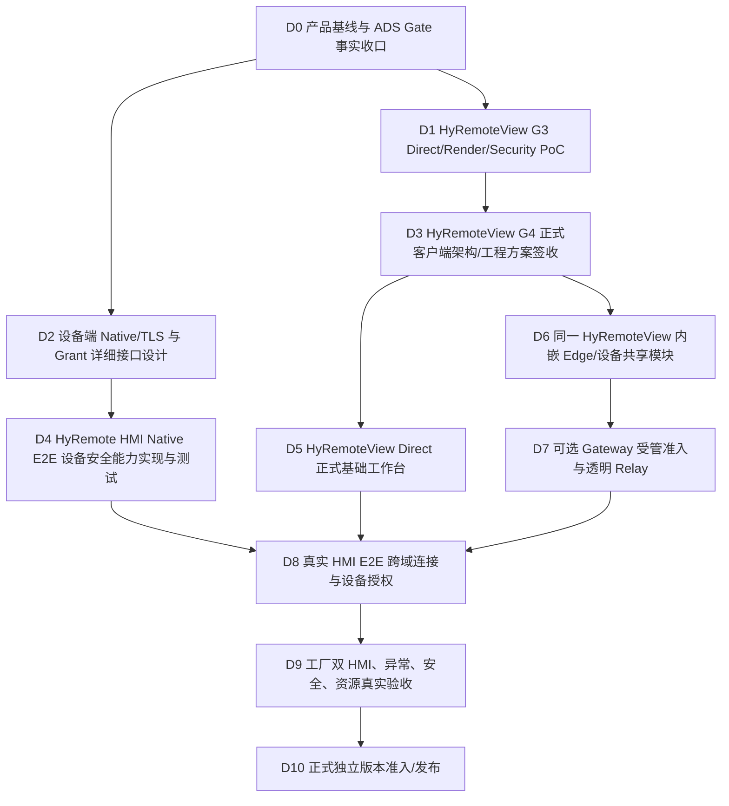

# V15/V8 模块详细设计 04｜研发工作分解、依赖顺序和阶段准入

> #830，**设计阶段的实施规划**，不是要求立刻执行代码的 ADS 订单。Human 已批准的是 V15/V8 产品与总体架构；G3 PoC、设备 Native TLS、站点平台安全、Gateway 实机与正式功能研发均尚需按证据逐项准入。任何未来版本号/发布时间都须服从已有独立发布权威 #95/#594/#190，**本文件不激活 V1.1.0.0，也不修改当前 V0.3.5.0 候选**。

## 1. 当下工程事实：不可将计划误记成能力

- **HyRemoteView：** `skawu/HyRemoteView@main` 只有 G3 `poc/core-remote` 初始骨架；`poc/g3-core-remote` 曾有部分 Windows RFB PoC 证据，但在 #11 ADS 前置治理生效后被冻结，不能视为正式客户端。HyRemoteView #5 的 G3 Gate 未通过，#10 禁止 G3 随意引入 GitHub Actions Workflow。
- **ADS 前置门禁：** HyRemoteView #11 规定 ADS adoption/profile/事实读取/Claim/result PASS 前禁止 G3 代码开发。2026-11-04 核查原 `skawu/ADS` API 返回 **Moved Permanently**；目前指向私有 `skawu/HyAgent`，其 README 说明仅处于产品业务设计，尚不是可以直接假定为已交付的 ADS Core/Project Profile 执行器。**因此 #11 必须先澄清事实源与可用的真实 ADS 核心，并取得实际 adoption 证据；不得虚报 PASS，也不得自行临时造第二套任务调度系统。**
- **HyRemote：** 现有 `docs/security.md` 明确当前 RFB `Insecure` 不加密、条件 VNC Auth Type2 仍不加密，`AuthenticatedEncrypted` 不可用；Native 1.0 TLS、Session Grant 均是 V8 目标设计，而非当前已交付功能。Core/Runtime 性能 P1 #609 尚未解决。
- **Gateway：** 没有已批准的可部署受管 Gateway 源码/部署/公网安全验收结论。旧 #190 原独立 sidecar 部署假设已被 V15/V8 取代，#190 仍为 evidence-gated POST-GA CONDTIONAL。

## 2. 并行设计、串行实施的依赖图



注意：**D2 技术设计可与 D1 PoC 并行**；D4 产品实现需先获得其本身设备端实现设计 Gate，绝不能因技术设计完成就跨越受控发布/安全审查。D6/D7 可在不对公网宣称可用的实验网络中完成独立模块测试，但 **D8 之前不得用现实明文 RFB 出厂/公网演示为安全产品**。

## 3. 工作包与验收定义（最少可执行垂直切片）

| Work ID | 目标成果（不是按现有代码拆功能） | 前置准入 | 责任代码库与 Owner | 可观察验收/失败条件 |
| --- | --- | --- | --- | --- |
| D0 | 真实 ADS 采用源、HyRemoteView profile/事实与 Gate 读回，旧 #11 的执行真相 | 当前批准 V15/V8；ADS source 实证 | HyRemoteView / Owner；参考 `skawu/HyAgent` | ADS Core 确实存在、adoption/Claim/read-back/结果证据 PASS，或明确 BLOCKED；无伪 Ready |
| D1 | Direct 最小完整证据：RFB correctness、Qt Quick RemoteSurface、带宽与加密通道可行性 | D0；#5/#6/#7/#8/#9 原 PoC gate | HyRemoteView / Local proof owner | 同 SHA Windows/Linux 实际 PoC 证据；G3 通过才入 G4；失败时保留已完成单项 |
| D2 | HMI Native/TLS 安全终端、设备身份和 ViewGrant/ControlGrant 与 V8 wire 附录匹配设计 | V15/V8、ADR/Native 安全规格审查 | HyRemote / Cloud Owner | 字段/证书与设备身份、独立授权、重连和旧输入安全、Native/RFB 不互依 |
| D3 | 正式 Viewer 的 G4 工程架构：协议库、渲染、设备工作区、设备信任、安装/更新与工程门禁 | D1 G3 PASS；#11 PASS | HyRemoteView / Cloud Owner | 模块接口、构建入口、测试分层、责任/WBS 准入完全确定；Human 要求的重大产品变更单独批 |
| D4 | 在 HMI Framework 实现并证明设备端独立 Native/TLS E2E、Grant/Privacy | D2 技术方案与风险 Gate 通过、#246/Native API 真正允许 | HyRemote / Device Owner | 冒充证书、无 Grant、撤权、跨协议输入、损坏包、断线重试均按设备端拒绝；RFB Direct 不回退 |
| D5 | HyRemoteView Direct 可用客户端（无云） | D3 G4 PASS | HyRemoteView / Product Dev Owner | 用户在 LAN 找到/验证 HMI、实时显示与输入；不依赖 Gateway |
| D6 | 工厂 HyRemoteView 站点管理/Edge 白名单/安全重连、可辨状态 | D3 G4 PASS、01/02 设计验收 | HyRemoteView / Edge Owner | 单一 HyRemoteView 包可启停站点，选择共享 HMI；未共享端点不可拨号；无额外 sidecar |
| D7 | 自托管 Gateway 最小身份/路由/双端配对/有界透明转发 | 02/03 Threat Gate；D6 接口稳定 | Gateway 新模块或获批仓库（尚未确定）/ Cloud Owner | 两条双端通道按 RouteId 正确配对、非法目标/重放/慢端/日志泄漏拒绝，部署及回滚可操作 |
| D8 | 全路径与真实 HMI 端到端身份、Native 设备协议与授权 | D4 + D5 + D6 + D7 全 PASS | HyRemote + HyRemoteView + Gateway | 经中转的设备端 TLS/Grant 真实生效，Gateway/Edge 无设备内容密钥，断线不重放 |
| D9 | 工厂两 HMI + 远端 PC + Gateway 的产品级 E2E / Security / Cost | D8，批准可用测试环境 | 本地/设备 Owner / Cloud 验收 | EDGE-01..12、SEC 负向、CPU/帧龄/内存/队列/网络/升级真实数据，完整支持范围表 |
| D10 | 受管功能独立版本/发布候选，安全审计与运维发布 | D9 验收满足，已有发布门禁独立批准 | Release Owner | G6/Viewer/安全评审与自托管部署手册、升级回滚、可证实支持矩阵；未过不发布 |

### 实际下一件最有价值的工作

**D0：查明 HyRemoteView ADS 真实来源和采用准入，不要自动派发被 #11 禁止的 G3 开发。** D0 可由 Cloud Owner 继续做文件事实、Gate 更新与差异研究；若 ADS Core 尚不可用，则保持 `ADS_BLOCKED`，与此同时完成 D2 设备端方案审查与本次详细设计归档，不在无依据时要求 Human 为 ADS 凭空造新的可执行器。

不能把 D0 的阻塞当作“整体停止”：独立的源码检查、D2 安全契约和 Gateway 威胁模型可并行推进；但**任何实施必须遵守当时各仓库的实际 Gate**。

## 4. 设计决策与证据等级

| 议题 | 当前初步技术结论 | 证据等级 | 何时确认 |
| --- | --- | --- | --- |
| 工厂只装 HyRemoteView | 正式 V15/V8 强制，不能改成独立 Connector | APPROVED_PRODUCT/ARCH | 已批准 |
| Direct 与 Edge 双角色 | 同产品、独立授权与生命周期 | APPROVED_ARCH | 已批准 |
| HMI E2E 内容保护 | 公网 Managed 启用必要条件；Native/TLS 优先设计路线 | REQUIRED_NOT_IMPLEMENTED | D2/D4 |
| Gateway 控制协议 | 首选先验证 WSS/TLS1.3/TCP443，HTTP/2 CONNECT 比较 | DESIGN_HYPOTHESIS | D7 代理/容量实测 |
| Edge 进程结构 | 首次优先验证用户登录期单安装包/同进程，后台无人值守另定资格 | DESIGN_HYPOTHESIS | D6/D9 Windows 生命周期 |
| Gateway 语言/部署 | 优先安全可维护、可自托管及许可清楚；不以技术偏好决定 | OPEN_TECHNICAL_CHOICE | D7 架构评审 |
| 单 Route 256KiB / 8 Routes 等配额 | PoC 的初始候选，不能等同真实性能预算 | UNMEASURED | D7/D9 |
| Managed RFB | 当前明文 VNC 不能经公网宣称 E2E 安全；只在等效保护验收后准入 | UNSUPPORTED_CURRENTLY | D4/D8 |
| 旧 G3 Windows RFB PoC | 已回报但被 ADS 后置权限收紧，保留历史，不直接升格准入 | PARTIAL / GOVERNANCE_BLOCKED | D0 + G3 Review |

## 5. 代码/软件仓库边界

- `skawu/HyRemote`：HMI Framework/Native 和设备端 Session/Grant；本 #830 是**跨产品规格追踪**。不能将客户端/Gateway 业务逻辑塞进 `src/runtime/` 或四个 SDK 入口。
- `skawu/HyRemoteView`：同一个 Qt 产品的本地/异地客户端、内置 Edge；其 #11 ADS Gate 与 #5 G3 PoC 未满足前，任何 `src/` 正式实现都不准入。
- Gateway：可独立服务端交付，但不是工厂 PC 第二个软件；服务端仓库/技术栈由 D7 经过安全/部署/许可对比确认，不凭本文件擅自建仓。
- 当前 V0.3.5.0 和 #609 实测问题继续已有版本线治理。受管 Gateway 本轮**不插入发行候选，也不转移其真实性能问题责任**。

## 6. 最小工程测试分层（不创建 CI）

`T0` 设计一致性/Threat/协议状态机审查；
`T1` 纯单元负向测试（字段/ACL/replay/Route 状态）；
`T2` 两端与本机假设备的 TLS/Route 集成测试；
`T3` Viewer+Gateway+厂内 Edge+真实 HMI 两台的实际用户任务；
`T4` 目标设备/工业网络性能、安全、软件安装及升级验收。

G3 阶段按 HyRemoteView #10 **不添加新的 GitHub Actions**；G4 才在真实功能路线、平台资格及耗时证据基础上设计最小 CI。日常测试必须快速、有结果，每项有独立中止与回报；长时可靠性及完整平台矩阵只在适用阶段运行。

## 7. 风险、依赖和升级处理

| 风险 | 对产品的直接后果 | 技术缓解/升级条件 |
| --- | --- | --- |
| Native TLS/Grant 与实际 HMI 协议实现脱节 | Gateway 凭据可绕过设备授权或无端到端保护 | D2 设计完整审查，D4 真正实现与负向测试；不能以 TLS 隧道替代 |
| ADS 采用源迁移且 Core 不可用 | Viewer G3/G4 的工程准入失效 | 先事实对账 #11；不新造第二调度系统、不伪造 PoC PASS |
| 工厂背景运行状态不真实 | 售后工程师错误认为工厂设备在线 | 实际支持级别说明+在线 lease/心跳和用户可观察状态 |
| 工厂无公网出站/HTTP Proxy 拦截 | 异地访问不可用 | D7 用真实工厂网络/代理试验；不得默认 UDP 或安全降级 |
| 两层 Relay 内存/CPU/网络成本 | 对现场 PC 或 HMI 造成性能/资源压力 | D9 同机 Direct vs Managed A/B；非画面语义层背压，控制并发 |
| 工厂 Edge 绑定错误或设备身份更换 | 用户串 HMI 或访问其他网段 | 每 Route 本地白名单＋最终 E2E 设备身份验证，拒绝不明设备 |
| Qt/平台差异 | “Windows 跑通”等于“ARM/EGLFS 全支持”的误导 | 精确支持单元，目标设备单独验证，未测 NOT_RUN |
| 过度扩大产品范围 | 远程访问产品变成泛化 VPN/桌面远控 | 明确非目标：任意 TCP 代理/网段 VPN/OS 桌面/全量录制/未授权文件能力 |

### 阶段完成的判据

本轮设计可以完成 `DETAIL_DESIGN_DRAFT_DONE`、`THREAT_MODEL_DEFINED`、`TRACE_READY`、`DEPENDENCY_DAG_DEFINED`；但在 D0/D1/D2 真实证据、G3/G4 评审未通过前，仍必须为：

```text
HYREMOTEVIEW_ADS_ADOPTION=NOT_QUALIFIED
HYREMOTEVIEW_G3=NOT_PASSED
G4_ARCH_FREEZE=NOT_AUTHORIZED
G5_FORMAL_IMPLEMENTATION=NOT_AUTHORIZED
NATIVE_MANAGED_E2E=NOT_IMPLEMENTED
GATEWAY_PRODUCT=NOT_SHIPPED
CURRENT_RELEASE_TRAIN=UNCHANGED
```
