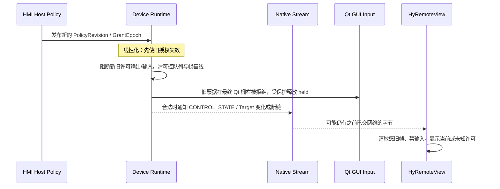

# D1｜设备协议详细设计：RFB 3.8 / Native 1.0 独立互操作、授权与状态契约（候选 V1）

> **2026-11-05 Human 决策已生效**：[Human #843 决策记录](https://github.com/skawu/HyRemote/issues/843#issuecomment-6646988698)。相关产品/安全取舍选 A；本文初始“待 Human 选择”语句如与本次批准冲突，以审批后的具体条款为准。批准不等于 V15/V8 原文审计、产品实现或设计冻结。

> **归属：** [全产品模块设计总控 #843](https://github.com/skawu/HyRemote/issues/843)；继承 [D1 Framework 边界稿](module-detail-d1-framework-boundaries-2026-11-05.md)（PR #844）。  
> **上位权威：** Human 批准 HYR-PD-001/V15、HYR-ARCH-001/V8（#827/#830）；Stage02 G7 + ADR-0007/0008。V8 **附录 A/B 原文是 Native 1.0 唯一 wire 权威**，本文件没有替代资格。  
> **代码事实基线：** `HyRemote/develop@02bd993174016439f22fe8c3dc304e20d8e3ed69`；`docs/security.md`、`src/runtime/src/transport/rfb_transport.cpp` 和 `rfb_delivery_state.hpp`。  
> **效力：** `DESIGN_CANDIDATE / NOT_FROZEN / NO_PRODUCT_CODE / NO_NEW_WIRE / NO_PRODUCT_IMPLEMENTATION_ADMISSION`。本稿的接口和状态名称仅用于内部设计，不是新公开 C++ API 或发布协议定义。

## 0. 本轮产品结果与设计范围

面向两个可独立成立的结果：

1. **标准 Direct/RFB：** 在明确适用的可信 LAN 与用户配置内，继续服务无需 HyRemoteView 的标准 RFB 3.8 Viewer；互操作、输入边界、只读和不加密的事实必须如实呈现，不能为了受管安全修改标准 RFB wire。
2. **完整 Direct/Native：** 同一个 HMI Framework 的独立 Native 1.0 协议将能够完成设备身份、认证、获准 Target、帧、输入和独立 ViewGrant/ControlGrant；经不解密的受管 ByteStream 仍由远端 Viewer 独立核验 HMI 证书与最终权限。

RFB/Native **仅共享**设备端采集源/目标索引、可信 DeploymentAdmission、授权策略、输出隐私、资源控制与最终 Qt 输入栅栏；**不共享**握手、安全认证方式、wire、编码/画面增量基线、网络队列或错误协议编号。不得让 Native 依附 RFB 画面，不得新造第三必需 Enhanced 侧信道。

当前实施事实：RFB 有真实源码；Native 设备 TLS / 完整 Native endpoint **尚未实现**。阶段任务是详细设计，不启动开发、G3、Gateway 或安装包改造。

## 1. 事实分级、旧 Issue 时效性和唯一规范

| 事实/约束 | 来源 | 证据等级和处理 |
| --- | --- | --- |
| 现行 RFB 已精确比较 `RFB 003.008\n`，拒绝其余版本后才继续安全选项 | `rfb_transport.cpp` 的 `AwaitVersion` | **CODE_FACT**；#158 中旧“接受 3.7”的审计文字已过时，不得据此创建重复修复 |
| 已在 `acceptPendingClients()` 设置 `QTcpSocket::setReadBufferSize(256KiB)`；`readClient()` 在 `readAll()` 之前检查 pending + 已缓存限额 | 当前 RFB 源码 | **CODE_FACT**；旧“先 readAll 后判断”的记录已过时，不能据此宣称已实测全进程 RSS 及恶意 burst 结果 |
| RFB Normal 设 250ms 周期扫查，5s 不完整消息进度和 10s 首次有用消息时限；握手 3s，ClientInit/初帧 30s，最多 8 客户端 | `rfb_transport.cpp` | **CODE_FACT**，不是 V8 新架构的冻结指标，也不是全部恶意场景通过 |
| `consumeClientMessage()` 对**任意完整** Normal 消息设置 `producedUsefulMessage=true`，没有每次 FBU 后自动重新进入有限 usefulness 窗口 | 当前 `rfb_transport.cpp`；#158 后期评论要求更强的持续占用复核 | **DESIGN_GAP**：现有“首次完整消息”不等价于“持续生产有用显示请求”；须在协议模块详细设计选择正确的进度/活跃条件，再决定是否需要有限实现变更 |
| RFB 当前 Raw + TRLE（按协商选择），DesktopSize、Cursor、Fence 的有界空 flags 回应、ContinuousUpdates 可选；Clipboard CutText 读取/限额后忽略 | `rfb_transport.cpp` / `rfb-delivery-profile.md` | **CODE_FACT**；不是所有维护中 Viewer 或剪贴板功能的发布保证；Fence 不能假称 Qt 最终输入完成同步 |
| VNC Authentication 可在具备构建能力时使用，但不加密；`AuthenticatedEncrypted` 当前 `SecurityUnavailable`；默认 `0.0.0.0:5921` / remote input disabled | `docs/security.md` / Runtime `access_instance.cpp` | **CURRENT_RELEASE_BEHAVIOR**；不得把历史默认值与未来 H-02a 合为一项 |
| 独立完整 Native 1.0：8-byte BE header、21 类消息、设备 TLS 与 Grant/Target/Scope/帧基线 | V8 附录 A/B（经 #830 文档 05 引述） | **ANNEX_SOURCE_21_TYPES_FIELDS_VERIFIED / WIRE_VALUE_BINDINGS_HUMAN_APPROVED / E2E_NOT_TESTED**：2026-11-05 Human 上传与历史 #827 送审稿 SHA 相符的 V8 全文且确认内容等效；21 type ID/字段/长度已核，2026-11-05 Human 通过 P-A/A 已批准原文缺少的值域与 TLS-first 解释（单一受控补充见后文），26 个字节级向量已设计但 Host/Viewer E2E 仍未执行。不得以本稿重编号或引入另一套取值 |
| H-02a 未来新架构启动任何协议监听前应先接受可信 DeploymentAdmission | ADR-0008 / V8 | **APPROVED_FUTURE_DESIGN, NOT CURRENT_IMPLEMENTATION**；保留已发布 RFB 行为事实 |
| Gateway/Edge 只做已登记 HMI 的有界透明 FIFO 字节路由；Managed 安全必须 View↔HMI 端到端设备身份/TLS | V15/V8、Stage04/05 | **APPROVED_DESIGN**；不能用 WSS/代理签发的 route token 取代设备授信 |

**来源更新（2026-11-05）**：Human 提供 V15/V8 的两份完整送审稿，实际 SHA-256 与历史 #827 **送审稿**记录精确匹配，Human 确认与批准正式版“内容一样”。已对真实 V8 A.1–A.6/B.1–B.3 核对 21/21 type ID/字段/长度、5 输入子型、13 错误码；原 Word 原来缺少的值域已获 Human P-A/A 批准，作为 [V8 A/B 唯一数值/TLS 增补](module-detail-w00-native-v8-delta01-approved-2026-11-05.md) 生效， [26 个字节级向量](module-detail-w00-native-v8-golden-vectors-design-2026-11-05.md) 已完成设计计算，但 parser/E2E/负例实测均未执行。本次不宣称正式版 DOCX 二进制 SHA 相同或 Native 已实现。

## 2. 双协议逻辑拓扑与“共享但不串权”

~~~mermaid
flowchart TB
  HOST["HMI Host: Target/Scope + Policy Authority"] --> P["Shared Runtime: DeploymentAdmission / AccessPolicy / AccessSessionRegistry"]
  CAP["Qt Widgets / Quick FrameSource"] --> F["共享基础采集与 Frame Storage"]
  F --> RFP["RFB per-peer Output Gate + RFB Encoder"]
  F --> NFP["Native per-session Output Gate + Native Encoder"]
  P --> RFP
  P --> NFP
  RFB["RFB 3.8 Listener: Auth/ClientState"] --> RFP
  NAT["Native 1.0 Listener: TLS/Auth/Session"] --> NFP
  RFB --> IN["可信输入上下文 + AdmissionFence"]
  NAT --> IN
  P --> IN
  IN --> GUI["Qt GUI 投递前再次验证 Grant/Epoch"]
  RFP --> RV["标准 RFB Viewer，可信 Direct"]
  NFP --> NV["HyRemoteView: Direct / E2E Managed Native"]
~~~

- 一台 HMI 可以依批准的构建模式配置 `RFB-only`、`Native-only` 或 `Dual`，但不创建第二套 Core/Shared Runtime。两个独立 listener 可以有各自的生命周期/隔离，统一遵守 H-02a 的部署准入。
- 每条协议连接必须拥有**独立的协议状态与会话实例**。跨协议 Scope 控制冲突由**同一 HMI 策略**裁决，而不是由同一个 RFB Socket 或 Gateway Route 决定。
- 凡当前代码仍只有 `InputHandler(InputEvent)`、全局 `remoteInputEnabled`、每个 RFB Client 的键鼠按住计数，均不构成经证明的未来设备端会话授权。安全设计需要在 Runtime 内部扩展可信上下文和 admission seam，但**尚不批准公共 Core API 更动**。
- 两个协议的输出最终发帧前都需做 ViewGrant/Scope/PrivacyRevision 栅栏；不同身份/授权的输出缓存不可误共享。Raw/Delta 前的设备侧帧丢弃与 Gateway 密文字节的无损 FIFO 是两个独立控制问题。

## 3. F-04 RFB 3.8：标准互操作与设备端策略映射

### 3.1 协议状态机（事实与未来策略接入分离）

**当前源码事实：**

~~~text
TCP Accepted
  -> AwaitVersion (server advertises RFB 003.008 / exact client reply)
  -> AwaitSecurityChoice (None 1 or VNC Auth 2 if provisioned)
  -> AwaitAuthResponse (only VNC Auth)
  -> AwaitClientInit
  -> AwaitInitialFrame (only if initial geometry unavailable)
  -> Normal (SetPixelFormat/SetEncodings/FBU/Key/Pointer/...)
  -> Disconnect/abort (held-state cleanup)
~~~

- 服务端 `ServerInit` 当前使用固定产品名与几何数据；它不是现有设备端 ViewGrant/TargetScope 的证明。
- 连接成功、Native 同机可用、RFB VNCAuth 通过、`RemoteAccessState::Running` 与 `connectedClientCount>0` 都不能被推导为某个自然人获得 ControlGrant。
- **未来策略接入点（候选）**：新架构 DeploymentAdmission 成功 → RFB 安全协商 → HMI 本地对该 RFB 连接当前所能代表的策略身份/配置授权 → 仅在允许查看的唯一受控 Target 下进入可发帧 Normal；Key/Pointer 必须再经当前 ControlGrant 最终检查。是否使用可证明身份还是仅 Host-managed 匿名只读能力必须明确，而不是隐含“已认证用户”。
- RFB 协议没有 Native 的 `TARGET_LIST/CONTROL_REQUEST/GrantEpoch` 原生消息。**绝不把私有 Native 字段插进标准 RFB 3.8 数据流**；对无法表达的会话角色、Scope 与多 Target 需求，由 Host 的受限外部策略/部署绑定处理，不可自动用云操作员身份补全。

### 3.2 RFB 传统客户端的身份能力上限（必须形成产品兼容裁决）

| 模式 | 现有可证明事实 | 目标设计安全表达（候选） | 不得声称 |
| --- | --- | --- | --- |
| RFB None / Insecure | 不认证、不加密，可在配置 LAN 端口访问 | HMI trusted deployment 确定可共享的单一 Scope/只读；若政策要求不可证明的身份，拒绝该请求或不启用该模式 | 不能凭 IP/握手推断用户身份或 ControlGrant；不能用于不可信公网 |
| RFB VNC Auth | 共享密码 challenge-response（构建/配置条件）；内容未加密 | 仅说明当前连接通过 **共享口令**校验；由宿主局部策略确定可访问的视域与是否允许输入，绝不假定一人一身份 | 共享 VNC 密码不是个人身份/证书或端到端加密 |
| RFB 具有明确批准的**未来**设备端端到端加密方式 | 目前没有已交付资格 | 若经独立威胁审查、实现和真实 Viewer 验证，可另行确定 Managed 资格 | 不能把 Gateway WSS、端口转发、代理 TLS 自动算作 RFB 设备 E2E |
| RFB 3.7 或其他版本 | 当前代码要求精确 3.8 | 作为不受支持的客户端版本按标准语义拒绝 | 不把旧 `lenient37` 握手现象包装成严格 3.7 互通 |

**RFB-ID 已由 Human 的 H-RFB=A 关闭产品语义选择**；本节明确的是 legacy RFB 在 V8 Host 授权体系中的技术实现与兼容边界：
1. 可信 LAN 上仅对经宿主显式允许的固定 Target 提供 read-only 标准 Viewer 路径；
2. 需要个人身份、动态 Target/Scope、设备端细粒度 Grant 的交互优先 Native；
3. RFB 输入仅在 HMI 自身**明确且当前**授权了连接范围的情况下允许，默认关闭；单 Scope 控制独占需要设备 Runtime 中真正的 Gate，不能靠 Viewer 端自律。
上述条款受已批准 **H-RFB=A** 约束，不能自行取消已发布宿主明确启用的 legacy 输入，也不能以 RFB 共享密码构造个人/Native Grant；未来真正改变产品权利或 RFB 标准 wire 才需新的 Human 受控变更。

### 3.3 RFB 数据、资源与时间界限的详细契约

| 领域 | 当前实现参考 | 下一设计出门要求 |
| --- | --- | --- |
| 协商 | exact 3.8，None/VNCAuth 条件分支，ClientInit/ServerInit | 非法版本不进入安全列表；错误安全类型不默认降级；部署准入先于 listener |
| 像素/更新 | Raw/TRLE、每 peer 像素格式与 `RfbUpdateState`；Full/Delta、resize 失效、DesktopSize | 每 Viewer 授权输出独立，策略更新后旧 Full/Delta/待发密文不能继续泄漏；必要时拒绝/重建基线 |
| 扩展 | Cursor/Fence/ContinuousUpdates 是协商能力；当前 Fence supported flags 为 0；CutText 有界丢弃 | 不把 Cursor 元数据、RFB name、剪贴板当成无授权可泄漏渠道；不夸大 Fence 同步或 Clipboard 支持 |
| 读缓冲 | `setReadBufferSize(256KiB)` + `bytesAvailable` 前置检查；最多 8 peer；编码数量≤1024、CutText≤64KiB、held keys≤64 为代码常数 | 总占用仍需包含 Qt/OS socket、send buffers、per-peer Frame/Delta、Encoding 临时；不能仅拿 256KiB 判断整机有界 |
| 阶段超时 | 握手 3s，ClientInit 30s；Normal 部分消息 5s，首次有用消息 10s（当前代码） | 不在合法静态 outstanding FBU 上实施普通空闲超时；同时不得让任意完整无关配置消息永久占用 8 个槽位；期限应按协议状态明确、由数据验证，而非先指定产品 SLA |
| 控制/释放 | `deliverKey/Pointer` 汇总多 peer held state，断开时释放；Core `InputEvent` 没有可信会话身份字段 | 多 peer 同 Scope 默认一操作者；逐连接可信上下文带到 Qt 最终栅栏；撤权/跨协议独立输入清理不得重复释放他人的 held key |
| 错误与恢复 | `protocolFailure`、`authenticationRejected`、`deferClientAbort`、断开回收 | 网络/协议错误不能提升 Host 权限；停止/重绑后一切旧会话/输入/敏感基线无效 |

特别审查当前 `consumeClientMessage()`：对任一完整 Normal 消息将 `producedUsefulMessage=true`。因此“曾发完整 SetEncodings”与“目前有显示 FBU 请求或有效持续交互”并未被严格区分；协议工作包应设计**按真实有用进展**的可复核状态转移，同时防止静态帧、慢 Viewer 被误杀。**本稿不直接指定修改超时或现行发布验收结论。**

### 3.4 标准 RFB 3.8 的设备端 Target/Scope/输入仲裁实施合同（H-RFB=A）

> **已批准产品范围，不重开选择**：Human 的 `H-RFB=A` 确认保留宿主**明确开放**的已发布基础 RFB 输入能力；新设计默认只读、设备侧统一 Target/Scope 和单冲突 Scope 一名远程控制者，匿名与共享 VNCAuth 不能构成个人身份。以下 `RLG-` 是**F-04/F-06 内部逻辑合同**，不是扩展 RFB 3.8 报文字段、Native Grant 编号、公开 SDK ABI 或客户端对第三方 Viewer 的能力要求。

#### A. 只存在一个设备端权威的 legacy 会话上下文

| 内部对象 | 唯一所有者与生成条件 | 生命周期/失效边界 | 不能做的事 |
| --- | --- | --- | --- |
| `RfbEndpointProfile` | 经 DeploymentAdmission 验证的宿主配置；一个 RFB listener 与获准的**固定 TargetId/ScopeId** 绑定 | ProfileRevision 改变、Target 撤销、RuntimeEpoch 停止时失效 | 从 ClientInit sharedFlag、RFB ServerInit name、IP、第三方客户端字符串推导 Target/Scope |
| `RfbPeerContext` | F-04 在每个 TCP peer 协议身份验证后创建，含 `AccessSessionId/RuntimeEpoch/ProfileRevision/TargetId/ScopeId/AuthAssurance` 和独立 Frame/held ledger | 断线、授权失效或连接代际不匹配，终态；绝不跨 reconnect 复用 | 把 VNCAuth 共享密码、来源 IP 或 Gateway OperatorId 冒充个人/Native 设备授权 |
| `LegacyViewEligibility` | F-06 从当前宿主 ViewPolicy/TargetScope 和该 peer 的真实身份**能力等级**裁决 | ClientInit/ServerInit 前最后检查，出每个受限 Frame 前再次检查；撤权先失效当前 egress | RFB 握手成功便可读取任意 Target；以 client sharedFlag 放宽控制 |
| `LegacyControlLease` | F-06 唯一 `ControlArbiter` 为具体 peer/Scope 授予；同 Scope 与 Native 互斥，现场优先 | policy epoch、peer 断线、现场接管、Target 销毁、lease 结束立即失效 | 两个 RFB peer 各自 socket 输入就同时实际控制；Native 和 RFB 各有第二套仲裁器 |
| `PeerHeldLedger` | F-06 按 `AccessSessionId+Scope+key/button` 记录合法投递的 DOWN | peer 失效/撤权先关新 DOWN，再通过受保护释放清该 peer 的 held；对跨 peer 聚合状态逐源计数 | 一连接断开就松开其他合法 peer 或现场正在按住的同键；把保护 UP 当新 Grant |

**一个 RFB endpoint 不能自动枚举/切换多个目标**：RFB 3.8 的 ServerInit 是一幅桌面几何，V8 的多个 Target/Scope 通过**受控部署中明确登记的 endpoint/profile** 暴露相应允许的固定目标；是否允许额外 endpoint 还受 H-DUAL=A 的统一 Host Admission、端口配置和资源预算约束。不能为了方便在 RFB 内添加 Native 的 TARGET_LIST 或绕过 Host 共享敏感 Target。

#### B. 握手、查看与首个输入的确定顺序

1. `DeploymentAdmission` 在任何监听前决定 `RfbEndpointProfile` 是否可信，配置可保存默认 getter `0.0.0.0:5921` 但**不会因此允许真实网络 listener**。拒绝时不得用“只读”状态留下旁路监听。
2. TCP peer 进入原标准 RFB3.8 版本/安全协商（None/VNCAuth 按实际部署配置）→ F-04 创建**非个人身份的** PeerContext → F-06 检验 Host 当前固定 Target/Scope 的查看政策。任何阶段拒绝必须尽可能在标准协商/连接关闭边界完成，不发送自定义 Native 授权结构。
3. `ServerInit` 中几何、桌面名称和 framebuffer 内容均受当前 Target 可见/隐私规则控制。未获准时**不可先发送敏感桌面名称或第一帧再遮蔽**；如果身份/策略不满足部署档位，拒绝握手或结束 peer。
4. 每次 `FramebufferUpdateRequest`/ContinuousUpdates 只面向该 peer 当前获准的过滤后 Target；Full/Delta 基线、Encoding/pixel format 与待发队列按 peer 隔离。H-REVOKE=A 新 PolicyEpoch 生效后停止新选取/排队旧受限图、清可控 egress/FrameBaseline，必要断链；已到内核/TLS或已显示像素无法追回。
5. `KeyEvent/PointerEvent` 进入 `F-04 parse→F-06 currentScopeGate→ControlArbiter→admitInput(ticket)→Qt deliverInput(finalCurrentPolicy)`。**不是**在 F-04 仅判断 `remoteInputEnabled=true` 就直接调用 Qt；必须同时持有宿主实际许可、当前 Scope 控制 lease 和与现场优先兼容的输入资格。
6. 传统第三方 RFB 不具有 Native 的 `CONTROL_REQUEST/CONTROL_STATE`。对宿主**明确开放** legacy control 的 peer，F-06 在首次需要实际控制的输入到来前，应从**当前** Host Policy 申请/确认本 peer 的内部 ControlLease；如果无法取得（另一 peer 或 Native 持有、Scope 撤销、身份要求不可满足）则拒绝该次输入而仍可保持获准查看。必要时断开 peer 以保证安全清理，**不能默默重新指派已被占用的控制权**。此控制资格是设备内部状态，不能声称向第三方 Viewer 发送了 RFB 授权 ACK。
7. 客户端 `sharedFlag` 按 RFB 的标准共享连接语义处理，不是远程控制抢占请求；Client `SetPixelFormat/SetEncodings` 的调整只影响输出呈现，不可改变 Host/Scope/Grant。已知 RFB 扩展 Cursor/Fence/CutText 也不得作为隧道偷带权限、设备身份或秘密。

#### C. 失败、收尾和跨协议竞态（不改变 RFB wire）

| 竞态/异常 | F-04/F-06 必须做出的设备行为 | 第三方客户端与官方 View 的真实表达 | 设计验收 |
| --- | --- | --- | --- |
| Host 未完成部署准入，但配置 getter 显示默认端口 | 不 bind，不创建 PeerContext | 连接拒绝；不能误报服务正在安全运行 | `RLG-01` |
| RFB None/VNCAuth 通过但 Host 当前 Target/Scope 无查看许可 | ServerInit/任何敏感 Frame 发送前拒绝或关闭；不枚举目标信息 | 协议断连/拒绝，不宣称“连接成功但设备没画面”是权限成功 | `RLG-02` |
| 两个 RFB 与一个 Native 同时申请同 Scope 控制 | F-06 控制租约只属于当前获准一名远程 peer；现场可随时收回 | 旧 RFB 没有 Grant 回执，官方 View 标识能力无法证明，绝不显示“已执行” | `RLG-03` |
| RFB peer 已送 KEY_DOWN，Qt GUI 队列尚未消费，Host 撤权 | 先推进权限 epoch、禁新 DOWN，Qt 最终检查拒旧 ticket；保护性释放按 peer held ledger 计数 | 没有第二次授权，迟到 KeyUp 不跨 peer 释放 | `RLG-04` |
| RFB 只读政策下收到合法语法 Key/Pointer | 消耗有界合法协议包，但不投递 Qt/不改变 held；若行为无法安全隔离才关闭该 peer | 第三方没有标准 InputACK，不伪造“成功控制” | `RLG-05` |
| Target 被撤销、改变几何、遮罩或 PolicyRevision，peer 帧有积压 | per-peer 全/增量基线和可控队列失效，后续合法图只能基于新授权 FULL/resize 重新开始 | 旧已显示像素无法物理追回；官方 View 按策略遮旧 | `RLG-06` |
| 断线/旧 peer 回调与新连接同 IP | 旧 `AccessSessionId/RuntimeEpoch` 失效、释放其 held、销毁旧 frame，重连必须重新 Host 审核 | 不因为 IP/共享密码相同继承旧控制租约 | `RLG-07` |
| RFB 被用于 Managed/Public 安全要求 | 无独立 DeviceTLS E2E/个人身份资格时拒绝不符合要求的部署 profile，不从 Gateway 的 WSS 推导 HMI 加密 | UI 如实呈现“不满足设备端安全资格”，不偷偷回退 Native/RFB | `RLG-08` |
| ClientInit/FBU 的握手超时和静态画面 | 区分协议状态和可证明的“有效进展”；正常静态画面不得被无依据的空闲判定反复断链 | 不把 SetEncodings 反复发送当作真实画面进展/权限认证 | `RLG-09` |

**安全与兼容边界**：本节仅要求使用 RFB 3.8 已有标准消息和设备端 Host Policy 的内部控制；未改变已发布 RFB 的明确授权输入权益，也没有把其共享密码升级成个人身份或端到端安全。所有 `RLG-01..09` 属于**设计验收规格、未运行**。当第三方 Viewer 无法获知细粒度授权拒绝的原因时，设备端依然 FailClosed；不能靠新增非标准私有报文伪装原生兼容。

## 4. F-05 Native 1.0：严格复用已批准的完整设备协议

### 4.1 V8 A/B 及 Human 已批准的数值补充（未实现，须实证）

| 环节 | 当前 Stage03/05 候选中的 V8 引用（非全文二次验证） | 设计责任 |
| --- | --- | --- |
| 帧头/协商 | `[type:u16, flags:u16, payload_length:u32]`，网络大端 8 byte；1.0 `flags=0`；`HELLO` / `WELCOME`，`HYRP` magic 和版本/能力/大小预算 | `NativeFrameParser` 先校验版本/类型/长度/状态，再分配与处理；禁止 Qt QVariant/QDataStream 外泄 |
| 设备安全 | 原生配置的 `plain` 或 `tls-password` 模式，不允许运行时 STARTTLS/隐式安全回退；TLS 身份与用户凭证分开 | `NativeTlsListener`、`NativeAuthVerifier`；Managed 只能在真实经认证的 Device TLS 与独立 Viewer 信任成立后使用 |
| 会话/目标 | `AUTH`/`AUTH_RESULT`（受要求的 TLS 模式）；`TARGET_LIST/STATUS/EVENT/SUBSCRIBE` 与 `SCREEN_INFO` | HMI 独立 Registry 决定可枚举/可订阅 Target，跨 Scope/Session 不泄漏 |
| 画面 | `FRAME_BEGIN/RECT/END`、`REQUEST_FULL`；Frame generation/PolicyRevision 基线 | 每授权会话维护 Full/Delta/Rect 与状态；变更隐私或目标后强制新合法基线 |
| 输入/控制 | `CONTROL_REQUEST/STATE/RELEASE`、`INPUT`；按既有附录字段校验 `target_id/scope_id/grant_epoch/generation` | ControlGrant 由设备发放，网络收包和 Qt GUI 投递前二次检查；不能把 GrantEpoch 当 bearer token |
| 错误/关闭 | `ERROR`、`CLOSE` 按 V8 原有编号，不再加 Gateway 路由字段 | 失败关闭、释放 held state、清除旧 Session/Queue；TLS 认证错误不通过普通 Native ERROR 降级 |
| 资源 | 已有派生设计报告目标上限（Target/geometry/Rect/UTF-8），以 V8 A.6 为准 | 不创造新常数；最终必须从完整附录生成逐类型长度/状态/符号向量矩阵 |

- **严禁**在 Native 1.0 header/body 塞 `RouteId/OperatorId/SiteId`，借 Gateway 登录发 Grant，或把 21 类消息拼成第二份“本文件定义的 Native 1.0”。
- Native 1.0 必须完成一套独立画面、输入、目标/会话/授信能力。RFB 作为平行传输不提供 Native 帧依赖；Native-only 编译和 Direct 实用性须在方案验收证明。
- **Human SOURCE_TENSION_01=A 已批准**：`plain(0)` 与 `tls-password(1)` **均须先可信 HMI DeviceTLS→HELLO/WELCOME**；plain 仅表示不要求独立用户名密码 AUTH，仍不能由 TLS 自动授 ViewGrant/ControlGrant，Managed 仍须可归责身份/真实设备授权；tls-password 在 TLS 后还要 AUTH。禁止 STARTTLS、Native 明文回退和 Gateway RoutePermit 代授权。见 [唯一规范补充](module-detail-w00-native-v8-delta01-approved-2026-11-05.md)。

### 4.2 Native 设备会话和帧基线状态机（语义候选，非 wire 新增）

~~~text
DeploymentAdmitted
  -> NativeListenerReady
  -> TransportSecured? (由批准的安全模式决定；Managed 必须 Device TLS)
  -> HELLO/WELCOME exact V8 version and bounds
  -> AUTH required by configured mode
  -> DeviceSessionAuthenticated
  -> AuthorizedTargetList (仅返回当前许可)
  -> ViewGrant(Target/Scope) -> Subscribe
  -> SCREEN_INFO -> FULL complete -> DELTA permitted
  -> ControlRequest -> independent ControlGrant -> INPUT allowed
  -> Revoke/PolicyChange/TargetLost/Disconnect
       -> input fences revoked / held released
       -> queued sensitive frames invalidated / baseline reset
       -> closed; new TCP+TLS => new AccessSession
~~~

**候选状态维度（不得误写为 Native 枚举）：**

- `TransportTrust`：NotEstablished / DeviceIdentityVerified / Failed；只表示可信设备会话，不表示查看权。
- `DeviceAuth`：Unauthenticated / Authenticated / Denied；必须防止 AUTH 不在合法安全模式中发送。
- `ViewGate`：NoTarget / ViewDenied / ViewGranted / Revoked；没有 ViewGrant 时发送零未授权像素。
- `FrameBaseline`：Absent / FullInProgress / FullCommitted / DeltaEligible / Invalidated；按 Target/Scope/Session/PrivacyRevision 限定。
- `ControlGate`：NotRequested / Denied / Granted(epoch) / Revoking / Revoked；只有 HMI 的当前快照和最终 Qt 栅栏授予执行资格。

**三项必须设计并确认的竞态语义：**

1. **输出撤权：** 当前 PolicyRevision 更新后，不可有旧敏感帧从 device output 队列继续发送；已有写入 TLS/内核不可撤回字节的风险需定义明确的事件生效界点、连接关闭方式及相关剩余泄漏上界。不能简单声称“清缓存=撤回所有已发送字节”。
2. **输入撤权：** `INPUT` 进入协议队列不等于最终允许执行；在 GUI 真正提交前复核 `AccessSessionId/GrantEpoch/Scope/PolicyRevision`。授权更替和输入提交的线性化顺序需能证明旧 input 不在撤权生效后执行。
3. **断线重连：** 网络通道恢复不恢复旧 `ControlGrant`、未确认业务操作或 DELTA 基线；新连接须从可信 TLS/Native 身份与独立 Grant 开始。

### 4.3 独立设备 TLS 的部署与安全要求

HMI 的密钥材料与 DeviceId 由设备制造商/客户可信交付或受信根管理；Viewer 必须独立验证真实 HMI 的证书链/标识与已确认 DeviceId。工厂 View Edge/Gateway 仅经授权转发字节，绝不拿到 HMI 设备 TLS 私钥或充当信任根。证书变化、过期、吊销和被替身攻击应在 View 端失败关闭，不得显示旧像素冒充实时当前画面。

设备 TLS 和会话用户名/密码属独立层：未经 E2E 身份核验不得传秘密或任何授权输入；用户名/口令材料只经合格端到端安全通道传输。验证配置/受信来源失效时拒绝，不自动切换 RFB 明文。任何密码算法/安全参数选择以 V8 9.4及目标硬件成本验收为准，不能在设计稿里增加凭据明文存储或临时 CLI 参数。

### 4.4 Native 1.0 的正交状态机、错误归因与最终授权栅栏（W00 下一层详细设计）

> **源权限边界**：受控字节值以 [Human 批准的 V8 P-A/A](module-detail-w00-native-v8-delta01-approved-2026-11-05.md) 为准；V8 §§5.2–5.5/6.3–6.4/7.2–7.4/8.2–8.6 和附录 A/B 优先。本节的 `T/S/V/C/F` **状态名是设备端/客户端内部设计模型，不是新增 Native 报文字段、公开 SDK API、消息 ID 或 wire status 编号**。原有类型完整保留，实际产品实现/测试仍未经 Gate-I。

#### A. 多条相互独立的状态轴（禁止简化为一个 Connected/Running）

| 内部状态轴 | 状态与进出条件 | 状态真相的唯一权威 | 失败关闭行为 |
| --- | --- | --- | --- |
| `T` Transport/Identity | `T0 STOPPED → T1 ADMISSION_PREPARED → T2 TLS_NEGOTIATING → T3 TLS_TRUSTED → T4 HYRP_NEGOTIATING → T5 SESSION_ACTIVE → T6 CLOSING/CLOSED` | HMI 可信部署清单决定 listener 可开；Viewer 独立设备证书/DeviceId Trust，TLS 握手双方各自确认安全链 | `T2` TLS/证书失败：**零 HYRP 字节**、无弱模式重连；`T4` 非法头/主版本/caps/序列必须拒绝 |
| `S` Session/User | `S0 NO_SUBJECT → S1 AUTH_PENDING`（仅 `tls-password`）→ `S2 AUTH_VERIFIED` 或 `S3 AUTH_FAILED`；`plain` 为 `S4 DEVICE_ONLY_NO_USER_AUTH` | TLS 只能证明 HMI 设备；用户名认证只来自 HMI Native 密码验证器，`plain` 无自然人身份 | `S3` 不枚举 Target；`S4` 只能按 Host **明确可证明**的当前策略授权非敏感能力，Managed 缺可归责用户则拒绝 |
| `V` Target/View（逐 Target） | `V0 UNKNOWN → V1 LISTED → V2 SUBSCRIBE_PENDING → V3 SUBSCRIBED` 或 `V4 DENIED / V5 REMOVED` | `TARGET_LIST` 只含当前获准目标；`TARGET_STATUS` 1/2/3/4 是设备回执，`PolicyRevision` 属 HMI | 本地历史 Target 不替代新 `ViewGrant`；失权或目标关闭清该目标输出和输入，其他获准目标可独立继续 |
| `C` Control（逐冲突 Scope） | `C0 NONE → C1 REQUESTED/PENDING(1) → C2 GRANTED(2)` 或 `C3 DENIED(3) / C4 REVOKED(4) / C5 EXPIRED(5) / C6 RELEASED(6)` | HMI AccessSession、Scope、Target、PolicyRevision、GrantEpoch 与现场独占裁决；非 Viewer 请求意图 | 除 `C2` 且所有实时设备授权仍有效外一律禁止新输入；`C4/C5/C6` 清 held；不同 Scope 是否独立由 Host 证明 |
| `F` Frame（逐 Target） | `F0 NO_BASE → F1 FULL_OPEN → F2 BASE_VALID`；合法增量 `F2→F3 DELTA_OPEN→F2`；失配 `F4 WAIT_FULL`；撤权 `F5 REVOKED` | HMI 单 Target 的 generation/frame_id/full 覆盖与 per-session filter；Viewer 只能确认自己已经完整应用的本地基线 | `F4` 不应用 DELTA，发 `REQUEST_FULL`；不把 TCP send/ACK 当呈现完成；撤权清可控已过滤帧与帧缓存 |

**正交约束**：`T5 SESSION_ACTIVE` 并不等于 `S2 AUTH_VERIFIED`、`V3 SUBSCRIBED` 或 `C2 GRANTED`；`S2` 也不自动获得可见 Target。控制状态由设备当前 Policy 生效点决定，Viewer 只能显示回执及可能的过期/未知，不可用“刚才成功请求”代替 `C2`。

#### B. 按 V8 唯一报文时序映射到上述内部状态

| 阶段 | 可接收/发送的既有 Native 消息 | 必须检查的先决条件 | 设备/客户端应暴露的可验证结果 |
| --- | --- | --- | --- |
| Listener 前 | **无 HYRP** | H-DUAL=A 必需端点统一 DeploymentAdmission，失配全部不对外服务 | `START_ABORTED` 仅内部诊断，不是新增 Native error_code |
| TLS | **无 HYRP** | 任一 Native 模式均按 SOURCE_TENSION_01=A 设备 TLS-first、身份可信 | 失败无协议字节；UI `DEVICE_TLS_UNTRUSTED` 为本地诊断标签，**非 wire 编号** |
| HELLO/WELCOME | `0x0001/0x0002` | TLS 建立、`HYRP` magic、major1、caps=0、受控 auth_mode 0/1、长度/预算匹配 | 会话“通道可用”与用户/查看/控制分别报告；未知值拒绝 |
| Auth（条件） | `0x0003 AUTH`、`0x0004 AUTH_RESULT` | 仅 `tls-password=1` 中的独立认证；`plain=0` **不要求 AUTH**，但不假定有用户身份 | `AUTH_RESULT.success=1` 仅表示用户验证成功；失败不得枚举目标 |
| Target 列表/订阅 | `0x0040 TARGET_LIST`、`0x0041 TARGET_SUBSCRIBE`、`0x0042 TARGET_STATUS`、`0x0043 TARGET_EVENT`、`0x0005 SCREEN_INFO` | `T/S` 达准入条件，HMI 当前对每个 Target 许可 `ViewGrant`；status/op 值用 P-A | 不可见 Target 不列出；`DENIED/REMOVED` 停图，旧列表不产生授权 |
| Screen | `0x0010 FRAME_BEGIN` → `0x0011 FRAME_RECT`×N → `0x0012 FRAME_END`，需要时 `0x0013 REQUEST_FULL` | 先设备 per-session 隐私过滤；`V3`、当前 Policy/generation、合法 rect 范围与 FULL/DELTA | FULL 需完整覆盖；失配进入 WAIT_FULL；不添加逐帧 ACK |
| Control | `0x0050 CONTROL_REQUEST`、`0x0051 CONTROL_STATE`、`0x0052 CONTROL_RELEASE` | 设备单冲突 Scope 仲裁/现场优先；仅 `GRANTED=2` 且最新 GrantEpoch 有效 | `PENDING=1` 一律只读；迟到 GRANTED 若旧 request/epoch 失效不能启控 |
| Input | `0x0020 INPUT`，五子型 | 先网络接纳检查 Session/Target/Scope/GrantEpoch/Generation、坐标和消息值；Qt GUI 真交付前**再检同一当前政策** | `Accepted/Rejected/Ignored` 是内部交付状态，不是 Native wire 扩展；Rejected 不增 held |
| Heartbeat/Close/Error | `0x0030/31 PING/PONG`、`0x00FE ERROR`、`0x00FF CLOSE` | 状态合法、报文长度与原 V8 号码；TLS 失败不可发送 HYRP ERROR | 关闭清 session/held/frame；不会根据 PING 自动恢复用户授权 |

#### C. 撤权、乱序与并发的不可破坏时序

- **线性化先于通知**：设备不等待网络 ACK 或 View 关闭窗口才使旧 Grant 生效失效。依 H-REVOKE=A，进入 OS/TLS 或用户已经看到的像素物理上不能追溯收回；不能以客户端灰屏代替设备端隐私。
- **GUI 与网络竞态**：input packet 在网络线程 `admitInput` 被 `Accepted`，若 Qt GUI 消费前 policy 改变，该输入须在 `deliverInput` 被拒绝；已按下来源计数释放单独优先通道，不允许清理期间生成新的 KEY_DOWN。
- **跨协议 Scope**：RFB 和 Native 共享唯一 Host ControlArbiter/held 计数；新 Native GRANTED 不得绕过 RFB 既有控制者，除非 Host 明确撤权/切换 Scope。同名 Target/IP 不代表相同 TargetId 或 SessionId。
- **增量基线**：`generation`、`frame_id`、`PolicyRevision`、`GrantEpoch` 属不同逻辑域；不可混作一个整数或以大小直接推断跨域授权。一帧 START/RECT/END 间不得夹另一目标帧报文；错误基线只能 REQUEST_FULL/WAIT_FULL 或断链，不得悄然拼接旧帧。
- **状态失败路径**：TLS 失败零 HYRP；非法头/flags/len 用 V8 既有 `BAD_HEADER/BAD_LENGTH` 范围决定拒绝；非法顺序 `BAD_ORDER=3`；未知字段 `INVALID_FIELD=5`；无授权 `POLICY_DENIED=13`；错误代次 `STALE_GENERATION=10`。**是否发送 ERROR 后 CLOSE 取决于当前已建立的可信应用协议状态与 V8 既定规则**，不能把外部 TLS 错误包装成新的 Native 消息。

#### D. 本模块与 V-01／X-02 对拍的设计验收入口

| 合同 ID | 设计输入及预期 | 既有验收入口 | 当前状态 |
| --- | --- | --- | --- |
| `AFS-01` | 两档 TLS 在 HELLO 前完成证书/设备身份；TLS 失败零 HYRP，不能明文回退 | DP-07/XP-07/GN-10 | `DESIGN_ONLY` |
| `AFS-02` | `plain=0` 无独立 Auth 不等于个人身份或可见 Target；Managed 缺用户/Host 权限拒绝 | XP-03/XP-10/GN-11 | `DESIGN_ONLY` |
| `AFS-03` | `tls-password=1` AUTH_SUCCESS 后仍独立检查 HMI ViewGrant | DP-09/XP-03 | `DESIGN_ONLY` |
| `AFS-04` | 仅已授权 Target 出现在 List，Denied/Removed 禁止订阅/像素/输入 | XP-06/XP-10 | `DESIGN_ONLY` |
| `AFS-05` | PENDING/迟到 GRANTED 不能在旧 Scope/epoch 产生新输入 | FW-04/XP-04/XP-05 | `DESIGN_ONLY` |
| `AFS-06` | 两协议共 Scope 现场抢占、撤权、held 保护性释放 | FW-06/XP-05 | `DESIGN_ONLY` |
| `AFS-07` | FRAME FULL 与 DELTA 有效基线，旧 generation 进入 WAIT_FULL | DP-08/XP-06 | `DESIGN_ONLY` |
| `AFS-08` | 不同权限 Viewer 过滤、基线、可控网络队列不串像素 | FW-07/FW-08/XP-06 | `DESIGN_ONLY` |
| `AFS-09` | 旧输入已排 Qt GUI，在撤权后最终检查拒绝 | FW-06/XP-05/GN-09 | `DESIGN_ONLY` |
| `AFS-10` | 错误 enum/caps/编码/消息乱序/长度不触发状态提升 | GN-01..GN-08/GN-12 | `DESIGN_ONLY` |
| `AFS-11` | Gateway route 已 READY 但 HMI TLS/Grant 拒绝仍零目标/控件输入 | XP-09/XP-10 | `DESIGN_ONLY` |
| `AFS-12` | 停机/断线后旧 target/Grant/Frame 不恢复、业务操作不重放 | XP-11/XP-26 | `DESIGN_ONLY` |

**本节设计状态**：`F05_V01_NATIVE_STATE_AXIS=SPECIFIED_FOR_REVIEW`，`AFS-01..12=DESIGN_ONLY`，`NATIVE_NUMERICS_P_A=HUMAN_APPROVED`，`SOURCE_TENSION_01=A_HUMAN_APPROVED`；`HOST_VIEWER_E2E_TESTS=NOT_RUN`，`FULL_MODULE_DESIGN_FREEZE=NO`，`IMPLEMENTATION_AUTHORIZED=NO`。

## 5. 多模式启动、降级与权限的精确定义

| 构建/部署 | 允许的结构 | 必须拒绝的行为 |
| --- | --- | --- |
| RFB-only | Shared Runtime + Core + 单独的 RFB transport；面向经批准的本地部署信任范围 | 不能因为 Native 编译关闭就放松 H-02a 或输入/输出隐私栅栏 |
| Native-only | Shared Runtime + Core + 完整 Native transport、会话和设备安全适配 | 不借 RFB `FramebufferUpdate` 完成 Native 的画面路径；无 RFB 监听 |
| Dual | Shared Runtime + Core；各自 RFB/Native 连接、认证、输入状态；共享设备 Scope/Policy/采集 | 不因为某一协议认证通过使另一协议连接获权；不能让故障造成未授权 listener 部分可用 |
| Managed Native | 经 Gateway/Edge **只透明中转**完整 Native 安全字节 | 无真实 Device TLS/独立设备信任时拒绝；Gateway 的 RoutePermit 不提供 View/ControlGrant |
| Managed RFB | 当前**不具备**不可信公网的端到端设备保密资格 | 不能仅凭 WSS/HTTP Proxy/VNCAuth 进入 Managed Public 支持清单；等价 E2E 技术若未来提案需独立审查与实测 |

**待决 D1-PROT-04**：Dual 的两个 listener 在初始 bind/config 失败时，建议“**只要任意被要求的协议不能安全启动，则没有有效部分启动承诺**”；如果按宿主显式允许单协议退化，必须提前固定失败条件、警告与权限隔离。不得擅自改变既有已发布 RFB 运行习惯；此处仍为设计候选。

## 6. 跨协议安全仲裁：真实设备权威只在一个地方

| 事件 | RFB transport 做什么 | Native transport 做什么 | HMI 共享策略做什么 |
| --- | --- | --- | --- |
| 新连接 | 协商 RFB 安全类型；记录可证的**连接能力** | 验证 TLS/Native 认证；创建独立设备会话 | 校验 Deployment、可见 Target/Scope 与新的 ViewGrant |
| 只读查看 | 发送受准入保护的标准像素 | 发送当前 Scope 授权的 Native FULL/DELTA | 每连接输出前隐私过滤，撤权时清待发受限数据 |
| 控制竞争 | 标准 Key/Pointer 没有 GrantEpoch，须依受信连接上下文到设备端检查 | `CONTROL_REQUEST/STATE` 和 `INPUT` 只按既有 V8 字段 | 同一 Scope 默认一名远程控制操作者，宿主现场优先；另一个协议不能抢默认控制权 |
| 本地撤权 | 切断其当前可用的输入/输出，安全释放所持 Qt 状态；必要时关闭连接 | Grant epoch 变化，拒绝旧 INPUT、旧基线和 VIEW | 原子推进权威 epoch，在 GUI 最终投递前禁止旧操作 |
| 证书改变 | RFB 本身无法通过 VNCAuth 提供设备证书身份 | Viewer 必须独立拒绝旧不可信 DeviceId | Policy/Trust 更新不得被 Gateway/Edge 替代 |
| 目标切换/移除 | 不能通过标准私有命令隐式枚举所有 HMI 业务目标 | 按 Native 1.0 既有 TARGET/Scope 规则重新授权 | 拒绝越 Scope，不跨 Session 泄露 Target 名或旧画面 |
| 慢客户端 | 独立 per-peer damage/output 队列与背压/关闭 | per-session FULL/DELTA+有界输出队列与重建 | 设备主线程不因任何 remote peer 阻塞；不将过时画面谎称新鲜 |
| 丢连接 | 刷新 per-client key/button 计数并正确释放 | 销毁 AccessSession、GrantEpoch、FrameBaseline | Scope 恢复为实际策略，其他正常连接不被误撤权 |

**统一的内部、非 wire 语义接口（候选）**：

~~~text
admitConnection(protocol, independentlyVerifiedSecurity, deploymentRevision)
  -> AccessSessionId or DENY

authorizeView(session, target, scope, currentPolicyRevision)
  -> AllowedOutputPolicy | DENY

requestControl(session, scope, requestedIntent)
  -> Granted(epoch) | DENY

enqueueInput(session, normalizedInput, verifiedProtocolContext)
  -> BoundedQueueTicket | DENY

deliverQtInput(ticket, livePolicy)
  -> EXECUTED | REVOKED | TARGET_LOST

prepareFrameForSession(session, sourceFrame, livePrivacyPolicy)
  -> AllowedFullOrDelta | WAIT_FULL | DENY

revokeAccessScope(scope, newPolicyRevision)
  -> atomic deny boundary + invalidation & asynchronous notifications
~~~

**非伪造原则**：RFB 的 `InputEvent` 当前不含当前用户和 Grant 字段；Native wire `INPUT` 虽有已批准的字段，也不能替代本地 AccessSession 绑定检查。内部 `verifiedProtocolContext` 必须由协议实现关联受信 socket/session，绝不能直接信任客户端自报 `operatorId` / `ScopeId`。以上函数是审查用语义，不是即刻新增 public API。

## 7. 跨版本/三种客户端兼容性矩阵（设计与真实支持分列）

| Client → HMI Server | 设计期预期 | 当前可验证事实 / 不得宣称 |
| --- | --- | --- |
| 第三方标准 RFB 3.8 → 已发布 RFB | Direct 标准帧/输入依真实安全配置；不强制安装 View | 源码含 RFB 3.8/Raw/TRLE 及部分扩展；每 Viewer/平台/当前 SHA 互操作资格须独立记录 |
| 旧 RFB 3.7 → 新架构 RFB 3.8 | 拒绝版本，不暗中发送 3.8 安全帧冒充 3.7 | 当前源码已做 exact 3.8；历史 #158 旧注释不能被当成仍在运行的 parser |
| 仅 RFB 的旧 HMI → 新 HyRemoteView | 在可信 LAN、按实际协商且设备公开安全条件满足时可用 Direct | 不代表它能提供 Native 设备证书、Target List 或细粒度 Grant |
| Native 1.0 Viewer → Native-only HMI | 独立 Native 全画面、输入/会话/TLS/Target/Grant | **NOT_IMPLEMENTED/NOT_RUN**；必须与正式 V8 A/B 精确一致 |
| Native Viewer → Dual HMI | Native 不依赖 RFB；同设备 Scope 权限共享 | **NOT_RUN**；不可因 RFB 已测推导 Native 互操作 |
| 第三方 RFB Viewer → Dual HMI | RFB 标准直接连接，仍无必须的 Enhanced side channel | 身份/细粒度控制能力上限由 RFB 与 Host 安全配置决定 |
| Managed Native View → Gateway/Edge → Native HMI | Edge/GW 不终止 Device TLS、不处理帧语义；View 自证设备身份、设备端 Grant | **NOT_IMPLEMENTED/NOT_QUALIFIED**，待 HMI 实现 + View G3/G4 + 真 E2E 证据 |
| 公网 Managed plain RFB → Gateway/Edge → HMI | 当前**拒绝支持声明** | 现有 VNCAuth 无内容保密，不能因为 route 上有 WSS 就称 E2E |
| Qt5.15/Qt6.8 各四种 HMI 接入 → 双传输 | 同一个 Runtime 逻辑、受控 Qt Private 单元隔离 | 实际每个 Kit、构建模式、Target family 的资格分列；不能跨平台外推 |

## 8. 设计验收与证据映射（目标用例，不是本轮运行结果）

| ID | 合同测试/审核对象 | 判定要点 | 状态 |
| --- | --- | --- | --- |
| DP-01 | RFB 3.8 正确协议握手/版本拒绝 | 3.8 成功；3.7 在安全协商前拒绝；严格客户端不乱序 | `SPEC_READY, CURRENT_CODE_SEAM_PRESENT` |
| DP-02 | RFB None/VNCAuth 安全差异和未加密事实 | 未授权及加密要求缺实现时 fail closed；不在公网声称设备保密 | `SPEC_READY` |
| DP-03 | RFB Raw/TRLE/DesktopSize/Continuous/Fence/Cursor 互通 | 正确协商、每连接独立更新与基线、Fence 不声称 UI 输入已完成 | `SPEC_READY` |
| DP-04 | RFB 资源/半包/多 peer 占用 | 在当前实现限额上做 burst/partial/usefulness/静态 outstanding FBU/重入及持键清理；不以已存在代码替代 exact-SHA 实验 | `SPEC_READY, MEASUREMENT_PENDING` |
| DP-05 | 传统 RFB 的 Scope/View/ControlGrant 能力边界 | **H-RFB=A 已批准**：RFB 无 Native Grant 字段，Host 显式开启的已有输入能力保留；新策略默认只读、统一 Scope Controller、共享认证非个人身份；仍需标准 Viewer 负测 | `PRODUCT_DECISION_APPROVED / EVIDENCE_NOT_RUN` |
| DP-06 | 单 Scope 下 RFB+Native 多连接控制竞争 | HMI 统一限制默认一操作者，另一协议不会绕过；现场撤权阻断所有旧输入 | `NOT_IMPLEMENTED` |
| DP-07 | Native 1.0 21 类消息与 V8 A/B + Human 增补 | 原文 **21 type/field/len、5 INPUT subtype、13 ERROR** 已核；P-A 数字及 TLS-first A 已获 Human 批准（唯一数值源见 W00 approved delta）；**26 个字节级 golden vector 仅计算完成，仍未在 Host/Viewer 运行** | `SOURCE_AUDITED / NUMERIC_SEMANTICS_APPROVED / VECTORS_DESIGNED_NOT_RUN` |
| DP-08 | Native TLS/设备身份、用户名密码安全认证 | 证书替身/过期/错误身份拒绝；TLS/口令变更不降级 | `NOT_IMPLEMENTED` |
| DP-09 | Native Target/Scope/ViewGrant/ControlGrant 分离 | 未授权不能枚举/看/控；GrantEpoch 旧输入在 Qt 最终投递前拒绝 | `NOT_IMPLEMENTED` |
| DP-10 | Native FULL/DELTA/generation/PrivacyRevision | 独立每 Session 基线、撤权/遮罩变更无旧敏感帧输出、慢端恢复 FULL | `NOT_IMPLEMENTED` |
| DP-11 | RFB-only/Native-only/Dual 部署准入及失败 | H-02a 未批准零新 listener，独立构建无额外依赖、Native 不依赖 RFB | `NOT_IMPLEMENTED` |
| DP-12 | Direct 离线与 Managed E2E 独立 | LAN Direct 不依赖云；公网 Native 必须 E2E；RFB 不走不可信公网明文 | `NOT_QUALIFIED` |
| DP-13 | 完整性能/资源边界 | Core + peer caches + Qt/OS/TLS/network 全口径有界；现场 CPU/帧龄可测 | `NOT_RUN` |
| DP-14 | Host 安全拒绝与 GUI 最终栅栏 | 撤权与当前输入执行具有可定义的线性化点，释放 held 状态一次，不回放业务操作 | `NOT_IMPLEMENTED` |

本轮只核对代码与文档；没有执行新测试。已公布过的历史 Windows/Qt/Viewer 证据继续有效于**原确切 SHA 和实际平台**，但不自动晋升为 Native/新架构/当前 PR 的产品验证。

## 9. 待设计决定（不能让开发时临时拍板）

| 决策 ID | 问题 | 当前候选 / 应取得的证据 | 人员审批边界 |
| --- | --- | --- | --- |
| D1-PROT-01 | 标准 RFB View/Control 与 Host Scope | **H-RFB=A 已批准**：标准 RFB 保留 Host 过去明确开启的远程输入；新设备策略默认只读，Host 为 Scope/Target 明确授予控制，并与 Native 共用单 Controller 仲裁；不把共享密码当个人/Grant | 产品选择已关闭；高保证动态身份用 Native，维护中 Viewer/权限负向验证仍待证 |
| D1-PROT-02 | 新架构 RFB 的 ServerInit、Cursor、Target name/geometry 在 ViewGrant 前能透露什么 | 优先只暴露政策允许的非敏感协议元数据；确需延迟/拒绝 handshake 时审查维护中的标准 Viewer 容错 | 如对公开互操作构成实质变化，Human |
| D1-PROT-03 | RFB 既有任意完整 Normal 消息置 useful 与长期占用保护差距 | 精确定义 FBU outstanding、配置消息、progress、有效客户端慢端与静态图的时序；不简单加全局 idle timeout | 一般工程细化可经技术审查 |
| D1-PROT-04 | Dual 的启动/运行期故障 | **H-DUAL=A 已批准**：声明为必需的协议端点全部经过 Host Admission 并原子启动，失败整体拒绝；RFB-only/Native-only 仍是独立 profile；运行期局部故障隔离，无自动明文回退 | 产品选择已关闭；实际监听回滚、状态反馈与兼容性测试待证 |
| D1-PROT-05 | RFB 原聚合 held count 与未来多 Scope 权限争用的实现关系 | 先在 Host 授权后形成 per-session/per-scope logical held 账本，再按目标 Qt state 做合法汇总和撤权释放；与 Qt Private 窗口投递例外隔离 | 涉及默认控制角色的修改必须遵守 D-02=A |
| D1-PROT-06 | Native 认证与 V8 A/B 受控追踪 | 21 type/字段/定长算术已审；Human P-A/A 已批准 WIRE-V01..V06 值域/键码和两模式 DeviceTLS；26 个正向字节向量 + 12 个异常变异**设计完成未测试**。下一步审签状态机、线程/错误、现有 RFB 兼容及真实 Host/Viewer 互通 | 若改变批准的数值或 TLS-first A 须 Human 另批准；当前不创建产品代码 |
| D1-PROT-07 | 设备 TLS 信任材料更换、站点信任绑定、跨 protocol identity 映射 | 设备根与 Gateway/Edge 独立；不自动把云 OperatorId 变 Native 用户；如需委托另立版本/架构讨论 | 需要扩充身份/Device wire 则 Human |
| D1-PROT-08 | 撤权与在途字节 | **H-REVOKE=A 已批准**：新 Policy/GrantEpoch 生效后不新选择/生成/排队旧受限输出和输入；清本进程可控缓冲并必要时断链；View 清/遮旧显示。已进 kernel/TLS/远端显示的字节不声称可撤回 | 产品安全承诺已确认；线性化点、队列拥有者与竞态/网络负向测试需技术审核 |
| D1-PROT-09 | RFB 与 Native 的资源预算及正式支持矩阵 | 用当前代码限额做基线，按 V8 128MiB 设计目标及实测拓扑完善；不预填 TLS/Native 未验证数值 | 一般技术评审，实质支持声明需要授权 |

## 10. 与其他设计包的边界与下一轮接续

- [D1 第一轮](module-detail-d1-framework-boundaries-2026-11-05.md)：总体 Core/Runtime/Policy/四入口的设计继续作为父级；本稿只展开 **F-04 / F-05**。如果出现冲突，先核对正式 V15/V8，再在全产品评审统一处理，不生成平行权威。
- [设备 Native 设计 05](managed-edge-detail-05-hmi-native-trust-2026-11-04.md)：对 HMI TLS/AccessSession/Grant 已形成更具体候选，本稿仅引用其协议生命周期，**不覆盖**或重号 V8 A/B。
- [Stage05 IDL](stage05-managed-edge-control-idl-2026-11-04.md)：属于 Gateway/Edge Route Control。其 `OperatorId/RouteId` 不被植入 Native 会话，`OUTCOME_UNKNOWN` 仅是宿主业务响应未知、不代表二次自动执行。
- [HyRemoteView #5](https://github.com/skawu/HyRemoteView/issues/5)/[#9](https://github.com/skawu/HyRemoteView/issues/9)/[#7](https://github.com/skawu/HyRemoteView/issues/7)：是研发前的技术验证/资格依赖，不能替代 HMI 正式 wire/Device TLS 设计。
- [#158](https://github.com/skawu/HyRemote/issues/158)：其历史审计的“3.7 可接受”“先 readAll”“未设 Normal 超时”已经与当前源代码不一致；需根据新 SHA 复核真实 remaining gap，但本阶段**不执行修复或提前关闭**。

**本稿通过后，D1 的六个领域 F-01..F-06 都已有可复用的跨模块设计材料，但尚未完成正式 V15/V8 正文/附录校对、所有开放技术取舍的审签和一体化状态/权限矩阵，因此仍是 `D1_DESIGN_CANDIDATE / D1_FREEZE=NO`。**

下一轮回到 **D1 跨六模块一致性审查与正式条款缺口审计**：查是否存在相互矛盾的 Scope、Frame 撤权、Native wire、RFB 兼容、安全启动、线程/内存约束，形成唯一问题/决策清单及 D2 Viewer 可引用的设备侧接口契约。**不启动产品代码或新的测试专项**。

## 11. 本轮设计自检

- [x] 以实际 `develop` RFB 源码而非旧 Issue 快照作为现行代码事实。
- [x] 分离现有 RFB 能力、Native 经批准的未来设计和未经验证的实现。
- [x] RFB 标准 wire 与 Native 独立 wire 不混合、无 Enhanced 基础侧通道。
- [x] 设备端 View/ControlGrant、Target/Scope 与 per-session 输出隐私由 HMI 最终裁决。
- [x] 显式记录多客户端 held 状态、RFB 标准身份不足、当前 usefulness 语义、隐私 in-flight 字节四类真实设计难题。
- [x] Legacy Direct 兼容与未来 Managed E2E 安全声明分开；不启用 #190。
- [x] Human 提供的 **V15/V8 完整送审稿**历史 SHA 匹配、内容等效声明已记录，Native A/B 21 类 type/字段/长度已核。
- [x] Native **WIRE-V01..V06 数值**及 SOURCE_TENSION_01=A 已由 Human 选定，唯一现行增补规范已归档；26 个字节样例/12 个异常变异**仅计算/设计**。
- [ ] V15/V8 全部原子需求→状态/错误/验收追踪、Native **WIRE-V07 真实互通/恶意输入负测**以及正式版 Word 二进制比对仍未通过，不得宣布 Gate-D/Gate-I。
- [ ] D1-PROT-01..09 经必要证据/产品决策审签，尚未冻结。
- [ ] 未来新架构 Native/TLS/Grant/RFB-H02a 的任何正式实现/实测资格：均未获得。

**状态：** `F04_F05_PROTOCOL_DESIGN=CANDIDATE`；`D1_CROSS_MODULE_REVIEW=PENDING`；`NATIVE_DEVICE_IMPLEMENTATION=NO`；`FORMAL_PRODUCT_DEV_AUTHORIZATION=NO`。
