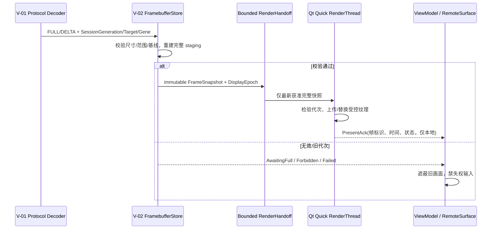

# D2｜HyRemoteView 客户端模块详细设计 V-01/V-02/V-03（候选）

> **2026-11-05 决策状态更新**：[Human #843 决策记录](https://github.com/skawu/HyRemote/issues/843#issuecomment-6646988698) 已批准 H-T01/H-DUAL/H-REVOKE/H-EDGE/H-RFB 均选择 A。其他接口、性能和 Native A/B 原文仍是待审候选，不因本次选择而自动冻结。

> **治理入口：** [HyRemote #843](https://github.com/skawu/HyRemote/issues/843)；跨仓前提为 [HyRemoteView #1](https://github.com/skawu/HyRemoteView/issues/1) / [#4](https://github.com/skawu/HyRemoteView/issues/4) / [#5](https://github.com/skawu/HyRemoteView/issues/5)，及已批准 `HYR-PD-001/V15`、`HYR-ARCH-001/V8`。  
> **依赖：** [D1 设备基础](module-detail-d1-framework-boundaries-2026-11-05.md)、[独立 RFB/Native](module-detail-d1-device-protocols-2026-11-05.md)、[D1 六模块一致性审查](module-detail-d1-consistency-review-2026-11-05.md)、Stage04/05 Managed 边界。  
> **权威更正：** HyRemoteView G2 #4 历史“RFB+独立 Enhanced TLS 控制侧通道为必需”已被 V8/ADR-0008 修订；现行设计必须为完整独立 RFB/Native 两条设备协议，不得再定义第三基本协议 listener。  
> **状态：** `D2_DESIGN_CANDIDATE / NOT_FROZEN / NO_VIEW_G4_OR_G5_PRODUCT_CODE / G3_NOT_PASSED`。所有下述类名均是**逻辑候选**，不创建正式 HyRemoteView 源代码树，不等于正式 SDK API。生产行为只允许按真实 Gate 资格声明。

## 1. 用户工作流、产品边界及“一个客户端”

HyRemoteView 是独立客户端产品，服务三类场景：① 离线/可信网络 Direct 访问单个 HMI 或维护过的设备；② 有授权的工厂 PC 既使用 Local Direct Viewer，又在**同一个 HyRemoteView 安装交付**下可选启用内置 Edge；③ 异地 Viewer 经可选 Gateway 请求指定共享 HMI 并独立验证真实 HMI 的设备身份、Native 会话和 Grant。**HMI Framework 不是 Viewer，Edge/Gateway 不知道 HMI 明文，HyRemoteTool 不是 Gateway。**

用户旅程必须在产品 UI 中保持：
`选设备/路径 → 核对端点/协议/网络风险 → 建立连通 → 完成设备身份信任（协议支持时） → HMI 用户认证与获准目标 → 获准画面 → 可选申请控制 → 结束/撤权`。

对传统标准 RFB，无设备 TLS 证明且无 Native Grant wire，必须把“未验证设备身份”“已收到画面”“输入已发送”“设备确认控制权”等状态分开；不通过拟制 Cloud OperatorId 或读到像素来造出 Native ControlGrant。**离线 Direct 不触发 Gateway 登录、不要求 Edge 注册、不要求企业订阅。**

## 2. 统一客户端架构与所有权

~~~mermaid
flowchart TB
 UI["Qt Quick/QML: Device Workspace / RemoteSurface / Errors"] --> VM["C++ ViewModels: Commands + immutable snapshots"]
 VM --> ORCH["RemoteSessionCoordinator: Session + Input/Focus"]
 ORCH --> CON["ConnectionPath: DirectTCP 或 ManagedByteStream"]
 ORCH --> RFBC["RfbClient: RFB 3.8 / None / VNCAuth / Framebuffer"]
 ORCH --> NATC["NativeClient: V8 A/B / HMI DeviceTLS / Auth / Grants"]
 CON --> RFBC
 CON --> NATC
 RFBC --> FRAME["Bounded DecodedFramebuffer / RenderHandoff"]
 NATC --> FRAME
 FRAME --> SURF["RemoteSurface: Qt Quick Scene Graph"]
 ORCH --> TRUST["TrustStore / CredentialAdapter"]
 ORCH --> DISC["DeviceCatalog / CapabilityCache"]
 ORCH --> DIAG["Diagnostics / Local Audit Projection"]
 VM --> EDGE["Factory-sharing settings (UI only) / EdgeSiteManager (D3)"]
~~~

**V-01：RemoteSessionCore**（C++17/Qt6.8 内部服务）
- `ConnectionPath` 只负责按序有界 ByteStream，生命周期/网络错误和断开；`DirectTcpStream` 连接用户明确选的地址，`ManagedByteStream` 从 D3 的获准 RoutePair 取得流。路径建立成功不能自动升格为设备信任。
- `DeviceProtocolClient` **一次仅选一条**实际可用设备协议适配：`RfbClient` 或完整 `NativeClient`。两者共享 session 控制层的状态呈现/帧/输入接口，但保持独立握手、消息解析、Client security contexts、错误与 baseline。**不得自动在 Native TLS 失败后换明文 RFB**。
- `RemoteSessionCoordinator` 拥有取消、重连、会话 generation、当前设备/协议/Target/Scope、可靠状态及 UI 派生；Session 中止必须终止网络/parser、丢弃旧 decode、禁发输入、清画面。
- `TrustVerifier` 对 Native 证书/DeviceId/预置信任材料执行真正 TLS 验证，不接受 Gateway/Edge 报“这是 HMI”代替 E2E；每个 SecurityProfile 与信任变更使用独立失败关闭处理。
- `InputIntentRouter` 从用户焦点/控制状态/Viewport 转换为协议正确事件；UI 不直接写 socket，也不能存旧 GrantEpoch 重发操作。
- `DecodedFramebufferStore` 拥有上界、像素尺寸、stride/pixel format、damage、device generation 与许可代际；`RenderHandoff` 为 Qt Quick render thread 传递安全存储引用/有限增量，不让 UI 任意触碰网络 buffer。

**V-02：View/RemoteSurface**
- Qt Quick 负责页面/键鼠可视焦点和 Scene Graph 显示；QML 不保存密码、Socket、原始 HMI 密钥、不实现 Parser、授权判定或网络重试循环。
- 由可观察 snapshot 驱动身份、路由、授权、连接时效、帧年龄、只读/控制状态；“设备在线”和“正在控制”不是 Boolean 导航开关。
- 帧投递属于 render thread，在公开稳定的 Qt Quick scene graph 能力内按纹理/区域提交；不把 QRhi semi-public ABI 暴露进项目主服务层或公共插件 API。

**V-03：设备/身份/本地资料与诊断**
- `DeviceCatalog` 为本地显式添加、最近连接、收藏、经证明的已发现设备分配稳定本地 ProfileId；`ConnectionProfile`（寻址）≠ `TrustedDeviceIdentity`（证书/DeviceId）≠ `GatewaySiteIdentity`（云站点）。
- `CredentialStoreAdapter` 只使用平台合格秘密存储或经批准安全材料；`ProfileStore` 仅保存版本化非秘密元数据，原子写盘、拒绝含原始口令或 Token 的普通 JSON。
- `IdentitySession` 将本机用户、Native HMI 用户与 Gateway Operator 三类身份**彼此独立**；OIDC/OAuth PKCE 仅供选定的 Managed 授权路径，Direct 离线不依赖该账户。
- `DiagnosticsPresenter` 展示来源/时间/可信程度的连接、版本、已协商能力、每端可观察指标，不能伪造 Runtime CPU、Frame age 或 HMI 许可状态。
- `BrandingProfile` 负责单一产品的可验证 OEM 资源/配置/安装身份，不允许为客户维护各自协议客户端 fork；企业功能只在取得授权和真实服务时出现。

## 3. 输入输出合同（内部模型；非正式代码 ABI）

| 数据/操作 | 由谁产生→谁消费 | 必要关联/所有权 | 失败语义 |
| --- | --- | --- | --- |
| `ConnectionProfile` | 用户/目录→`ConnectionPath` | profileId、明确地址/已批准 route、protocolHint、非秘密选项；**不含**可信设备身份证明结论 | 地址失败只更新该连接；不遍历/扫描内网替换目标 |
| `VerifiedDeviceIdentity` | Native TLS verifier→Session | DeviceId、trustAnchor/pin 证据摘要、证书时效、校验时间、session generation | 更换/过期/不匹配→`TRUST_BLOCKED`；停止发送认证/输入，须可信复核 |
| `ProtocolCapabilitySnapshot` | 当前协议解析器→VM | 协议、已确认版本、编码、输入、Target/Grant 可表达的范围 | 缺失字段是 `NOT_SUPPORTED/UNKNOWN`，不是默认允许 |
| `ViewAuthorization` | HMI Native 的当前授权事件或 RFB 的真实可见范围→Session | target/scope/generation/expiry/policy revision（按协议可表达程度） | Native 无 ViewGrant 不呈现像素；RFB 无原生 grant 时**不能**标“设备已明确许可该用户” |
| `ControlAuthorization` | HMI Native 的 ControlState 或 RFB 的受限能力事实→Input Router | current input eligibility + granted/unknown/denied，Native 含 GrantEpoch | `UNKNOWN/DENIED/REVOKED` 不能产生新控制操作；RFB 可发输入≠HMI 执行已确认 |
| `DecodedFrame` | protocol decoder→bounded store→RemoteSurface | SessionGeneration、Target/Scope、pixel dimensions、image format/stride、Damage、full/delta baseline、frame timestamp | 超界/坏增量/旧 generation→拒绝；等待新的合法 FULL，不展示上次设备的残留 |
| `InputIntent` | Qt 输入焦点→Session Router→协议 | 当前 screen transform、device pixel coordinates、focus/pressed ledger、context generation | 连接丢失/控制撤权/离焦→立即禁发；不能把未确认业务操作自动重放 |
| `ConnectionTelemetry` | stream/parser/render 统计→VM | source、sample interval、单位、clock confidence、带宽/帧龄/丢包/显示耗时 | 没有权威 HMI 指标就展示“未提供”，不臆造 CPU/诊断健康 |
| `EdgeShareCommand` | 工厂站点管理员 UI→D3 EdgeSiteManager | 受验证的站点/HMI/管理员操作，预览、确认、policy revision | 不是 Socket write，不允许管理 UI 指向任意 TCP host |

`RfbClient` 的 wire 数据仅从标准 RFB 3.8 解码：None/VNCAuth、ServerInit、Raw/TRLE 及实际双方协商支持的扩展；**未经过验证的 server 消息先检查长度/rect count/像素乘法溢出，后分配**。Server 可支持某 extension，不代表 Viewer 已实现并可向用户承诺。

`NativeClient` 必须只依 V8 附录 A/B 已批准消息及严谨 parser：Device TLS→HELLO/WELCOME→必要 AUTH→获准 TargetList/Subscribe→ScreenInfo→FULL/DELTA→独立 CONTROL_REQUEST/STATE→INPUT；Gateway 的 `RouteId/OperatorId` 不进入 Native body。V8 A/B 来源字段已核，Human P-A/A 数值及 TLS-first 语义已获批准，唯一值源为 [受控 Native 补充](module-detail-w00-native-v8-delta01-approved-2026-11-05.md)；实际独立 Host/Viewer parser 与 E2E 仍未实现/未测试，不得擅改 opcode、字段或数值。

## 4. 设备连接与会话的正交状态机

| 维度 | 状态域（内部设计候选） | 权威与 UI 规则 |
| --- | --- | --- |
| `Path` | Idle / Resolving / Connecting / Connected / Closed / Failed | 仅网络可达，不能标设备授权 |
| `Route` | NotApplicable / SitePending / EdgePending / Paired / Closed / Failed | Direct 永远 NotApplicable；Paired≠DeviceTLS |
| `Trust` | Unverified / VerifiedDevice / Blocked / NotAvailableForProtocol | Native 通过设备证书判断；RFB 无设备 TLS 不能标 VerifiedDevice |
| `Protocol` | Negotiating / Authenticating / Ready / Unsupported / Faulted | 各协议独立配置/错误；Native auth 失败不得 fallback RFB |
| `View` | Pending / Granted / ViewOnly / Denied / Revoked / UnknownLegacy | Native 由 HMI 授权；RFB 的旧身份能力不能伪装细粒度 Grant |
| `Control` | NotRequested / Requesting / Granted / Denied / Revoked / NotExpressible | 按 Scope 与有效期；按钮状态不足以证明 HMI 实际执行 |
| `Image` | Empty / AwaitingFull / Fresh / Stale / Forbidden / Failed | 只有新一代已许可像素才能 Fresh；Stale 遮罩并禁止当实时 |
| `Interaction` | Inactive / FocusedView / FocusedControl / LosingFocus / Disabled | Tab/系统切换/focus 丢失必须解绑本地 held 状态与输入会话代际 |

### 4.0.1 Native P-A/A 已批准补充

参见 [唯一批准的 Native V8 数值和 TLS-first 补充](module-detail-w00-native-v8-delta01-approved-2026-11-05.md)；Framework 和 View 使用同一数值表，26 个 Golden Vector 属于设计数据，未运行产品测试。

**已批准的客户端语义**：`plain=0` 和 `tls-password=1` 都须通过设备 TLS 身份核验后才能发送 HELLO/WELCOME；前者省略独立用户 AUTH，但不产生自然人身份或设备 Grant。`pixel_format=1`/`encoding=1` 按 RGBA 字节序处理；TargetStatus、ControlState、键码均采用同一受控数值表。设备信任、用户认证、Target 可见和控制权分层显示；未知值拒绝。全部向量仍须真机/独立客户端验证。

#### F-05/V-01 原子状态与客户端真相映射（设计候选）

[设备端唯一正交 FSM、AFS-01..AFS-12 负例合同](module-detail-d1-device-protocols-2026-11-05.md) 定义 `T` Transport/DeviceIdentity、`S` 用户认证、`V` Target/ViewGrant、`C` ControlGrant、`F` 每目标 Frame baseline。V-01/V-03 应持有五轴独立只读观察模型，不能把 `Connected` 或 RouteReady 作为可控状态。

| 用户界面/输入判定 | 必需的 HMI 可证明条件 | 缺失/迟到行为 |
| --- | --- | --- |
| “已连接到可信设备” | `T3/T5` 的 HMI DeviceTLS 身份可信 | 证书变化/不可信应显示独立安全失败；无 HYRP 降级 |
| “认证的用户” | `tls-password` `S2 AUTH_VERIFIED` | `plain` 为 `S4 DEVICE_ONLY_NO_USER_AUTH`，不显示为已认证自然人 |
| “可查看 Target” | HMI 真实 `TARGET_LIST/STATUS` 与当前 ViewGrant/PolicyRevision 有效 | 本地历史 Target 不能显示为已获准；Denied/Removed 清失效内容 |
| “可发送输入” | `C2 GRANTED` 且最新 Target/Scope/GrantEpoch/Policy 当前有效 | Pending/Expired/Revoked/Released 显示只读并禁输入；迟到 GRANTED 不恢复旧资格 |
| “画面实时” | Target `F2 BASE_VALID`、已完整应用合法帧且未失权 | WAIT_FULL/断网/撤权按 V15 旧帧与敏感策略处理，不将旧画面当实时 |

**V-02 的输入/渲染竞态**：View 的输入焦点和 RemoteSurface 只能产生新请求意图；设备端双栅栏仍为执行权威。断线/重连生成新会话、清 held/Delta 基线；本地没有“已渲染”线缆 ACK。上述仅设计，真机 UI/解码/Qt 线程证据尚未运行。

### 4.1 Direct 与 Managed 共用真正的设备会话

~~~mermaid
sequenceDiagram
  participant Operator as 用户
  participant UI as View Workspace
  participant Session as RemoteSessionCoordinator
  participant Path as DirectTCP / ManagedByteStream
  participant HMI as HMI Device Protocol
  Operator->>UI: 选择 Device/Profile/Intent
  UI->>Session: ConnectIntent (new generation)
  Session->>Path: Open permitted FIFO
  Path-->>Session: Connected (network only)
  Session->>HMI: RFB 或 Native 独立协议握手
  Note over Session,HMI: Native E2E Trust 必须由 View 验证，Route 不算设备权利
  HMI-->>Session: 真实 Auth/Target/ViewGrant（依协议能力）
  Session->>UI: View state + frame eligibility
  HMI-->>Session: 经准入的完整/增量画面
  Session->>UI: 新代际可显示 Frame
  Operator->>UI: 请求控制
  Session->>HMI: Native CONTROL_REQUEST 或标准 RFB 实际受限输入路径
  HMI-->>Session: Native ControlState（RFB 无原生等价消息）
  Session->>UI: Control capability/Grant fact
  Operator->>UI: 输入
  Session->>HMI: 只在当前许可和焦点有效时发送
  HMI-->>Session: Grant revoke / Close / TCP loss
  Session->>UI: 禁用控制、清旧 held 与 stale frame
~~~

### 4.2 取消、重连、失败的可验证规则

1. 连接按钮双击、切换设备、DNS/route 重试，先撤销旧 `SessionGeneration`；旧网络 callback、旧 frame upload、旧键鼠意图不能更改新设备会话。
2. 断开/安全拒绝时，清空本地 pressed/focus/decodedFrame/密码临时缓冲；已发送给设备但未 ACK 的**非幂等业务操作**结果为 `OUTCOME_UNKNOWN`，绝不自动重发。
3. 对用户明确允许的连接重试，**只重试新建物理路径**，Native 必须重新验证设备证书/认证/Target/ViewGrant 和 ControlGrant；禁止缓存旧 Grant 直接进入 Frame/Control。
4. 异地 Viewer 能看到 Gateway Presence，但不能因它在线显示 HMI 画面或控制成功；Factory Edge 离线不影响用户同机 Direct。
5. 当 Display 断流、掉线、权限被收回、证书变化，旧纹理应**遮蔽并标记 Stale/Forbidden**而不是继续以“实时画面”展示。是否保留用户明确保存的截图属于未来权限范围，不能把缓存当截图功能。
6. RFB 不支持 Native Grant 消息，不能要求第三方客户端因此拒绝基本 RFB；官方客户端需要坦诚显示权限可证明程度，而 HMI 最终权限仍在设备端。

### 4.3 F-02/F-06 的客户端消费与显示边界（统一设计合同）

D1 设备端 [F-02 RT-01..08 与 F-06 POL-01..08](module-detail-d1-framework-boundaries-2026-11-05.md) 是 D2 客户端的**实际服务边界**，不新建第三套本地权限权威。

| 设备输出/变更 | V-01/02/03 必须采取的动作 | 不得作出的推断 |
| --- | --- | --- |
| `RT-01/02` Runtime/Target generation 改变 | 使旧 Target 订阅、RemoteSurface 源、上一次 FULL/DELTA 基线无效，重连生成新会话 | 同 IP/同名称/旧 DeviceCatalog 记录不是旧 Grant 的恢复依据 |
| `RT-04/05` 合法过滤帧 | 仅解码当前 Session/Target/generation 的已许可帧；FULL 完整覆盖后才可接受 DELTA，Render 对当前帧龄负责 | 网络队列清空、Socket Connected 或 Gateway Ready 不是显示新帧的证据 |
| `RT-07/08` 慢端/失权/断链 | 慢端展示真实卡顿/WAIT_FULL；敏感或未知失权目标立即清理可控制的 GPU/CPU 缓存并阻断新输入 | 不能依靠 View 遮罩替代 HMI 设备端撤权，也不能承诺清除第三方已存截图 |
| `POL-02/03` 设备身份与 ViewGrant | 设备身份、用户身份、目标可见、当前 ViewGrant 四种状态分开展示；`plain` TLS 不等于用户已认证 | 不从 TLS 握手成功/设备列表历史状态推出已获得控制权 |
| `POL-04/05/06` 当前 Scope ControlGrant | PENDING/拒绝/过期/撤销时控件禁用、停止新输入，释放 View 本地 held，并等待设备当前回执 | 不把“已请求”当“已执行”，不自行猜测 GrantEpoch |
| `POL-07/08` 撤权与终止 | 清旧会话/Scope 焦点、旧权限缓存与按键状态；只有重新确认设备许可才恢复会话 | 网络连通恢复不是业务操作重试的许可 |

**接口消费约束**：D2 只订阅设备协议本身允许观察到的真实回执；标准 RFB 不具有 Native 专用 Grant 消息，其权限失败可通过设备端服务拒绝/会话关闭和第一方 UI 的“身份未验证/当前控制不可证”表述处理，不新增 RFB 字段。Qt Quick RenderThread 只消费经过 V-02 边界检查的 frame ownership，不与 HMI Qt GUI 线程锁耦合。

## 5. RemoteSurface / Qt Quick 帧管线与坐标

### 5.1 渲染对象、线程及有界缓存

`Network I/O`（QtNetwork 事件线程/worker）解析 framing，`Decoder Worker` 生成不可变 FrameSnapshot/Damage，并通过**有界 mailbox**将最近合法、可解码的帧与更新元数据移交 `RemoteSurface`。UI QML thread 只操作 ViewModel/交互；Scene Graph render thread 在正确时机更新纹理/区域；禁止在网络回调直接修改 `QQuickItem` node 或 Qt GUI 对象。

- 第一次合法 FULL 建立 `framebufferGeneration`；有效 DELTA 只可应用于同 `SessionGeneration,Target,Scope,PrivacyRevision` 的已提交基线。缺少 FULL、尺寸/stride 超界或不连续 update → `AwaitingFull`（按协议请求 FULL 或安全重连），不能在旧屏上盲画矩形。
- 提交路径应分别测网络收包→解码→纹理上传→实际呈现耗时，统计 P50/P95、update age、队列高水位。对 UI 60FPS 目标不得让慢网络或慢 GPU 挤爆 Device store；取消时旧 generation 的 texture job 必须可撤销或丢弃。
- 纹理与 CPU 帧缓存的容量、RGBA stride、damage 合并规则、QSG API 的 exact Qt6.8 适用点待 G3 真实 PoC 定量选择；此处不凭空承诺 30/60FPS 或 GPU 零拷贝。

### 5.2 图像坐标与输入

源图像用设备端真实 framebuffer 像素整数网格 `(W,H)`；显示视口 `(vw,vh)`；Fit 模式缩放 `s=min(vw/W,vh/H)`，绘制左上偏移 `(dx,dy)`；将窗口鼠标点换算为源像素 `x=clamp(floor((px-dx)/s),0,W-1)`、`y=clamp(floor((py-dy)/s),0,H-1)`，在黑边区域不自动向 HMI 发送点击。Fill/1:1/缩放拖动须保留自己的具体反变换。**DPR 只按来源合同换算一次**，不在 Viewer 与 HMI 分别再乘。滚轮、按钮、触控、IME 等在当前协议可表达和真实测试范围内逐项映射；未验证不得猜测。

按键发送仅在 RemoteSurface 真正焦点、当前 `Control` 可执行且当前 `SessionGeneration` 匹配时允许；离焦释放本地持键账本并在仍被授权的当前连接上按协议发送合法释放；**权限撤销后禁止再发送旧 GrantEpoch 的清理 INPUT**，设备端持键清理由 HMI 安全执行。不可再把过期 local held presses 带入新连接。

### 5.3 V-02 RemoteSurface 对象所有权与跨线程帧交付合同

V-02 仅复用已批准的 D2 ViewModel/Session/RemoteSurface 架构，并消费 [F-02 的 RT-01..08 与 F-06 的 POL-01..08](module-detail-d1-framework-boundaries-2026-11-05.md)；不增加设备新权威，也不依赖 RFB 私有扩展。以下均为**内部设计接口、非已实现类或公开 SDK ABI**。

| 逻辑对象/唯一所有者 | 写入线程及可变状态 | 向下游交付什么 | 必须阻断的错误 |
| --- | --- | --- | --- |
| `ProtocolParser`（V-01） | 每连接协议 I/O 执行域；仅 Native/RFB 各自合法 wire、会话 generation | 验证过的 Target/generation、FULL/RECT/END、像素块、设备授予状态 | 错误 length/stride、身份失效、乱序不能分配大缓冲或喂渲染 |
| `DecodedFramebufferStore`（V-02 decoder） | 独占**可变**重建中的 framebuffer、协议基线与尺寸；按 Target 独立 | 仅在整帧有效之后发布不可变 `FrameSnapshot`，包括合法 damage、PTS、目标/会话代次 | 非法 DELTA 破坏原已展示基线、并发读写或旧 Target 代次串图 |
| `RenderHandoff`（V-02） | 有界 mail slot；只接受合法、完整、不可变的 snapshot 引用及显示代次 | `PresentationCandidate` 与取消/遮蔽指令 | 慢 GPU 引发内存无界、以任意帧丢弃破坏 decoder DELTA 基线 |
| `RemoteSurface`（QML/GUI） | 当前设备/Target/Scope/视口变换、显示时效和输入焦点 | 不可伪造的 `InputIntent` 给 V-01 Router；更新呈现目标 | 不直接访问 socket、PolicyProvider 或 mutate QSG node |
| `SceneGraphRenderBridge`（Qt Quick render thread） | GPU 纹理/可见节点及实际提交帧代次；不拥有网络或用户密码 | 内部 `PresentAck`（仅渲染统计，不是 Native frame ACK） | render thread 在旧设备/session/permission 下上传或重新显示已禁帧 |
| `InputIntentRouter`（V-01 Session 入口） | 当前连接/Focus/ControlEligibility/本地 held | 经过协议能力检验的 Key/Pointer/Text/Scroll 意图 | 控制权过期、失焦、旧 transform 或旧 SessionGeneration 时发送新输入 |

**唯一所有权**：一个完整 `FrameSnapshot` 发布后不可再被 decoder 原位修改。若增量应用需要复用旧内容，只能在 decoder 拥有的可变 staging buffer 中重建；render thread 只持 pinned immutable snapshot 或自己的 GPU 副本。GPU texture 与 CPU staging 分开记账，不能让场景图持有可能被网络线程覆盖的裸指针。Qt 对象操作与 Scene Graph node/纹理更新仅在相应 Qt6.8 公开支持的线程回调进行，不从 socket 回调触碰 QQuickItem。

### 5.4 V-02 帧与显示事务（每个设备、目标、会话独立）

- `DisplayEpoch` 是客户端本地作废旧纹理和异步 render job 的世代，不添加 Native wire 字段。一个候选必须同时匹配当前 `SessionGeneration`、设备可信身份、Target/incarnation、协议当前 framebuffer generation、DisplayEpoch 和可观察的授权边界；Legacy RFB 不具备的 Native PolicyRevision 不得由 View 伪造。
- **完整性顺序**：`FULL` 形成合法新基线前不输出可显示内容；`DELTA` 先在 decoder staging 完整应用、验证无越界/错误基线，才发布完整新快照。跳过 GUI 上某个已完整构造的中间快照**不等于**丢弃 decoder 内部协议差量；后者只能在保证恢复 `FULL` 时发生。
- **尺寸/Target 改变**：先将旧 DisplayEpoch 置无效、清受影响 Target 的输入 transform 与本地 held、遮旧纹理，再等该 Target 新尺寸下的合法 FULL；不得把旧帧缩放成“正在实时显示”的新屏。各 Target 的基线独立，不连累仍合法的其他设备。
- **超时/慢端**：帧的 `receivedAt/decodedAt/uploadedAt/presentedAt` 分别保留可信本地时钟和来源，`PTS` 有不同时钟域时标注不可直接相减。掉帧仅限 RenderHandoff 中的**已完成快照**，保留 decoder 连续性，不能尝试在 Edge/Gateway 的加密字节流中合并帧。
- **撤权与隐私**：客户端被可靠告知 Native 失权、Session 终止或 Target 移除时，立即禁新输入、取消旧 DisplayEpoch 并遮蔽可见 Surface，在后续 Qt 合法安全生命周期回调销毁其可控 CPU/GPU 缓冲。已提交 GPU/屏幕和第三方保存的像素不能追溯收回；仅 View 的遮蔽不能替代 HMI 端设备撤权。RFB 无 Native Grant 通知时以真正可观察的拒绝/断线和本地可信策略限度为准，不能宣称“收到授权撤销消息”。
- **资源上界**：令 `M_view = M_decoded_current + M_decoder_staging + M_handoff_pinned + M_GPU_textures + M_parser_buffers + M_other`。所有积压项必须有可配置/受审核上限，超过时对受影响会话丢过时完整呈现候选或拒绝并断开，绝不因内存压力改为跨会话共用遮罩内容。具体双/三缓冲、纹理格式、GPU API、P95/FPS 数值须依实际 G3 Kit 性能证据确定，**目前不伪造量化结论**。

### 5.5 输入焦点与像素坐标合同（屏幕几何 != 设备授权）

- 只有本机实际获得焦点的 RemoteSurface 和可证明的当前设备控制许可才能生成输入。多个连接/Target 即使同时显示，也只能把每个输入意图绑定到**事件产生时的** SessionGeneration、TargetId、Scope、DisplayEpoch 和 FrameSize/transform revision；目标切换/撤权后迟到事件一律丢弃。
- 所有显示模式使用唯一可逆 `DevicePixelToViewport` 变换（含 Fit、Fill/Crop、1:1、居中偏移、平移、旋转及 Qt Quick DPR）；`InputIntentRouter` 用其逆矩阵把视口点映射到**设备 framebuffer 像素网格**。在黑边或被裁剪但不可输入的区域拒绝事件；错误矩阵、零尺寸、未获完整新 FULL 时拒绝，不能先 clamp 到边缘然后误点击危险按钮。
- DPR 仅在 UI viewport 转换阶段采用 Qt 当前 screen 的确切比值；设备端 image pixel 是网络定义的像素，不能第二次乘 DPR。源图/显示容器在同一事件循环内变化时必须更新 transform revision，已排旧事件不得按新矩阵发送。
- 鼠标 Move/Button/Scroll、按键（主键与小键盘不同码）、已提交中文 IME Text 都通过已批准协议的**实际可表达字段**映射。未协商的 Native 1.0 原生多点触控、剪贴板或宿主业务操作不得凭 QML 手势/控件隐式发送；本地双指缩放默认只改变本地视口。
- View 本地 held ledger 与 F-06 Host held ledger **各自有责任**。离焦且当前许可仍有效时发协议合法的 UP；已经失权时不发送旧 GrantEpoch 的清理输入，立即清本地 held，并由 HMI 受保护释放已接受的按键。RFB 共享密码不具备个人可追责性，客户端只能陈述发送事实/服务端可观察状态，不虚构设备已经执行业务动作。

### 5.6 V-02 可审查设计合同及后续验证入口

| 合同 ID | 必须可证明的正确行为 | 失败/竞态用例 | 验收映射 |
| --- | --- | --- | --- |
| `SURF-01` | Parser/decoder/render 各在线程所有者域执行，immutable FrameSnapshot 生存期明确 | 解码尚未结束时 render 消费与销毁旧对象 | VIEW-06/08、XP-17 |
| `SURF-02` | FULL/DELTA 每 Target 基线及矩形范围严格有效，未知格式 fail closed | invalid rect、partial FULL、旧 generation、bad encoding | VIEW-04/06/09、AFS-07 |
| `SURF-03` | RenderHandoff 有界，只丢完整显示快照且不破坏 decoder 基线 | 慢 GPU/网络并发、断线后迟到 snapshot | VIEW-08、XP-17/27 |
| `SURF-04` | Target/resize/device switch 使旧 DisplayEpoch/纹理和 input transform 同时失效 | 新旧设备相同 IP/名称、切屏时被按按钮 | VIEW-06/07/11、XP-02 |
| `SURF-05` | 撤权/证书变化/断线即禁输入、遮敏感旧图与清可控缓存 | TLS 中断、Native Grant 收回、RFB 无 Grant wire | VIEW-03/05/07、XP-25/26 |
| `SURF-06` | Fit/Fill/1:1/高 DPI 只逆变换一次，非法或边框点不点击 | 黑边、缩放矩阵坏、DPR/旋转/Target 变更 | VIEW-06/07、XP-02/21 |
| `SURF-07` | Focus/ControlGrant/按键 ledger 绑定当前 Session 与 Scope | 输入请求 Pending、窗口失焦、迟到 UP、重复 KEY_DOWN | VIEW-07、AFS-05/09 |
| `SURF-08` | 真实帧龄/解码/上传/呈现 P95 来自可复核采样 | 只有 PING 但画面旧、GPU 后台暂停、不同钟域相减 | VIEW-08/12、XP-17 |

**V-02 设计状态**：`SURF-01..08=DESIGN_CANDIDATES_FOR_REVIEW`；所有产品 Frame/Qt Kit/G3 及性能资格仍按真实证据 `NOT_RUN / G3_NOT_PASSED`，不因这些纸面约束变成实施能力。**正式 API、纹理后端选择和缓冲精确容量**只能由已批准依赖范围及目标 Kit 验证后固定，不擅自修改 V15/V8 协议或新增批准功能。

## 6. DeviceCatalog、Trust、Identity、Credentials、Diagnostics 和 OEM

### 6.1 设备与信任来源

| 域 | 持久项/来源 | 安全限制 |
| --- | --- | --- |
| Device Profile | ProfileId、用户名称、Direct 地址/端口、预选 protocol、最近访问记录、用户收藏 | 不能凭 IP/最近成功自动认定 Verified HMI；不能自动扫描后向 Gateway 共享网段 |
| Trusted HMI | DeviceId、来源证明、用户或管理员受信的 CA/pin 标识、轮换记录 | Pin/TrustBundle 更换必须可信复核并触发受影响 Session 拒绝/断开；不能 Gateway 静默覆盖 |
| Gateway Site | Site/Tenant、当前登录者、获准共享 DeviceId 清单、Presence 时间 | 只作可路由元数据；不能替代 HMI Trust 或设备最终 Grant |
| Credentials | Local RFB 口令、Native HMI 登录验证材料、Gateway OAuth tokens 按用途完全隔离 | 不能写入普通 ProfileStore、日志、CLI、错误消息；OS 密钥库不可用时安全失败 |
| Diagnostics | 每个数据项附 source/time/generation/confidence；脱敏导出 | 未通过协议授权不得发现/获取 HMI 私有诊断；切勿把服务端未提供 CPU/FPS 编造成指标 |

### 6.2 身份/授权优先级和发现边界

- 身份来源顺序不是“企业优先于 HMI”：Gateway Operator 只判断站点/Route；HMI Native user/证书决定设备会话身份；现场 HMI Host 决定 View/ControlGrant。客户端始终尊重最小的有效权限集合。
- 本地发现是**可选明确授权动作**，不得自动扫描工厂所有主机并共享；发现到的地址只创建待确认档案，不签署 HMI 身份、不能自动启用 Edge Sharing。
- OEM Profile 仅改变 UI/发行配置等经批准可定制域；不得为品牌 A 悄然禁用设备 TLS 校验，为品牌 B 改写 Native header 或泄露别家租户 Profile。
- 供应链/许可证：不将 TigerVNC/LibVNCClient 的 GPL 实现作为新产品 production 依赖；Qt6.8/C++17 栈的详细第三方 licence 和 OEM 修改发布需单独出具依赖审计。

## 7. 操作界面及失败状态矩阵（仅显示可证事实）

| 场景 | 主画面/入口 | 控制区 | 需要给用户的反馈 |
| --- | --- | --- | --- |
| 第一次启动（离线） | “本地设备 / 添加设备”，不挡在企业登录页 | 无 RemoteSurface | Direct 离线可用，站点功能可选 |
| 用户输入 IP:Port | 明确设备档案/协议/网络风险选择 | 不预先开启控制 | RFB 无加密风险、Native 按实际 TLS 能力 |
| 旧 RFB Basic 成功 | 标示连接已建立、画面实际收到、身份未获证书验证 | 只读默认；输入是否被设备接受须诚实解释 | 不显示“已通过 HMI 个人授权” |
| Native TLS 设备证书变化 | 遮蔽 RemoteSurface，停止自动 Auth/输入 | Disabled | “设备身份变化；可信重新核验后才继续” |
| Native ViewGrant 被拒 | 无敏感预览、不展示旧缓存 | Disabled | “HMI 拒绝查看”，不是 Gateway 离线 |
| 控制申请被拒/被抢占 | 只读仍可保留获准画面 | Disabled | “当前 Scope 无控制权/现场优先” |
| 授权中途撤销 | 立即遮蔽旧帧；清持键、取消旧 generation | Disabled | 明确“设备已撤权”；不静默 reconnect 恢复 |
| Gateway/Edge 离线 | Managed 路径不可用；本地 Direct 继续可选 | 只影响其自身会话 | 分层报告路由不可用≠设备权限已撤销 |
| 静止画面但有有效会话 | 保留显示但按实际 last frame 与心跳标注时效 | 原 Grant 仍按当前权威 | 不因暂时无像素变化推断掉线 |
| 慢网络/帧过期 | 显示 Stale 与帧龄/积压情况；不假实时 | 可选择暂停输入风险操作（需产品确认） | 帧延迟与连接失败分开 |
| 设备 TargetLost / ScreenSize 变更 | 清旧图并等待新合法 FULL，正确处理 resize | 重新计算焦点/coords | 不沿用旧 Scope/帧基线 |
| 用户主动退出或换设备 | Cancel generation、清显示/焦点/凭据临时态 | Disable | 告知未确认业务操作不可自动重试 |
| 未支持的功能（诊断/剪贴板/其他编码） | 不显示可点的虚假入口 | N/A | `NOT_SUPPORTED` 与 `NOT_IMPLEMENTED` 分开 |
| 工厂开启 Edge 共享 | 独立工厂管理页，明确管理员/站点/HMI 精确清单 | 不影响 GUI Direct | 默认 OFF，单 HMI 明示共享并可撤销 |
| 无人值守后台运行未资格通过 | UI 明确“仅登录会话期间可在线” | N/A | 不因服务计划而虚构登录后持续在线 |

**界面职责**：身份/控制/连接进度靠结构化状态驱动，不能通过“一个绿色 Connected 状态”包办。错误消息统一按证据层分类，具体对外文本/翻译在 V15 正式条款对照及交互稿中再审。

## 8. 依赖与后续实施阶段划分（设计包，不是立即编码）

- `V01-A` 协议/ByteStream 抽象、安全解析/拒绝/会话生成；与 D1 Native/RFB 精确兼容。**Native 需先有真实 HMI wire 实现与源合同**才可功能验收。
- `V01-B` Native 设备 TLS 信任引导、验证失败关闭、用户独立认证、Target/Grant/断线/重连。
- `V02-A` FramebufferStore 与 SceneGraph RemoteSurface，缩放/帧龄/跨线程；RFB/Native 均只经过这一显示管线。
- `V02-B` InputIntentRouter 与焦点/按键账本，协议能力判定、重复点击/切换/撤权负向用例。
- `V03-A` ProfileStore/TrustStore/OS SecretStore/Discovery，结构版本与数据迁移。
- `V03-B` 可证明诊断、审计投射、OEM 构建配置与软件升级。
- `V03-C` Factory sharing 管理 UI 消费 D3 的真实 EdgeSiteManager/后台能力，不包含自行实现 Gateway 路由。

工作包之间的依赖与真实实现准入 **必须由后续 D5 统一计划、Human 冻结与 HyRemoteView G3 证据 Gate 控制**。G3 一次性 PoC 中的代码可以作为技术证据，但不得因它已编译就直接把 PoC 目录当正式架构/产品出门检查。

## 9. D2 验收设计矩阵（不冒称执行）

| ID | 验收题目 | 可证伪结果 | 当前 |
| --- | --- | --- | --- |
| VIEW-01 | 彻底离线 Direct，不登录 Gateway | 仅本地网络+有效设备配置可建立 RFB/Native，云宕机无影响 | `DESIGN_ONLY` |
| VIEW-02 | RFB 3.8 None/VNCAuth/Raw/TRLE 与合法拒绝 | 精确 server/client/Kit 和异常帧、无证书身份虚构 | `POC_PARTIAL_NOT_G4` |
| VIEW-03 | Native TLS 设备指纹/CA 可信引导 | 正证通过，替换设备/证书变化在发送秘密前拒绝 | `NOT_IMPLEMENTED` |
| VIEW-04 | Native 21 消息 A/B + Human P-A/A 数值与 Target/View/Control | 26 黄金字节正例与 12 异常设计向量，未来双端独立解析/状态与身份 Grant 测试 | `SOURCE_APPROVED / VECTOR_DESIGNED / E2E_NOT_RUN` |
| VIEW-05 | Route paired、Device TLS、ViewGrant、ControlGrant 分离 | Gateway 在线不能出现未获许可像素/输入 | `NOT_QUALIFIED` |
| VIEW-06 | 视图缩放、DPR/resize/full/delta | 单屏/全屏/高 DPI/背景切换无错位/坏基线 | `G3_PARTIAL` |
| VIEW-07 | Focus lost/reconnect/撤权并发 held 输入 | 无旧 Session input，HMI 清理一次，本地 GUI 不重放 | `NOT_RUN` |
| VIEW-08 | 1080p static/localized/high-motion | 测 decoded bytes/render upload/帧龄/CPU/RSS 与正确性 | `NOT_RUN` |
| VIEW-09 | 解析恶意 RFB/Native 超界/乱序 | 均在分配前拒绝，另一 Session 不受影响 | `NOT_RUN` |
| VIEW-10 | Profile/schema/TrustBundle 迁移及 OS 凭据 | 原子升级与降级失败可诊断，绝不明文泄密 | `NOT_RUN` |
| VIEW-11 | 多设备/站点/品牌隔离 | 同名不同 DeviceId/站点无串权，OEM 不劣化 TLS | `NOT_RUN` |
| VIEW-12 | 诊断事实来源与脱敏导出 | 没有 Host 真正来源就显示 unavailable，密码不落日志 | `NOT_RUN` |
| VIEW-13 | 退出、崩溃、注销、升级、工厂 Edge 资格 | Direct/Managed/Service 各按实测可用性报告 | `NOT_RUN` |
| VIEW-14 | Qt6.8/C++17 Windows/Linux 与 licence | G3/G4 exact Kit/协议/渲染审查证据真实；无 GPL 客户端引入 | `G3_NOT_PASSED` |

## 10. 待审决策、与 Tool 重叠及下一阶段

| ID | 提案与未解决问题 | 技术先行处理 | Human 需要参与的条件 |
| --- | --- | --- | --- |
| D2-01 | RFB legacy `ControlAuthorization` UI 的可证等级 | **H-RFB=A 已批准**：默认只读；保留 Host 明确启用且当前 Scope 允许的传统输入，UI 显示“已请求发送/未获个人身份验证”，不得冒充设备回执 ControlGrant | 合同已定；准确状态、旧 Viewer 与输入负测仍待验证 |
| D2-02 | TrustBundle 首次导入与证书轮换、TOFU/CA 优先级 | 优先显式指纹/制造商或客户 CA；不自动接受来自 Gateway 的任意新根 | 新信任根或产品安全默认改变 |
| D2-03 | Frame stale 时输入是否暂停 | 作为 UI 风险提示/可配置策略候选，设备最终控制由 HMI 决定 | 改动安全/设备操作者权利时 |
| D2-04 | 用户注销后工厂 Edge 支持级别 | **H-EDGE=A 已批准**：首批仅用户登录期间 Edge 运行，退出/注销实时离线；无人值守服务态为以后独立资格，同安装/升级体系 | 首批产品选择已定；生命周期实现/实机验收仍待验证 |
| D2-05 | 设备发现协议/扫描权限与长期元数据泄露 | 仅在用户明确触发时进行受限发现，发现≠可信设备登记 | 若开放网段扫描/自动共享则需要产品审批 |
| D2-06 | 与 HyRemoteTool 的长期职责 | **H-T01=A 已批准**：Tool 保留已发布基础 RFB 能力；完整 S1 依 #586 仍是 OPEN；新的 Native/Managed/Edge/官方完整 Viewer 主线归 HyRemoteView，Tool 后续偏重 SDK/Qt Kit/诊断 | 产品决策已关闭；协议客户端是否复用仍须许可证/技术评审 |
| D2-07 | Qt Quick stable SceneGraph 核心与 GPU/CPU/帧 budget | 真实 G3 PoC 数据选择 buffer/texture/renderer；无 GPU 数据时不冻结优化 | 如改变架构 G2 已批准 Qt6.8/Quick 技术栈 |
| D2-08 | OEM feature switches/installer 品牌边界 | 单源码/受签 Profile/协议能力无差别；不客户 fork | 改变客户已交付支持声明 |

**重要历史兼容说明**：HyRemoteView #4 的“RFB + 必需 Enhanced side channel”和兼容 3.7 是旧方案；V8/ADR-0008 已替代其基本协议取向。本设计不要求去修改该 Issue 历史，只在 D2 表达真实 supersession。Tool 已批准的“综合工作台”历史规划与 View 主线曾有重叠，现已由 **H-T01=A** 明确分工：Tool 不撤销已发布基础 RFB 访问，完整 S1 #586 仍待验收，新完整 Native/Managed 官方远控主线属于 HyRemoteView；不借本次决定把 Tool 未完成工作自动标 PASS。

**阶段状态**：`D2_V01_V02_V03=DESIGN_CANDIDATE`，非开发。下一步进入 **D3：把 Stage04/05 Edge/Gateway 既有设计进行跨客户端/设备接口消歧**，补齐后台运行/共享撤权、双信任界面与受管断线真实状态；不得重写平行 IDL 或申请 Gateway #190 产品激活。
