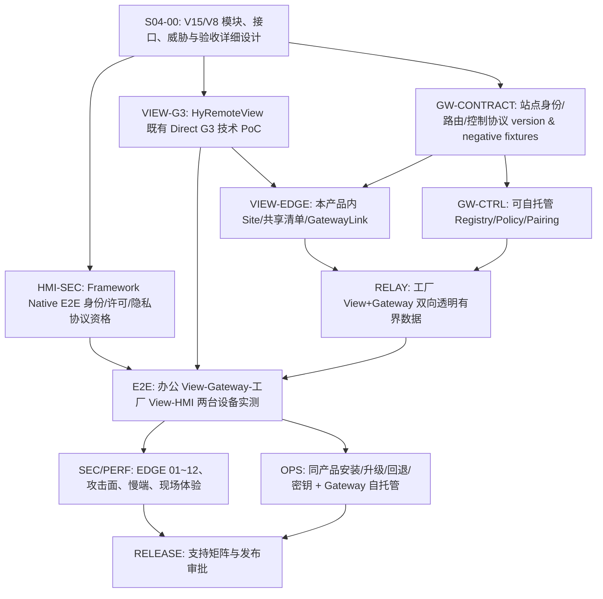

# HyRemote Stage 04 — EDGE 产品验收追踪与模块实施依赖计划（设计稿 V1）

> 归属 [#837](https://github.com/skawu/HyRemote/issues/837)。**正式基线**：HYR-PD-001/V15 + HYR-ARCH-001/V8（2026-11-04 Human 批准）。**状态**：设计完成待实测，不代表 Managed Gateway 或 HyRemoteView 客户端已经实现。ADS 工程治理门禁已由 Human 撤销（HyRemoteView #11、HyRemote #14 均已废止），以下依赖图**没有 ADS 前置**。仅保留真实产品、技术安全、审查和发布准入。

## 一、12 个产品验收场景与证据责任

所有项以实际客户可观察结果验收，不以“Gateway 端口能监听”或“代码编译通过”取代完成。证据必须注明仓库 SHA、产品/Qt/OS 版本、设备配置、真实网络条件和运行日志。未知均为 `NOT_RUN`。

| ID | 最终用户应得到的结果 | 负责模块 / 仓库 | 必须有的反证测试 | 当前 |
| --- | --- | --- | --- | --- |
| EDGE-01 | 工厂 PC 仅安装 HyRemoteView 即能选择启用受控 Edge，不用第二个 Agent、Connector/Bridge、VPN | View 安装/Edge / HyRemoteView | 全新 PC 安装清单、开停/升级/卸载和用户使用录屏；不得暗装另一独立软件 | NOT_RUN |
| EDGE-02 | 云断网后 HMI 本地业务及工厂 Direct 访问仍正常 | View Direct / HyRemote HMI | 断开 WAN、断开 Gateway 后当前 Direct HMI/本地输入保持 | NOT_RUN |
| EDGE-03 | 默认不分享任何设备；未启用前异地无权访问 | Edge Site / Gateway Registry | 未登记/关闭共享时远端枚举及路由均拒绝 | NOT_RUN |
| EDGE-04 | 只共享 HMI1，不可横向访问 HMI2 或工厂其他网络资产 | Edge ACL / Gateway Broker | 枚举非共享 HMI、SSHD、任意 TCP、DNS 重绑定和扫描均拒绝 | NOT_RUN |
| EDGE-05 | 同名 HMI 在两厂不串站点、设备身份 | Registry / Device Identity | 同名不同 pin、路由 ID 替换、跨租户尝试拒绝 | NOT_RUN |
| EDGE-06 | Gateway 路由已获准但 HMI 不授权时依然不能看画面 | Remote DeviceSession / HMI | 站点允许、设备拒绝，零受限像素输出 | NOT_RUN |
| EDGE-07 | 查看与控制独立，现场撤权后新输入立即停止 | View Input / HMI Grant | 快速撤权、失焦、断链、held-key release 与旧输入回放 | NOT_RUN |
| EDGE-08 | 隐私与受限目标过滤在 HMI 端实施，不靠 Edge 事后掩码 | HMI Privacy / Edge Relay | 隐私状态改变、旧帧缓存/断线重连，违规泄漏为 0 | NOT_RUN |
| EDGE-09 | Gateway/Edge/HMI/Viewer 任一断开都有准确状态，不复活旧权限 | 多层状态/超时/route epoch | 分别切断链路/杀进程/重启并校验路由和 DeviceSession | NOT_RUN |
| EDGE-10 | 关闭单画面窗口、退出程序、用户注销、OS 重启/升级时产品行为明确 | View Lifecycle + Package | 不同 OS 支持等级实测；不支持无人值守则不可宣称后台在线 | NOT_RUN |
| EDGE-11 | 一工厂 View 服务多 HMI、多 Viewer，现场优先、资源有界、不重复采集/压缩 | Edge ByteRelay / Gateway Relay / HMI | 慢网、动态画面、不同分辨率，测 Host CPU/帧龄/RSS/队列/现场响应 | NOT_RUN |
| EDGE-12 | 服务到期/云不可用不剥夺永久合法 Direct 使用权 | Licensing + Direct / HMI | 断网/服务不可用后的基础局域网合法连接 | NOT_RUN |

验收红线：未授权查看或输入、跨站点路由、无边界转发、设备隐私泄漏、重放旧控制等安全问题为**零容忍**。CPU/FPS/延迟目标沿用产品验收研究的测量方法，具体数字如未获正式签收，只能标注候选，不得自定义产品保证。

## 二、实施依赖关系（产品优先，最小必要 PoC）

**ADS 全部不参与上述准入。** 尤其不得把原 HyRemoteView #11 的 Adoption、Ready/Claim/Result 作为 Task DAG 节点。HyRemoteView 技术 G3 的实际 PoC **不是 ADS**，它仍提供协议正确性、Qt 快速渲染、TLS 安全和性能的必要事实。代码实施须以模块设计/接口评审及对应安全风险评估就绪为前提，并通过各仓库常规 PR/CI/设备测试。

## 三、WBS、跨仓边界与可并行执行内容

| WBS | 可独立交付的成果 | 主导仓库 | 具体准入与反证 |
| --- | --- | --- | --- |
| S04-00 | 已批准产品/架构对齐的模块及安全契约、12 场景矩阵 | HyRemote | 本轮文档差异审查和 PR，不能冒充功能已实现 |
| VIEW-G3 | 最小 bounded RFB/Direct Viewer 端到端技术 PoC；Qt6 RemoteSurface/输入/异常路径 | HyRemoteView | #5/#9 技术 PoC 任务无 ADS 阻塞，要求实际 SHA/Kit/结果 |
| HMI-SEC | Native TLS 端到端设备身份、DeviceSession View/ControlGrant 与隐私执行 | HyRemote | 不准用外层 WSS 代替设备端 E2E，加密路径/证书轮换需真实资格 |
| GW-CONTRACT | Gateway 控制信封、认证身份绑定、配对撤销/资源模型及负面 fixtures | 设计责任归 HyRemote，实施仓库待事实决策 | 明确协议字段和重放、错误码；不得偷改 Native 1.0 设备报文 |
| VIEW-EDGE | HyRemoteView 内置管理员 Site 与共享清单、出站安全连接、HMI 设备 pin | HyRemoteView | 一安装包/一个产品，默认禁用 Edge，网络地址不授权内网任意 TCP |
| GW-CTRL | Gateway 最小可自托管 Registry/PolicyBroker + Relay | Gateway 仓库尚未确定；独立工程规划 | 不许为了快速上线要求工厂额外安装独立软件 |
| RELAY | View 的 RouteAdmission/ByteRelayPump + Gateway 透明数据 | HyRemoteView + Gateway | 端到端字节顺序/完整性、queue/OS buffer 实际上限、撤销超时 |
| E2E | 两台 HMI + 工厂 View + 办公 View + Gateway 的安全受管用户旅程 | 联合工程 Owner | 先 Device E2E 安全 PASS，再允许声称公网 Managed 能用 |
| SEC/PERF | 12/12 产品场景、安全威胁、负载与可靠性证据 | QA + Security | 场景按设备分档 NOT_RUN/FAIL/PASS，零安全越权 |
| OPS | View 安装/后台声明/升级/回滚 + Gateway 自托管证书运维 | Delivery | 真实 Windows/Linux；无额外厂内部署软件；服务模式需实测 |
| RELEASE | 独立产品/版本门禁 | Release Owner/Human | #190 仍 post-GA conditional，不能因 V15/V8 批准抢跑实际发行 |

### 三项可独立推进的工程准备

- **View Direct PoC 轨道**：可继续按已有 [HyRemoteView #5](https://github.com/skawu/HyRemoteView/issues/5)/[#9](https://github.com/skawu/HyRemoteView/issues/9) 推进，它不会因 Gateway 长期方案而被锁死；先证明完整 Viewer 客户端。
- **HMI Secure Native 轨道**：安全通信和设备端授权必须先有可运行依据，仍遵守 Framework Native 1.0 独立协议/G7 冻结要求。
- **Gateway 协议与威胁轨道**：可并行完成数据模型/短期令牌/租户隔离和最小单节点自托管运维设计，但在没有设备 E2E 安全资格时不对外开放真实 HMI 画面访问。

## 四、明确暂不冻结的工程选择

下列都不会由 ADS 或旧实现路线机械决定，需基于真实产品场景和证据完成技术选型：

- Gateway 编程语言、存储数据库、自托管服务打包、证书续期方案；
- WebSocket over TLS 1.3（当前首选候选）与 HTTP/2 CONNECT/QUIC 的取舍，需真实工厂网络和 Qt 6.8 Kit；
- 工厂 HyRemoteView 内 GUI、内部后台运行组件采用同进程还是同安装包多进程，必须保持一安装、统一更新卸载；
- 登录期在线 vs 注销后仍在线：以产品支持分档和真实平台资格决定；未获批准不可口头扩大承诺；
- Native 安全会话完整实现后是否扩展 Managed 安全 RFB 兼容性，不能把 VNC Auth 当作 E2E 加密；
- 具体 CPU、内存、最大站点设备数、同时 Viewer 数及公网时延目标：按目标设备等级/网络真实测量后签收。

## 五、最小可证伪的首批技术试验

| 验证 | 要回答的产品问题 | 建议最小试验 |
| --- | --- | --- |
| T-01 | View 能否作为一个产品在 Windows/Linux 运行 Direct | 原 #9 最小 RFB 客户端 + 单个 HMI，像素/输入/异常返回可验证 |
| T-02 | Qt 6.8 的网络组件能否严格控制资源 | WSS/TLS 单连接，限制接收缓冲/消息尺寸/日志内容，超限 fail-closed |
| T-03 | ByteRelay 能否透明转发而不扩大 HMI 能力 | 随机二进制序列双向对照、缓慢消费者/断开/重连无截断重放 |
| T-04 | 站点/设备授予网络路由不能代替设备端查看 | 同站点批准、HMI 无 Grant，必须零画面输出 |
| T-05 | Edge 是否成为任意内网代理 | 非共享 IP/端口、DNS rebinding、跨站点 hmiId 全部拒绝 |
| T-06 | 同一 View 安装是否真实满足产品部署 | 干净 Windows/Linux 安装、Edge 启停与正常 GUI、卸载无残留独立程序 |
| T-07 | 是否增加现场 CPU/画面时延 | 同一 HMI Direct vs Managed 在相近网络下、静态/局部/全屏动态与本地输入同时测量 |

真实试验状态当前**全部 NOT_RUN**；任务设计完成不等于产品已具备功能。

## 六、当前阶段准出标准

- **文档层：** V15/V8 约束、模块职责、数据模型、协议安全与 12/12 产品场景全部可追踪；P1/P2 文档审查收口。
- **源码层：** 本轮不修改任何 HyRemoteView/HMI/Gateway 产品源码，仅归档实施合同。
- **技术层：** 具体协议 wire、资源预算与登录后台资格暂不宣布冻结；真实技术试验将由下一期开发任务承担。
- **治理层：** ADS 专属门禁全部作废；常规技术/安全/发布门禁仍正常。#190 后 V1 候选不提前激活版本。
