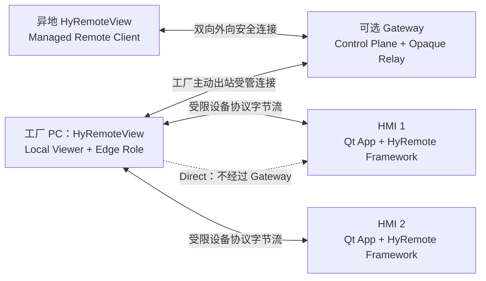
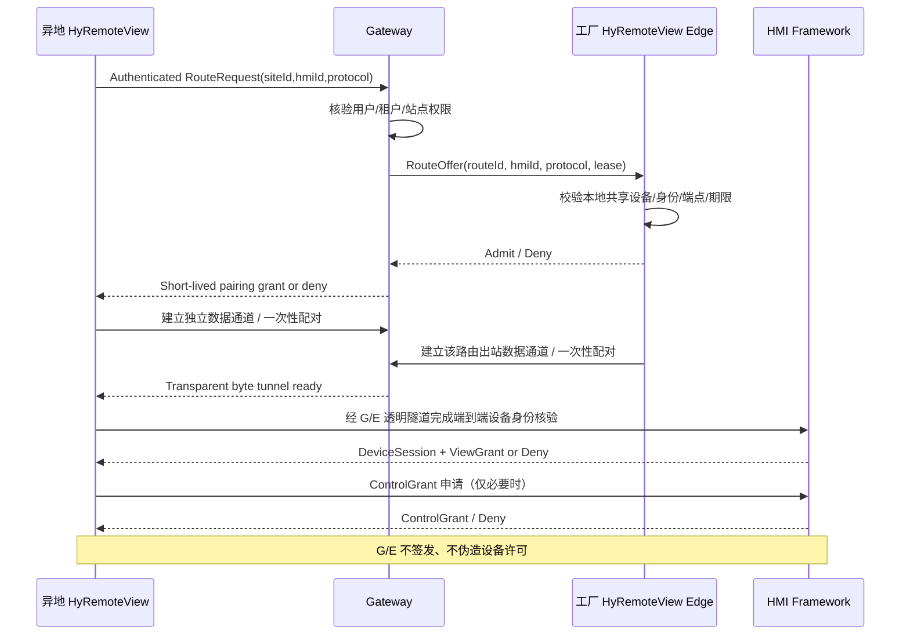

# HyRemote Stage 04 — Managed Edge 模块详细设计（技术设计稿 V1）

**设计基线：** 《HyRemote 产品设计文档》HYR-PD-001/V15、《HyRemote 产品架构文档》HYR-ARCH-001/V8（均正式批准）；任务 [#837](https://github.com/skawu/HyRemote/issues/837)，上游实施候选 [#190](https://github.com/skawu/HyRemote/issues/190)。  
**状态：** `DESIGN_CANDIDATE`，无代码实现许可，无公网支持声明。Human 批准的方案 B、工厂 PC **只部署 HyRemoteView** 为不可擅改产品约束。  
**研究定位：** 以用户可完成的远程维护任务、授权正确性、故障安全及现场性能为先；模块/语言/库服从这些目标，不服从现有代码路径。

## 1. 产品行为与拓扑

1. **工厂侧部署物只有 HyRemoteView 一个产品**。即便内部需要 UI/后台隔离，亦由一个安装包、一个设置与凭据管理体系、一个升级/卸载责任承载；不得要求客户另装 Edge Connector、Support Bridge、VPN 或代理软件。Gateway 属于云端/客户自托管服务器，不属于工厂 PC 的伴生安装软件。
2. HMI 的 Qt App 与 Framework 决定画面、目标、身份、ViewGrant/ControlGrant、隐私及输入。工厂 View 不是第二个 HMI 采集/编码服务。
3. 未启用/未被管理员授权的 Edge 默认不发布 HMI，也不建立任何 HMI 受管路由；可独立使用 Direct，即使 Gateway 断线也不降低其安全条件。
4. Gateway 不连接 HMI 私网、不能远程端口扫描，也不能把工厂 Edge 变成客户厂区的通用 TCP 代理；仅在有效短期令牌下与具体注册 HMI 进行对应会话的字节转发。
5. V15 已批准“画面帧时序的合并或丢弃属于 HMI 设备端编码/加密之前”。在 Edge、Gateway 中只做**有界字节缓冲/背压/超时/断开**，不能在透明的 RFB/Native 加密字节流中任意删节。

## 2. 模块清单（职责、依赖与边界）

下列名称是设计级内部职责，**不是新增独立安装包**；可按最终并发与安全实证作内部代码组织调整。

| ID | 运行位置 / 模块 | 主要职责 | 不允许承担 | 对外最小接口 |
| --- | --- | --- | --- | --- |
| V-01 | 工厂/异地 View — `ViewerWorkspace` | 设备/会话 UI、Direct 连接入口、目标显示、焦点与控制反馈 | TLS/WS 协议解析、保管长期密钥、绕过设备端授权 | `listDevices`, `openDirect`, `openManaged`, `closeSession` |
| V-02 | 工厂 View — `EdgeSiteManager` | 管理员启停、站点身份、共享 HMI 清单、撤销与配置迁移 | 任意局域网探索或自动允许全部端口 | `enableSite`, `registerHmi`, `suspendHmi`, `getSiteState` |
| V-03 | 工厂 View — `GatewayLink` | 出站控制通道、Gateway 身份核验、心跳、重连、凭据更新 | 直接授予 HMI 控制权，匿名跨域降级 | `connect`, `disconnect`, `onRouteOffer`, `onPresenceChange` |
| V-04 | 工厂 View — `RouteAdmission` | 对一次路由核对站点/设备/协议/操作者/令牌/有效期/设备端点 | 无 ACL 的端口映射和 DNS 代理 | `admit(offer)`, `revoke(routeId)` |
| V-05 | 工厂 View — `ByteRelayPump` | 指定 HMI socket 与 Gateway 数据流间的透明、有界双向数据泵 | 解析画面、解码 RFB、任意丢加密内容、自动重放输入 | `start(RouteLease)`, `close(reason)`, `metrics()` |
| V-06 | 异地 View — `ManagedGatewayClient` | 用户身份、站点列表/设备范围、会话请求与可信边缘路径显示 | 把站点准入当作设备认证、弱协议自动回退 | `listAuthorizedSites`, `requestRoute`, `routeState` |
| V-07 | 异地 View — `DeviceProtocolSession` | Native/RFB 连接、HMI 端到端设备身份、安全会话、View/ControlGrant | 把 Gateway TLS 视为 HMI 端到端加密 | `attachByteStream`, `verifyHmi`, `requestView`, `requestControl` |
| G-01 | Gateway — `Registry` | 站点/Edge/HMI 身份登记、共享关系与版本状态 | 保存明文 HMI 画面/按键 | `enroll`, `bindHmi`, `setPresence` |
| G-02 | Gateway — `PolicyBroker` | 用户鉴权、租户范围、路由授权、一次性配对、撤销与 TTL | 替 HMI 签发 View/ControlGrant | `authorizeRoute`, `issuePairing`, `revoke` |
| G-03 | Gateway — `RelayNode` | 两侧短期配对、透明数据转发、有界缓冲/带宽、故障清理 | 解密 Native 设备内容、内网探测、业务操作 | `pair`, `pump`, `stop` |
| G-04 | Gateway — `AuditOps` | 最少必要的访问与失败元数据、监控/健康/更新回滚 | 明文凭据、截图、键盘文本和敏感文件 | `appendEvent`, `readHealth` |
| H-01 | HMI — 已批准 Framework | 目标授权、设备端协议身份、会话和画面/输入/隐私执行 | 依赖 Gateway 存在才能 Direct 运行 | 现有 Native/RFB 可信监听与会话契约 |

**依赖规则：** View/Gateway 的受管接入协议不进入 HyRemote Core/Shared Runtime；HMI 仍支持 Qt5/Qt6 的正式宿主接入分档，而 **HyRemoteView 产品自身**既有 G2 客户端路线是 Qt 6.8 LTS / C++17 / Qt Quick（以 `skawu/HyRemoteView#4` 为准）。不能把“Framework 支持 Qt5”误解成“View/Gateway 必须各自构建 Qt5 版”。

## 3. 数据模型（规范性字段与不变量）

| 对象 | 最小字段 | 必须满足的不变量 |
| --- | --- | --- |
| `SiteIdentity` | `siteId`, `tenantId`, `edgeInstanceId`, `credentialRef` | ID 与证书/签名身份绑定，不以公网 IP 识别站点 |
| `RegisteredHmi` | `siteId`, `hmiId`, `deviceIdentityPin`, `approvedEndpoints[]`, `allowedProtocolModes`, `shareState`, `policyVersion` | 不按网络段/通用 DNS/默认端口扫描；地址变化必须重新信任校验 |
| `RemoteOperator` | `principalId`, `tenantId`, `authenticationContext` | Gateway 用户身份不是设备协议用户身份 |
| `RouteRequest` | `routeRequestId`, `siteId`, `hmiId`, `requestedProtocol`, `operatorId`, `expiresAt`, `requestNonce` | 唯一身份、目标、协议、期限，签名/认证保护；拒绝重放和跨站 |
| `RouteLease` | `routeId`, `routeEpoch`, `hmiBindingVersion`, `sitePolicyVersion`, `pairingProof`, `expiresAt`, `idleTimeout` | 过期和撤销不可自动续权；一个 routeId 只绑定当前一对获准端点 |
| `RouteChannel` | `routeId`, `direction`, `maxQueueBytes`, `deadline`, `state` | 仅递送原字节，保持每方向顺序，队列不无限增长 |
| `DeviceSession` | `deviceSessionId`, `hmiAuthenticatedIdentity`, `viewGrant`, `controlGrant`, `scope` | 只能由 HMI 实际授权消息赋权；不会从 RouteLease 推导权限 |
| `SiteStatusSnapshot` | `gatewayLink`, `edgeReady`, `hmiReachability`, `routeCount`, `observedAt`, `freshness` | 每个维度独立、存在过期时间；绝不由 Edge 在线推导所有 HMI 运行正常 |

产品级字段的持久序列化/网络编码格式留在专门的**路由协议契约**中版本化，不把路由内控字段加入 HMI Native 1.0 报文或现有用户 SDK。

## 4. 工作流程与调用时序

### 4.1 管理员共享 HMI

1. 工厂管理员使用 Direct 连到 HMI，并通过可信资料核实 HMI 设备身份。未得到设备身份的可信凭据，不允许共享。
2. 管理员在 **同一 HyRemoteView** 的站点设置中选择 Gateway，执行可信身份绑定并显式 `enableSite`。
3. 每台 HMI 以 `RegisteredHmi` 单独登记，默认 `DISABLED`；明确允许后才成为 `SHARED`。登记必须包含设备身份绑定、唯一地址与允许的协议端点。
4. Gateway 只收到最小必要的站点/共享设备元数据，默认无明文画面、输入或业务数据。
5. 管理员能独立撤销 HMI1，不应连带撤销 HMI2 的合法 Direct；整个站点暂停时所有 Managed Route 均停止。

### 4.2 异地申请并查看（第一个独立的完整产品闭环）

**重要限制：** 时序图中的 `O->>H` 表示穿过 G/E 的**逻辑设备协议**，不是跨网直连 HMI 或 Gateway 知道设备协议内容。对于未能提供端到端 HMI 保护的老 RFB 模式，Managed Public 路线必须 fail-closed；只有另行证明的加密兼容模式才可启用。

### 4.3 设备端授权撤销、断线与恢复

- HMI 撤销 View/ControlGrant：设备端立即拒绝新权限输入，清理待发敏感画面和按键；中间路由即使仍存在，也不重新授予授权。
- 管理员撤销站点 HMI 分享：Edge 标记新 `policyVersion`，停止新路由并关闭对应旧 lease；Gateway 收到撤销事件后更新站点可见性和审计元数据。
- Gateway 故障：Edge 标记连接 `OFFLINE`，异地受管会话不可用，原工厂 Direct 与 HMI 本地 UI 持续运行；恢复时重新核实 Site、HMI identity、route lease，不自动复活旧控制权。
- 工厂 HyRemoteView 退出/崩溃/注销：不延迟假称在线；当前 Route 失效，旧输入不可重放；后台运行能力按该 OS 产品档位公开声明并通过真实验收。
- HMI 地址/证书更换：`RegisteredHmi` 进入 `NEEDS_REVERIFY`，拒绝新的受管路由；不能仅更新 IP 而继续信任旧设备身份。

## 5. 状态机（只记录本层真实状态）

| 层 | 状态集 | 关键事件与约束 |
| --- | --- | --- |
| Site sharing | `DISABLED` / `ENROLLING` / `ENABLED` / `SUSPENDED` / `FAULTED` | 默认 `DISABLED`，仅管理员动作可启用；网络断线不改变本地授权配置但导致不可用 |
| Gateway link | `DISCONNECTED` / `AUTHENTICATING` / `READY` / `RETRY_WAIT` / `REVOKED` | 认证错误/证书错误拒绝重试降级；重连须受限重试与可信身份核验 |
| HMI share | `DISABLED` / `VERIFYING` / `SHARED` / `PAUSED` / `NEEDS_REVERIFY` | 一台 HMI 的状态不自动传递给其他 HMI |
| Managed route | `REQUESTED` / `SITE_APPROVED` / `EDGE_APPROVED` / `PAIRING` / `FORWARDING` / `CLOSING` / `CLOSED` | `FORWARDING` 只是网络就绪，**不表示 ViewGrant/ControlGrant** |
| HMI session | 继续使用已批准的设备端 Session/Grant 状态 | 与 Managed route 状态相互独立，端设备处理所有实际查看/控制许可 |

路由 epoch 递增避免旧数据通道或旧配对凭据在重连后意外复活；对于恢复的应用层会话，必须重新走设备端身份和许可流程，不把“恢复 socket”当“恢复控制权”。

## 6. 运行模式与交付最小化

| 等级 | 客户可见行为 | 设计选择 |
| --- | --- | --- |
| 交互式（可在首期资格验证） | GUI 启用站点共享后，关闭单个远程画面窗口仍可维持 Edge；显式“退出 HyRemoteView”结束 Edge；用户注销后不可保证继续运行 | **不假设开机无人值守**；产品 UI 必须准确报告这些限制 |
| 受管后台（后续按平台资格） | 管理员启用后可按平台支持保持后台 Edge；统一安装、升级、停止、凭据与权限，GUI 可选 | 可采用**同一产品安装内容中的内部服务/进程**，不额外要求安装独立产品；需独立安全与升级验收 |
| 工厂无公网 | Direct 仍工作，受管 Gateway 状态显示不可用 | 不触发不安全的自动直连回退 |

V15/V8 **没有**直接规定“一定在用户注销后 24×7 在线”；首期是否把“无人值守登录外持续在线”作为支持承诺，需要由产品支持等级与真实平台证据签收，不能在详细设计中假造已批准需求。内部独立进程不是独立软件产品，但须保证一安装包、一授权入口、一生命周期和卸载完整性。

## 7. Qt 与技术机制的选择边界

- **HyRemoteView**：遵从其已冻结 G2 的 Qt 6.8/C++17/Qt Quick/CMake 路线；C++ 负责业务实体/IO/协议，QML 负责 UI 组合。不为 Edge 另造跨平台 UI。
- **HMI Framework**：保持 V15/V8 的 Qt5.15 与 Qt6.8（按该发行阶段实际支持）及四接入路径；Gateway/Edge 的控制协议不得依赖 Qt5/Qt6 专有 Qt MetaObject 序列化。
- **候选外向通道**：WSS/TLS1.3 over TCP443 为工程首选候选（现 #190 历史安全方案也如此），HTTP/2 CONNECT、QUIC 是后续替代/优化候选；企业防火墙代理证据与 TLS Kit 必须先验证。不要把默认 WebSocket 内部缓冲视为有界。
- **端到端信任**：Route/TLS 是网络/站点保护，Native Device TLS 和设备授权是另一层独立保护。标准 RFB 的不安全配置不得直接获得 Managed Public 支持标识。
- **服务端语言/数据库**：本文件**不冻结**语言、框架、存储品牌或基础设施平台；由吞吐、灾备、自托管可操作性、依赖与安全维护成本决定，禁止无目的引入微服务集群。

## 8. 工程接口设计准入

每个模块进入代码开发之前，必须提交如下**可独立验收的接口契约**，并由 Owner 审查：

1. 输入/输出字段、ID/权限/版本与授权不变量；错误分类、时限、重试边界。
2. 线程亲和性与回调取消/生命周期：网络 I/O 不得阻塞 UI/HMI 现场业务。
3. 数据可见性：令牌/凭据是否可被 UI、日志、转发节点读到；需要硬性保护的路径。
4. 连接断开、权限撤销、租户改变、证书更换、设备地址变化时的 fail-closed 行为。
5. 资源上限、负载/故障测试用例及支持环境（NOT_RUN 或真实 PASS）。
6. 客户打包更新/回退策略：工厂只安装 HyRemoteView 的验证证据。

**Stage 04 状态：** 本文件定义模块与接口责任；部署实现、公共协议、平台运行能力均未通过 PoC。工程详细选型仍受 [HyRemoteView#11](https://github.com/skawu/HyRemoteView/issues/11) 的 ADS 门禁约束。
