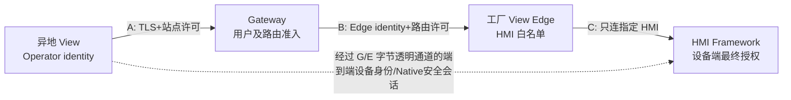

# HyRemote Stage 04 — Managed Edge 连接协议、安全与故障契约（技术设计稿 V1）

**依赖：** HYR-PD-001/V15、HYR-ARCH-001/V8、[#837](https://github.com/skawu/HyRemote/issues/837) 模块设计。**状态：** 设计候选，未实现、未运行安全 PoC、非发布 API。**目标：** 四层分离：Gateway 用户/站点准入、工厂 Edge 设备白名单、端到端 HMI 身份与设备会话 View/ControlGrant、宿主业务结果确认。

## 1. 安全承诺和不能混淆的四种身份

- `OperatorPrincipal`：谁请求了受管访问，由 Gateway 的可核验认证上下文标识；
- `SiteIdentity + EdgeInstanceIdentity`：哪个客户工厂与哪份经过登记的 HyRemoteView Edge 实例在提供站点通路；
- `HmiDeviceIdentity`：真正被访问的 HMI；须由异地 View 经**端到端设备协议**独立核验，不因 Gateway/Edge 给出某 IP 就自动可信；
- `DeviceSessionGrant`：HMI 上对当前用户、当前目标、当前时间的查看/控制/业务授权；Gateway 不产生此 Grant。



Gateway TLS 的加密通常只保护 Gateway 链路；**若 Gateway 终止这一层 TLS，它仍有能力看到受管隧道内未另外加密的 HMI 协议字节**。不得以“客户端到 Gateway 使用 wss://”声称屏幕/控制具有端到端保密。Managed Public 的安全支持范围必须由实际运行的设备端 Native/TLS（或另经证明等效的 RFB 端到端加密模式）决定。当前普通 RFB/VNC Auth 不能默认为安全公网可用。

## 2. 协议层与握手选择（分离已批准约束和实施候选）

| 层 | 已批准不变量 | 首选详细设计候选 | 生效条件 |
| --- | --- | --- | --- |
| O/E ↔ Gateway 认证保护 | 受管链路可信、不可降级 | TLS 1.3 / TCP 443；Qt View 侧先研究 `QWebSocket` 客户端 WSS | TLS 后端证书、代理、防火墙在真实 Kit 上验证；不得忽略 SSL errors |
| Gateway 控制面 | 管理站点/设备路由，不碰 HMI grant | 版本化 JSON 或 CBOR 控制信封（两者待 PoC 尺寸/解析比较）；单一业务 schema，不使用 Qt 私有序列化格式 | 版本协商、消息尺寸上限、未认识必需字段的 fail-closed |
| Gateway 数据面 | 透明双向字节、正确顺序、有界 | 每条 RouteLease 独立 WSS 二进制数据通道，控制和数据相互独立；HTTP/2 CONNECT 保留备选 | 验证不完整包、背压、公网代理、延迟和链路续接语义 |
| O ↔ HMI 设备协议 | Native 和 RFB 独立；设备端最终授权 | Native 的端到端身份与内容保护为首期 Managed Public 必备前置；RFB 仅在真正安全模式完成资格后列支持 | Native 1.0 wire 不因路由层自行更改；现有 Native 未完整交付即标 `NOT_READY` |
| Gateway 部署 | 自托管可行、云可选 | 先单节点可维护控制+Relay，再根据真实负载拆分 | 自托管安装、TLS/备份/日志/升级/回滚验证 |

**TLS 参考基线：** [RFC 9846（TLS 1.3，2026-07，取代 RFC 8446）](https://www.rfc-editor.org/info/rfc9846/)；WebSocket 协议 [RFC 6455](https://www.rfc-editor.org/info/rfc6455/)；需要证书绑定凭证机制时可对比 [RFC 8705](https://www.rfc-editor.org/info/rfc8705/) 与 [RFC 9449](https://www.rfc-editor.org/info/rfc9449/)。本设计没有声称仓库当前已有这些功能。

## 3. 版本化 Gateway 控制信封（设计级字段，不是最终 wire）

规范字段：`protocol="hyr.edge.control"`, `major`, `minor`, `kind`, `requestId`, `siteId`, `edgeInstanceId`, `issuedAt`, `expiresAt`, `nonce`, `authContext`, `body`。

- 不能因收到字段 `principalId` 就信任其身份；`authContext` 必须与**已经完成校验**的 TLS/用户会话绑定。Payload 中的不可信 ID 必须与已认证通道和服务器状态一致。
- `major` 不兼容直接拒绝并明确原因，不自动切换到无认证旧协议；新增必需能力必须在 `capabilities` 协商中明确。
- `kind` 由明确消息类型集合限制；未知类型与超长/过深、循环、重复字段的解析结果拒绝，不落入任意“控制命令执行器”。
- 所有时间戳为 UTC 墙钟时间，且验证本地单调计时上限和 bounded skew；失去可信时间源时不延长既有过期许可。
- 所有 `requestId/routeId` 不得从用户提交内容直接用作日志路径/临时文件名/URL 端口。

### 3.1 控制消息最小集合

| 消息 | 发起 → 接收 | 关键字段 | 成功/拒绝条件 |
| --- | --- | --- | --- |
| `EnrollStart` / `EnrollConfirm` | 工厂 Edge ↔ Gateway | 站点/Edge 公钥绑定、管理员确认、版本 | 仅一次受管登记，未知/过期站点不能自动登记 |
| `EdgeHello` / `EdgeAccepted` | 工厂 Edge ↔ Gateway | `siteId`, `edgeInstanceId`, `sessionEpoch` | 证书/密钥身份真实，与启用站点匹配 |
| `PresenceRefresh` | Edge → Gateway | 每台共享 HMI 的最小状态、`policyVersion`、鲜度 | 报告自身观测到的状态，不代替设备端授权 |
| `OpenRouteRequest` | 异地 View → Gateway | `siteId`, `hmiId`, `protocolMode`, `operatorId` | 当前用户/租户/站点获准、请求期限合理 |
| `RouteOffer` / `RouteDecision` | Gateway ↔ Edge | `routeId`, `routeEpoch`, `hmiId`, `hmiBindingVersion` | Edge 本地共享 ACL 再审查，不能依赖云端曾经批准 |
| `PairGrant` / `PairReady` | Gateway ↔ 两侧 View | 单次配对证明、route ID、方向、到期 | 两端与原 RouteLease 匹配，单次消费，无跨 Route 复用 |
| `RouteRevoke` / `RouteClosed` | 管理面/边缘/Gateway | `routeId`, `policyVersion`, `reason` | 撤销幂等、优先于数据面，关闭残留队列 |
| `ControlHeartbeat` / `PeerHealth` | 各侧控制连接 | `epoch`, `observedAt` | 心跳只证明链路，不证明 HMI 可用或有控制权 |

### 3.2 数据通道的不可分割条件

数据通道只允许 `pair(RouteLease)` 后进入 `FORWARDING`。任何数据通道重建必须持有**新的**路由 epoch 和一对有效凭据；不在旧通道上传旧 grant，也不把旧 TCP 流随意拼接进新加密会话。

收到数据只在有界 byte queue 中排队；数据顺序/完整性由传输机制维护。Gateway/Edge 不识别 HMI Native/RFB 帧类型、不缓存完整屏幕、不裁剪 RFB 画面增量、不替用户输入，不把握手、画面字节或控制内容写入审计。

## 4. 安全控制流程与权限撤销规则

### 4.1 三个独立准入门

- **Site Gate（Gateway）：** 操作者当次有效身份、租户与站点范围，允许提出指定 HMI 的路由申请；
- **Edge Gate（工厂 View）：** 当前站点管理员实际启用，`hmiId` 在实时本地共享白名单，目标地址/端口/设备身份固定且未改变，协议模式被准许；
- **Device Gate（HMI）：** 经中转的端到端身份校验完成，并收到 HMI 对具体目标的 ViewGrant/ControlGrant（及业务授权）；任一层不同步不得标为可控制。

### 4.2 设备白名单与防跳板

1. 仅由管理员完成身份验证的 HMI 注册形成精确 `hmiId → approvedEndpoint(address,port,protocol,identityPin)`；**不支持用户输入任意 host:port**，不允许远程传 URL 来指定目标。
2. 地址变化、证书不匹配、站点归属变动进入 `NEEDS_REVERIFY`；不能通过自动扫描网段找到“同名设备”再自动信任。
3. DNS 如用于连接已经登记的 HMI，解析结果仍需满足批准的端点策略/重绑定保护；不允许 DNS 返回公网、loopback、私网其他受限地址后无条件转发。
4. Gateway 不能把 route 的 `hmiId` 改写为另一台 HMI 或重复配对到已有租户；每条 RouteLease 明确绑定一次用户/站点/设备/协议。
5. 安全事件日志只记录必要元数据（routeId hash、时间、结果、错误码），敏感密码/证书私钥/令牌不存日志。

### 4.3 撤销优先级

```text
管理员停止整个 Site / 撤销共享 HMI -> Edge 更新本地 policyVersion -> 立即关闭相关路由
Gateway 用户/租户授权撤销          -> 先停止新路由 -> 关闭相关既有 RouteLease
HMI 控制权/可见范围撤销             -> HMI 立刻拒绝新控制输入/待发受限内容
任何层发现证书身份不匹配/过期        -> fail-closed；不得改试不安全 RFB/Direct
```

这些事件异步传输，**不能保证已经交付给远端的历史画面被删除**。必须在 HMI 端对每次受限输出先做权限/隐私处理；Gateway/Edge 只保证不再给已经失效的路由继续转发排队字节，必要时断开连接而非继续消费不可信缓存。断网恢复重新审批后可创建新路由，不自动重放旧输入、文件提交或业务动作。

## 5. 状态、超时与可恢复性

| 场景 | 预期状态/处置 | 禁止行为 |
| --- | --- | --- |
| 工厂 Edge 未启用、认证失败 | `SITE_DISABLED` / `EDGE_AUTH_FAILED`，不开放路由 | 缓存旧令牌无声恢复 |
| 工厂外网/Gateway 掉线 | `GATEWAY_OFFLINE`，Managed 不可用、Direct 正常 | 宣称 HMI 全部“离线”或自动明文 RFB |
| Gateway 在线但 HMI 不可达 | `HMI_UNREACHABLE`；目标设备仍可展示过期的目录信息但不得标记在线 | 把 Gateway heartbeat 当设备健康 |
| HMI 设备身份变化 | `HMI_IDENTITY_CHANGED`，拒绝新路由并终止敏感会话 | 自动更新 pin 或信任新 IP |
| Token 过期/已使用 | `ROUTE_EXPIRED` 或 `PAIR_REPLAY` | 重试旧 token、跨用户复用 |
| 慢接收方长时间阻塞 | 背压超时、`ROUTE_OVERLOADED` 后受控断开 | 无界排队、任意删除已加密字节 |
| 多个 Viewer | 每个会话独立 `RouteLease`、HMI 端各自授权 | 复用错误的 ControlGrant、用户串会话 |
| 本地 PC 退出/用户注销 | 若无经平台实测的后台能力，则 `EDGE_OFFLINE` | 把“上次已启用”当现在在线 |

**超时与容量数字：** V15/V8 没有批准固定毫秒/MB/设备数。工程原型可采用明确标记 `DESIGN_DEFAULT` 的小容量配置做负向测试，最终按工厂 PC 硬件分档与安全/性能 PoC 签收。所有 buffer 限额必须同时覆盖 Qt 的内部接收缓冲、业务队列、Gateway 中间缓冲与 OS socket 层可控部分；单独对业务队列限流不代表进程内存有界。

### 5.1 推荐的资源预算公式（不提前冒充正式标准）

设 `N` 为当前活跃 route 数、`Qe`/ `Qg` 为 Edge/Gateway 每方向应用级队列字节上限、`W` 为网络库的内部接收/写缓冲可观测上限、`R` 为 Route 实际元数据与 OS buffer 开销，则理论可控内存近似预算：

`B_edge(N) = B_fixed + N * (2*Qe + W + R)`。同理计算 `B_gateway`。要求独立统计内存 RSS/private、队列高水位、bytes outstanding、超时/限流事件，不用公式推导的值替代实测。

**Qt 风险：** [Qt 6.8 QWebSocket](https://doc.qt.io/qt-6.8/qwebsocket.html) 的 `readBufferSize=0` 默认**无界**；工程必须显示设置接收限制，并结合该 Qt 版本是否具备入站 frame/message 上限 API 进行真实测试。不能用 Qt 最新 6.12 的新增 API 假装 Qt6.8 也存在。WebSocket 代理与 TLS 后端功能须按选用 Kit 验证，所有 SSL peer errors 必须 fail-closed。

## 6. 威胁模型与最低限度反证

| 攻击/故障 | 安全控制/可观察测试 |
| --- | --- |
| 攻击者获得旧配对令牌 | 短期、单次、通道身份绑定、route epoch 与服务器端用后即销毁；重放必须失败 |
| Gateway 路由串租户/站点 | 租户范围在 Registry/Broker/Relay 三处保持一致；跨租户 `hmiId` 或 routeId 伪造拒绝 |
| Edge 被请求访问路由表任意地址 | 不接收 endpoint raw input，目标由当前允许 HMI registry 解析，端点变更 fail-closed |
| Gateway/Edge 试图冒充 HMI | Viewer 的 HMI 身份校验必须到设备端协议；更换证书/替身 HMI 的错误可复现 |
| 云端账号取得站点许可但无 ViewGrant | Tunnel 可以建立，**画面访问仍拒绝**；没有输入权限 |
| 中间节点窥探明文 RFB | 没有设备层端到端加密时 Managed Public 不提供支持声明或直接拒绝 |
| Gateway 被攻击者挤占流量 | 全路径有界队列/并发/速率/TTL/断开，保留其他站点独立性 |
| 网络恢复导致旧控制输入重复 | Route epoch 更新、设备端 session 重新认证，不重发旧命令 |
| 工厂 View 更新失败 | 受管站点按真实健康报告不可用，Direct 和 HMI 本地应用独立，凭据回退有界 |
| TLS / 证书到期或系统时钟漂移 | 认证失败不自动跳过证书验证；过期身份不续约，诊断明确 |
| RFB/Native 协议增量画面被中途删字节 | 模拟透明 relay 队列满，验证只会背压或断开，不产生屏幕随机错帧 |
| 普通用户意外开启站点分享 | 默认关闭，需经本地管理员确认，界面持续显示边缘状态，可随时撤销 |

## 7. 建议的安全与协议 PoC 顺序（当前**未授权执行**）

1. **安全 contract-only fixtures：** 不启用公网服务，用结构化测试向 Gateway Broker 投入无效用户/过期 token/跨租户/旧 policyVersion，请求必须拒绝。
2. **最小双向字节路由：** 用测试字节流证明序列完整、背压、队列上界、断线回收；此步**不能**宣称真实 HMI 公网安全。
3. **HMI Native 端到端安全 E2E：** Viewer 必须实际核验设备身份和安全会话，证据覆盖中继被替换、HMI cert 变化、ViewGrant/ControlGrant 撤权。
4. **网路压测与可维护性：** 不同企业代理/TLS 后端、工厂 View 退出/重启、Gateway 回滚、多个独立 HMI、慢接收方；在每个真实环境归档 exact SHA。
5. **正式权限/渗透评审：** 自托管配置、管理员身份、长效凭据保护、密钥轮换、日志隐私、限制用户枚举和审计真实性。

PoC 的代码只能在 HyRemoteView **ADS #11 门禁 PASS** 且工程任务获准后实施；设计文件/单测方案不会自动成为可合并的产品安全证明。

## 8. 设计待签收的选择和它们的产品影响

1. **控制信封用 JSON 还是 CBOR**：需要消息尺寸/错误处理/客户端调试性对比；均不改变“客户仅装 View”。
2. **TLS 客户端身份证明**：Edge 首选管理员登记的设备绑定密钥/mTLS；应用层证明持有密钥也可比较，要求证书生命周期可运维且无裸 bearer token 重放。最终经威胁建模 PoC。
3. **Qt WebSockets vs 其他可维护网络库**：不能为方便开发将 Gateway Wire 绑定成特定 Qt 二进制编码；View 只需符合既定 Qt6.8。
4. **同安装包后台的隔离级别**：最初声明“登录期共享”或增加内部受管后台，必须对注销/开机后可用性说真话；做成 24×7 需要真实服务资格，不因用户希望后台就跳过。
5. **Native 与安全 RFB 的首个 Managed 资格**：V15/V8 保留两设备协议，但安全公网需真实端到端能力；不允许把老 RFB None/VNCAuth 作为首期公网默认值。

### 本文件结论

`CONTROL_SECURITY_CONTRACT=DESIGNED`；`BINARY_WIRE=NOT_FROZEN`；`SECURE_HMI_E2E=NOT_PROVEN`；`MANAGED_PUBLIC_SUPPORT=NOT_QUALIFIED`；`PERFORMANCE_SLO=NOT_APPROVED`。不以这些未决事项阻止后续文档/风险研究，但不能在其未证实前进入产品发布。
