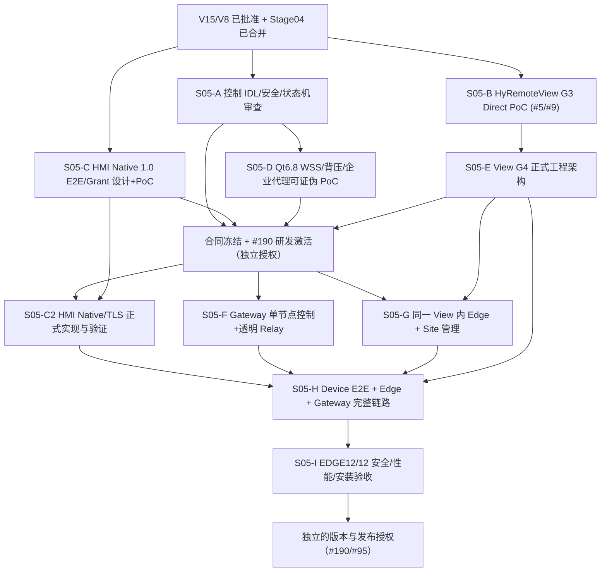

# HyRemote Stage 05｜Managed Edge/Gateway 工程实施 DAG 与验证计划（设计候选 V1）

> 跟踪 [#839](https://github.com/skawu/HyRemote/issues/839)；上位基线 HYR-PD-001/V15、HYR-ARCH-001/V8，输入 [Stage04 #838](https://github.com/skawu/HyRemote/pull/838) 三份设计和 HyRemoteView [G3 #5](https://github.com/skawu/HyRemoteView/issues/5)。**文档规划不等于实现批准**。#190 保持 POST_GA_CONDITIONAL；现行 SDK release train 不变；ADS 工程门禁已废止，不得作为隐含依赖重启。

## 1. 本轮要交付什么，而非先造什么技术

产品成功的最小真实演示：某工厂两台安装 HyRemote Framework 的 HMI、工厂 PC 上**只安装 HyRemoteView**并明确共享 HMI1、外地 PC 安装同一 HyRemoteView 产品、一个可自托管 Gateway。外地 View 只能够通过受管通道访问经过批准的 HMI1；HMI2 和其他工厂网络资产不可访问；HMI1 的设备身份/查看/控制由 HMI 自己最后裁决；Gateway/WAN 失效时现场 HMI 与 Direct 仍正常。

**明确非目标**：任意 TCP/网段代理、第二个厂内 Agent、二次采集/二次编码、桌面级全系统远控、现有 RFB 明文公网、默认 24×7 注销后在线、发布服务端集群。产品愿景不能取代所需的 Native E2E 和真实 Viewer 资格。

## 2. 依赖图：设计可并行；正式代码分段准入

- S05-A 是当前**纯设计**工作，完成文档审查也不允许宣称 Native E2E/Managed Public 可用。
- S05-B 继续执行既有 HyRemoteView #9 的最小 Direct RFB PoC、RemoteSurface 与安全性能资格，**不要创建重复的 Gateway PoC 取代它**。#5 G3 未 PASS → G4 正式架构和产品代码不进入批准态。
- S05-C 的 Native 1.0 严格由 V8 附录 A 决定；Framework 端 Qt5.15/Qt6.8 使用同一 Core/Shared Runtime，不因某个平台能做特殊 GPU 加速而私自换协议。
- S05-D 可以先以测试字节和无真实设备的封闭场景证明网络库边界，**不需要先做工厂公网产品服务**；它不会授予 HMI 观看/控制许可。
- **正式产品代码准入闸门**：S05-A/C/D 技术设计与最低可证伪实验形成完整签收，S05-B G3 通过且 S05-E G4 产品工程架构正式冻结；同时 #190 必须经过独立研发激活/范围批准。上述任一条件缺失，S05-C2/F/G 都不得创建正式产品实现。技术 PoC 与产品实现不能借同一“已设计”状态混用。
- **S05-C2 明确补齐设备端正式实现**：S05-C 的单元 fixture/技术 PoC 不能代替 Qt5/Qt6 Framework Native 端点、真实身份与授权在源码和设备上的完备验收；S05-H 必须依赖 C2 通过。
- S05-F 的 Gateway 是云端或客户自托管可选服务，不部署在工厂 PC 上；S05-G 的 Edge 必须封装在相同 HyRemoteView 的产品安装/授权/更新/卸载体系内。
- S05-H 只有在 Native Device TLS/Grant、View G3/G4、Gateway/Edge 三个实际能力都合格后才有真实 E2E 演示资格。先完成设备端身份与安全，会话无授权时必须零画面。
- S05-I 属于目标设备/工厂真实网络与产品安装验收；文档、模拟 Gateway、unit tests 都不能代替。

## 3. 工作包、Owner 与准入/准出证据

| 包 | 最小产出 | 前置 / Owner 边界 | 可证伪退出条件 | 状态 |
| --- | --- | --- | --- | --- |
| S05-A | 一份统一控制 IDL 与安全状态机；独立 WBS；审查差异 | Stage04；Cloud Owner / HyRemote 设计仓 | 字段认证来源、所有撤销竞态、非法消息处理及产品条款可追踪；PR 审查通过 | DESIGN_CANDIDATE |
| S05-B | 复用 View #5/#9 现有 RFB PoC，像素/输入/Direct/压力 | HyRemoteView Local PoC Owner；不改 Framework API 迁就测试 | exact SHA+Windows/Linux 各自真实测量；G3 Review PASS 才继续 G4 | NOT_PASSED |
| S05-C | Native 1.0 TLS+身份+View/ControlGrant+输入最终栅栏实现前规格、fixture，再有界 PoC | HyRemote Framework / Native Owner；#246；V8 wire | 伪造身份、无 ViewGrant、旧 GrantEpoch、遮罩变更、断线旧输入均拒绝；Qt LTS 不改 Core | DESIGN_ONLY |
| S05-D | Qt6.8 WSS 单控制+数据连接限制、代理/失败关闭最小实验 | View 侧公开 Qt API；Cloud 网络/安全 Owner，测试工具非产品代码 | 真实 setReadBufferSize/frame/message caps、写队列/OS 可观测上限、非法 TLS、慢端回收、代理行为 | NOT_RUN |
| S05-E | G4 View 正式模块接口/目录/测试模型 | 依赖 S05-B G3 真实 PASS；View Architecture Owner | Direct、Managed 复用 DeviceProtocolSession，Qt Quick UI 不介入 Edge IO；设计正式签收 | NOT_AUTHORIZED |
| DESIGN-FREEZE | 完整模块 IDL/状态机/安全取舍/资源预算方法/接口/打包边界签收；#190 的正式研发激活单独确认 | S05-A/C/D/E 与真实安全 PoC 证据；Cloud Owner 汇总，重大产品/架构取舍与激活由 Human 决策 | 所有 P1/P2 设计缺口收口，实施范围/非目标/回退已固定；否则仅允许继续设计/封闭技术 PoC | NOT_AUTHORIZED |
| S05-C2 | HMI Framework 正式 Native TLS/Native 1.0 设备会话、Grant/输入栅栏与双 Qt 版本验证 | S05-C + DESIGN-FREEZE；HyRemote Native Owner/#246 | 真实 HMI 安全连接、设备身份证书、View/ControlGrant、隐私/撤权/断线输入和 Qt5/Qt6 源码证据；无云代理授予权限 | NOT_STARTED |
| S05-F | 自托管 Gateway 最小单节点 Registry/Broker/Relay 的工程实现 | DESIGN-FREEZE + S05-A/D；Gateway Owner/待定仓库 | 租户隔离、Pair 单次消费、路由双端绑定、限额、证书轮换、升级/回退；不读取设备内容 | NOT_STARTED |
| S05-G | 同一 View 安装包内共享白名单、EdgeAdmission、ByteRelay、准确 UI 状态 | DESIGN-FREEZE + S05-E，S05-A 字段约束；HyRemoteView Edge Owner | 默认 OFF；仅 HMI1 注册后可以拨号；撤销立刻生效；同安装/卸载/退出不引入 sidecar | NOT_STARTED |
| S05-H | 外地 View → Gateway → 工厂 View Edge → 真实 HMI Native/TLS E2E | S05-C2/E/F/G 各自合格；联合 Owner | View 独立验 HMI 身份，设备端再核发 Grant；替身 HMI/撤权/重连均失败关闭 | NOT_STARTED |
| S05-I | 12/12 EDGE 产品结果、独立安全、资源/生命周期真实验收 | S05-H；本地/实机 Owner 和 QA/Security | 记录 exact SHA、场景、CPU/帧龄/RSS、慢端、现场优先、安装升级、真实代理/断网 | NOT_RUN |
| Release | 独立受管功能发布/支持资格 | S05-I + #190/版本授权；Release Owner | 实际支持平台和产品范围可证，不能用规划替代版本签收 | NOT_AUTHORIZED |

“Owner”是**工作责任边界**而非当前已经下发到运行 Agent 的任务；没有现场或本地执行者 ACK 时不能写已交付。普通设计审查由 Cloud Owner 连续完成；真正新的产品/安全权利取舍、正式设计冻结和发布范围由 Human 另行批准。

## 4. 首个可执行垂直切片与选择顺序

**研究/PoC 与正式产品实施严格区分**：

1. **先核实真实 View #9 当前 PoC**。获取明确 exact SHA 与 Windows/Linux RFB 像素/输入/解析限制证据；仅在目标能力不足时缩小实验，不重建新的 RFB 客户端工程。Direct 必须能在没有 Gateway 时使用。
2. **并行完成 HMI Native 1.0 Device TLS/Grant contract review**。对 V8 附录 A 的消息、限额、Session/Scope 授权和 Qt GUI 最终输入执行点做 trace；发现设备协议缺口时由 HyRemote 独立 Issue 审查，不偷改 Gateway wire。
3. **最小无 HMI 字节隧道试验**（只有技术/安全实验准入后）：一异地测试端、一模拟 Edge、一个 Gateway broker，使用随机二进制双向 hash、跨租户恶意 Pair、慢端/进程退出，不打开生产 HMI，也不称真实公网安全。
4. **Device E2E 资格先于宣称公网 Managed 可用**：受管 ByteStream 内通过实际 Native Device TLS、HMI 自己的 Native Auth / ViewGrant / ControlGrant；中转 TLS 只保护各段，不替代设备端加密。
5. **最小产品化**：在 View G4 合格后，先完成管理员“登记单台 HMI→明确共享→可撤销”与异地“申请指定 HMI→证书/Grant→看/控/拒绝”用户旅程；再扩大多 HMI/多 Viewer、后台运行/自托管运维支持。
6. **最后实机验收/版本适配**：两 HMI、工厂 PC、远端 PC、Gateway；Direct 与 Managed A/B 测现场 CPU/帧龄/内存、WAN 背压、故障恢复、安装/卸载，按实际 Kit/硬件给出支持等级。

禁止“先把 Gateway 生产端口打开跑起来，等安全功能补齐再宣称支持”；禁止因想加速将 HMI 画面在工厂 Edge 二次抓取或重编码。每个 PoC 要回答一个可否证的问题；不因失败扩大成 16 格超长矩阵。

## 5. EDGE-01～12 产品结果与研发切片映射

| EDGE | 关键产品事实 | 首次可证伪包 | 完整签收包 |
| --- | --- | --- | --- |
| 01 | 工厂 PC 只安装一个 View，站点 Edge 可启停 | S05-G 安装列表/启动退出 | S05-I |
| 02 | WAN/Gateway 故障仍可 HMI 本地与 Direct | S05-B 本地 Direct、S05-G 隔离 | S05-I |
| 03 | 默认无 HMI 共享，不能异地枚举 | S05-A ACL fixture、S05-G UI | S05-I |
| 04 | 不共享 HMI2/网段其他资产 | S05-A endpoint binding、S05-D 负测 | S05-H/I |
| 05 | 同名跨厂 HMI 不串站或换证书 | S05-A ID/租户/设备绑定 | S05-H/I |
| 06 | Route READY 但 HMI 不允许 View 时无像素 | S05-C Grant + S05-A route 分离 | S05-H/I |
| 07 | 看与控分离，现场撤权后无新输入 | S05-C 最终输入栅栏 | S05-H/I |
| 08 | Gateway 不见明文画面/输入/令牌日志 | S05-A 数据边界、S05-D 字节流 | S05-H/I 安全 |
| 09 | 断开/恢复状态真实、不复活旧授权 | S05-A 状态竞争/epoch fixtures | S05-H/I |
| 10 | 窗口/退出/注销/重启/升级真实行为 | S05-G 生命周期与支持声明 | S05-I 平台实测 |
| 11 | 多 HMI/Viewer 现场优先、资源受控 | S05-D 缓冲与 S05-C 合帧 | S05-I CPU/帧龄/队列 |
| 12 | 云许可/在线失效不取消合法 Direct | S05-B 原始 Direct 与状态隔离 | S05-I |

最终任何一种证据的 PASS 不能代替别种 Gate：`DOCUMENT_REVIEW_PASS`≠`G3_PASS`≠`HMI_E2E_PASS`≠`PRODUCT_EDGE12_PASS`≠`RELEASE_APPROVED`。

## 6. Qt 5/Qt 6 适配边界、成本与平台策略

- **View 端**：既定 Qt 6.8/C++17/Qt Quick/CMake；Network/Edge 选择应优先公开 Qt6.8 `QWebSocket`/`QSslSocket`/`QTcpSocket`；QML 只展示可观察状态，不执行流量中继、证书策略或解码。不能用未来 Qt6.12 API 证明 Qt6.8，需具体 Kit 编译+恶意输入/缓冲验证。
- **HMI Framework 端**：同一 Core+Shared Runtime/四接入（C++、QML、Generic、QPA），Qt5.15/Qt6.8 差异由 Runtime 私有适配处理；Native 1.0 wire 以 V8 附录 A 为跨版本合同，不在控制 wire 中传 Qt QVariant/QDataStream 或 GPU 指针。是否加速采集与当前 #609/#789 性能专项独立，不把 Windows 原生截图 API 变为全平台默认。
- **实际测试**：最低先对 Windows/Qt6.8 View、Windows Qt5/Qt6 HMI 的适用单元验证协议/撤权；Linux/ARM/EGLFS 作为目标设备产品范围需按真实验证标 `NOT_RUN`/`UNQUALIFIED`，不可把 Windows 结果泛化为“所有 Qt 平台 Supported”。HyRemoteView #9 的 Windows+Linux G3 gate 仍按该 Issue 执行。
- **成本**：Gateway/Edge 只路由原有 Native 安全字节，无额外图像采集、图像格式转换或 Viewer 专属编码；控制/数据队列、TLS 计算、HMI 帧生成与 View 解码/Qt Quick 呈现分别测。比较 0/1/2 Viewer、静态/局部/高动态时分别记录 HMI CPU、View CPU、工厂 Edge CPU、Gateway CPU、帧龄/吞吐/RSS/队列高水位，不能将任意一个进程 CPU 归因给编码器。

## 7. 当前要做与必须等待的设计决策

| 议题 | 目前依据与倾向 | 不可提前假定 | 决定所需证据 |
| --- | --- | --- | --- |
| 控制 IDL 载荷 | 逻辑 schema 一份；JSON、CBOR 比选 | `major=0` 即正式 wire、Qt 私有序列化 | 跨语言 parser、安全负测与版本演进 |
| Gateway Edge 身份 | 绑定安装实例密钥、优先比较 mTLS | bearer token 长期可复制、隐式跳过 TLS 错误 | 密钥保护/轮换/证书失效/自托管运维 |
| WSS / HTTPS Connect | Qt6.8 WSS/TLS 为最小验证候选 | 443 一定穿所有企业代理 | 真实代理/证书链/缓冲限额/断网恢复 |
| 后台常驻模式 | 同一 View 安装/许可体系，首验登录期 | Windows 服务=全部平台可用/自动 24×7 | 注销/重启/权限/升级/卸载各 OS 验收 |
| 安全 RFB Managed | 独立协议保留，但当前 VNCAuth 不加密 | 经 WSS 即安全 E2E | 独立经过证明的设备端等效保密方案 |
| 规模与响应指标 | 先测典型工厂 PC、真实 WAN | 8 路/256KiB/30秒等候选就是合同 | 稳态与故障数据、用户结果与成本评审 |
| Gateway 工程语言/仓库 | 单节点、易维护自托管优先 | 先建微服务/数据库集群 | 安全更新、许可证、部署/回滚成本比较 |

**Human 参与触发**：出现改变“工厂仅装 View”、Direct 离线、设备端最终权利、RFB/Native 双独立协议、用户注销后可用支持承诺等**实质性产品/架构取舍**，或需要正式阶段冻结/发布准入时提交决策；普通协议技术比选、文档审查和下一项可独立执行的 PoC 不依赖反复人工转发。

## 8. 交付/评审检查与当前结果

**Stage05 文档出门自检**：
- [x] V15/V8 与 Stage04 的产品/跨域信任不变量已明确继承；
- [x] 保留 12/12 EDGE 用户可观察结果和 Owner；
- [x] 设备 Native 1.0 与 Gateway IDL 明确分离；
- [x] 调用/错误/撤销/队列及跨 Qt LTS 边界具备负向检查；
- [x] ADS 不再是工程 Gate，G3 技术证据仍有实际前置；
- [ ] PR 独立审查通过、当前 develop exact-SHA readback；
- [ ] View G3 在真实 Windows/Linux 以 raw evidence PASS；
- [ ] Native Device E2E/路由安全、企业代理/缓冲/安装、EDGE12/12 实测。

**当前精确状态：** `STAGE05=DESIGN_PR_PENDING_REVIEW`；`DETAIL_CONTRACT_FREEZE=NOT_APPROVED`；`GATEWAY_IMPLEMENTATION_ACTIVATION=NOT_AUTHORIZED`；`VIEW_G3=NOT_PASSED`；`NATIVE_DEVICE_E2E=NOT_IMPLEMENTED`；`GATEWAY/EDGE=NOT_IMPLEMENTED`；`MANAGED_PUBLIC=NOT_QUALIFIED`；`POST_GA_RELEASE=NOT_ACTIVATED`。以上未完成项不成为阻止独立设计审查/技术研究的理由，也不能误记已 PASS。